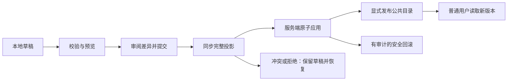

# 后台管理差距评估与优化方案

日期：2026-11-15。性质：基于用户故事、源码和本地页面的评估与实施建议。差距记录对应本轮修改前的基线，第一阶段的修复和验证结果见文末。不改变故事状态和既有验收记录。

## 判断

✅ 值得做。后台已有外壳、登录、授权、账号与账本接口，但页面没有形成完整的运营工作流；配置迁移还造成了功能缺口。应保留现有后台外壳和公共组件，先修正确性，再交付用户与积分、模板发布、任务排障的完整路径。

🟡 基础能力可以复用；🔴 当前业务页面不满足完整日常运营。不能用旧故事的 Done 或底层契约测试通过，代替当前页面验收。

## 评估依据

- 在真实本地服务检查 `/users`、用户详情与积分、`/templates`、模板新增弹窗、`/policies`、`/tasks`、`/audit` 和 `/account`。只查看页面、打开并关闭表单、修改查询条件，未提交资料、积分、模板或封禁操作。
- 浏览器实测：模板列表的当前查询数量为 1，但表格 canvas 实测高度为 0，页面看不到已有记录。
- 浏览器实测：模板工具栏显示 `text.*`，新增弹窗显示 `detail.basic`、`common.save` 等键；模板表单直接展示工作区、修订号、配置分支和删除时间。
- 浏览器实测：填写起止时间并应用任务筛选，两个 `/rest/v1/media_task_reports` 请求均没有 `started_at` 约束。
- 浏览器实测：用户详情出现在列表下方；审计显示 `content-save`、`trusted-membership` 和原始 UUID；直接访问 `/account` 被重定向到 `/users`。
- 对未做数据写入、断网恢复或多账号复现的内容，以下明确标记为源码判断或待验证风险。
- 证据仅覆盖本地环境；生产双部署状态不能由本次页面检查推定。

## 用户故事与页面对照

| 故事 | YAML 当前状态 | 要求 | 当前差距 |
| --- | --- | --- | --- |
| [MEDIA-US-203](../stories/account/MEDIA-US-203-business-admin.md) | Done | 用户管理、模板发布撤回、任务筛选、来源明确的用量、可追溯审计 | 用户列表和封禁入口存在；模板发布路径缺失、时间筛选失效、用量范围错误、审计缺少详情。当前代码需要回归验收 |
| [MEDIA-US-206](../stories/account/MEDIA-US-206-credit-admin.md) | In Review | 查用户、增减积分、完整流水、原因、原子幂等 | 余额和调整入口存在，但入口隐蔽；新接口忽略更早流水游标，查询超过 50 条时不能获得完整历史 |
| [MEDIA-US-207](../stories/account/MEDIA-US-207-admin-account-profile.md) | Backlog | 当前管理员名称、身份菜单、自己的账户详情与资料保存 | 顶栏只有邮箱和退出按钮；无 `/account` 路由、资料页及名称流程。这是尚未实现的故事 |
| [MEDIA-US-208](../stories/account/MEDIA-US-208-supabase-admin-boundary.md) | In Progress | Supabase Auth、普通数据直连、Auth 管理走 Edge Function | 登录和接口分流存在；直连迁移后的查询、游标和字段契约不完整，积分查询与调整仍走 Edge Function |
| [MEDIA-US-307](../stories/local-first/MEDIA-US-307-admin-rxdb-model.md) | In Progress | 模型驱动配置列表、详情、表单、校验、离线编辑与状态恢复 | 接入了 Entity List，但已有记录对应的表格画布高度为 0；业务表单不完整、模型文案目录缺失、平台模型没有页面入口、离线恢复缺少真实证据 |
| [MEDIA-US-308](../stories/local-first/MEDIA-US-308-config-branch-commit-sync.md) | In Progress | 修改、提交、投影、应用、发布、冲突与恢复 | 有投影监听和部分应用/回滚代码，但当前页面没有创建提交、差异审阅、完整发布或撤回操作 |
| [MEDIA-US-306](../stories/local-first/MEDIA-US-306-backend-rxdb-sync.md) | In Progress | 后台 RxDB 双向同步和崩溃恢复 | 是配置链路的依赖；不能凭页面存在分支状态文字，就宣称真实同步、恢复或发布已完成 |

[MEDIA-US-108](../stories/generation/MEDIA-US-108-platform-generation.md) 定义当前平台积分生成与扣费语义。[MEDIA-US-205](../stories/account/MEDIA-US-205-platform-billing.md) 仍是 Backlog，支付、充值与退款不纳入本方案。

## 已确认问题和源码风险

| 编号 | 优先级 | 问题、证据与影响 | 建议 |
| --- | --- | --- | --- |
| G14 | P0 | 浏览器实测模板列表查询数量为 1，但 `canvas` 高度为 0，已有记录不可见；不是简单的空数据状态 | 先定位宿主布局与表格初始化的尺寸契约；在真实组件里验证记录、列头可见及切页/调整窗口后仍正常 |
| G01 | P0 | 模板页和新增弹窗显示翻译键。宿主只通过 `createAdminI18n()` 注册外壳目录，模型组件使用同一运行时却查 `rxdb-model` 目录 | 组合注册外壳与 `modelMessages`，统一语言设置；用真实组件渲染验收按钮、字段和错误文案 |
| G02 | P0 | 任务时间筛选没有进入请求。`ProductClient.directReports()` 只处理 userId/model/channel/status，遗漏 from/to；浏览器已复现 | 将带时区的起止范围转成明确的数据库条件，前端与接口都验证合法性；列表与汇总复用同一筛选契约 |
| G03 | P0 | 用量直连路径固定 `limit=100` 并直接汇总；100 条即 `partial=true`，页面却提示“达到 10000 条上限” | 使用受保护的聚合 RPC 或完整分页；返回真实统计范围、截断标志和数量，页面照回执展示 |
| G04 | P0 | `olderCredits()` 发送 `before`，Edge Function 的 `credits()` 固定查询最新 50 条，未处理游标 | 完成受保护的账本查询契约；按稳定游标分页，返回下一游标，支持返回最近流水，验证无重复与遗漏 |
| G05 | P1 | 新增模板表单暴露工作区、revision、branch、deletedAt；领域实体与投影只保留 key/title/prompt/purpose/style/tags/enabled，缺少公共模板契约中的封面、来源版权、字段和结构化正文等 | 业务字段分组，系统字段只读或自动赋值；补齐领域模型、投影和发布 DTO 的无损映射，再接预览与发布 |
| G06 | P1 | 配置页监听 `commits$`，但 Admin 应用未找到触发 `workingTree.commit()` 的产品入口；现有模板页也没有发布/撤回按钮 | 增加本地保存、审阅差异、提交说明、应用与发布动作；各阶段展示真实回执 |
| G07 | P1 | `apply_media_config_commit` 写入 `media_config_records`；当前应用代码未发现把该应用结果发布到 `media_public_content` 的完整桥接。普通发布接口存在不代表新模型编辑流程已经接上 | 定义唯一编辑来源和发布服务，区分配置应用与公共目录发布；以普通用户实际读取发布版作为验收终点 |
| G08 | P1 | 用户详情与积分表单堆在列表下方；列表未显示注册/最近登录等已有字段；调整用正负数表达，缺少直观的变更预览 | 用户列表配详情路由；概览、积分流水和操作记录分区；增加/回收显式选择，并展示目标账号与余额变化 |
| G09 | P1 | 审计接口已取 `before_data`/`after_data`，前端 `AuditEntry` 和模板没有展示；页面只有最近 100 条原始动作与 UUID | 增加动作中文名、对象和操作者识别、前后版本差异、结果及关联请求；分页和过滤补齐接口契约 |
| G10 | P1 | `/account` 未注册，顶栏无身份菜单，资料需求完全未接线 | 按 MEDIA-US-207 完成自己的资料与名称，复用 MEDIA-US-208 当前授权边界 |
| G11 | P1 | 源码风险：`hydrate()` 先等网络、工作区与远端草稿，随后才连接本地数据库；`hydrateTemplates()`/`hydratePolicies()` 对已有记录直接 update，未见脏数据保护 | 本地已有数据先恢复；远端同步走明确 revision/冲突策略。必须用真实离线刷新和未提交变更复验，当前不宣称已发生数据丢失 |
| G12 | P1 | 源码风险：`permissionDenied()` 只显示提示，Entity List 仍渲染；未准备好 workspace 时 fixedQuery 为 undefined | 权限和当前工作区未准备好时不开放编辑；账号切换隔离本地缓存与在途结果，真实撤权和切换测试后关闭风险 |
| G13 | P1 | 配置页突出 RxDB、working-tree、projection 等实现术语；用户页和配置页不在同一内容布局中，主题样式也不一致 | 共用内容容器、标题和状态组件；主界面使用草稿、待同步、待发布、已发布、冲突等业务状态，技术详情放折叠区 |

主要源码证据：

- [后台路由](../../apps/admin/src/app/app.routes.ts)、[菜单](../../apps/admin/src/app/admin-shell.ts)、[页面组装](../../apps/admin/src/app/app.html)、[i18n provider](../../apps/admin/src/app/app.config.ts)。
- [后台业务模板](../../apps/admin/src/app/admin-console.html)、[业务交互](../../apps/admin/src/app/admin-console.ts)、[直连接口](../../apps/admin/src/app/product-client.ts)、[Edge Function](../../infra/supabase/functions/admin-api/index.ts)。
- [配置页面与水合](../../apps/admin/src/app/admin-config-model.ts)、[配置投影](../../apps/admin/src/app/admin-config-projection.ts)、[领域实体](../../packages/domain/src/media-config.ts)、[完整模板契约](../../packages/api-contracts/src/prompt-template.ts)、[应用 RPC](../../infra/supabase/migrations/020-admin-direct-config-apply.sql)。
- [模型 i18n 接线](../../../packages/rxdb-model-angular/src/i18n.ts)、[模型文案目录](../../../packages/rxdb-model/src/messages.ts)、[外壳文案工厂](../../../packages/rxdb-admin/src/i18n/index.ts)。

## 先统一需求口径

1. MEDIA-US-203 与 [D-19](../decisions.md) 明确移除旧供应商策略管理；MEDIA-US-307 又把 Provider Policy、平台模型和工作区配置列入范围。建议本轮菜单移除旧供应商策略入口，保留底层兼容实体；如需平台运行配置，先明确可编辑字段、审批/发布与运行时生效链，不把旧用户供应商页面改名后继续交付。
2. MEDIA-US-207 的技术笔记仍描述 Worker/service role 资料接口，与 MEDIA-US-208 的普通业务直连方向不一致。实施时统一到 208：普通资料通过有身份约束的 RLS/RPC；涉及 Auth 管理或其他特权动作才使用 Edge Function。207 的业务验收保持不变。
3. 203、206 的既有验收记录保留，但当前迁移回归必须重新留证。307、308 已明确仍在进行中，不能把通用实体列表接入当作整个故事完成。

## 页面组织建议

保留 `/users` 作为默认入口，复用现有 Admin 外壳。第一轮主导航围绕四项工作组织：用户与积分、模板管理、任务与用量、操作审计。账户资料放顶栏身份菜单。平台配置仅在范围、生效链和页面都可验收后加入导航。

| 页面 | 建议地址 | 主任务与布局 |
| --- | --- | --- |
| 用户与积分 | `/users` | 邮箱/账号检索、账号状态筛选、注册与最近登录信息、分页；用户身份优先于 UUID，详情与积分入口清晰可见 |
| 用户详情 | `/users/:id`，用 query 参数保存当前分区 | 概览、积分流水、相关已上报任务、操作记录；直接链接与刷新可恢复当前对象 |
| 模板列表 | `/templates` | 明确内置/远端草稿/已发布来源，按状态与分类查找；空态说明目录来源并提供合法的新建入口 |
| 模板编辑 | `/templates/:id` | 基本信息、提示词与参数、封面与来源信息；编辑和用户端效果预览并排，状态及保存动作固定在页面可见位置 |
| 提交与版本 | 模板详情的版本分区；跨配置提交在后续按 308 提供统一入口 | 修改差异、提交说明、校验、应用、发布、拒绝原因与安全回滚 |
| 任务与用量 | `/tasks` | 用户检索、模型、时间范围、状态、来源；列表与汇总共享筛选，明示数据覆盖范围 |
| 操作审计 | `/audit` | 操作、人员、对象、时间、结果过滤；打开记录查看允许展示的差异与关联项 |
| 我的账户 | `/account` | 名称可编辑；邮箱、UUID、注册/登录时间、管理员资格与产品访问状态只读 |

旧 `/users`、`/templates`、`/tasks`、`/audit` 地址保持可用。`/policies` 先保留明确的兼容提示或只读入口；有真实替代页面后再做迁移跳转，不能静默跳到无关页面。

### 用户与积分

- 检索用户后即可进入详情；列表不再让 UUID 占据主要视觉位置，支持复制完整标识。
- 详情顶部显示账号、访问状态、注册/登录时间及可用积分；积分明细区区分余额、预占、可用数额。
- 调整使用“增加/回收”加正整数，提交前显示目标账号、变化数额、当前与预期余额、原因。确认结果以服务端账本为准。
- 请求未确认时保留同一幂等 requestId；不能把重试变成第二笔调整。并发余额变化时重新读取并说明结果。
- 封禁使用包含目标邮箱和影响范围的产品对话框，保留最后有效管理员保护与“登录限制待确认”的中间状态；操作成功后定位仍在当前用户。
- 流水支持稳定分页、来源识别、操作人识别和请求/任务关联；新增筛选能力实施前补入 206 验收，不承诺财务报表或全站账本导出。

### 模板编辑和发布

- 通用模型组件继续负责列表、表单、校验与查询；应用通过字段元数据、分组和有限的专用编辑控件表达业务，不另造整套 CRUD 框架。
- 系统字段由当前身份、工作区和服务端管理。模板正文、参数字段、封面/替代文本、作者/来源/版权、用途、风格、标签等按已有公共契约完整保存，不在投影时丢失。
- 内置目录和已发布目录来源明确。内置内容可只读查看；如需编辑，使用显式的创建草稿动作，保持原标识与来源关系，不自动覆写用户草稿。
- 页面提供主操作：保存草稿、预览、审阅变更、提交、发布、撤回。撤销未提交编辑与回滚已应用配置是不同动作，文案分别说明。
- 分支、提交 ID、revision 和同步协议放高级信息；主界面始终说清“只保存在本机”“已同步但未发布”“普通用户已可见”。
- `applied` 不等于 `released`。发布需要完整校验、原子回执与公共目录生效验证，失败时保留编辑和旧发布版；冲突时展示双方差异并提供恢复路径。
- 冷启动和离线刷新先显示当前账号本地已有内容，网络恢复后再同步；不能用远端旧草稿覆盖本地未提交编辑。

目标链路：

### 任务、用量与审计

- 用户通过邮箱/账号选择，日期使用带时区说明的范围控件和常用时段；提交时生成规范时间边界。UUID 与 ISO 字符串保留在可复制详情中。
- 明确“平台已收到/用户已确认上报”的覆盖范围；没有上报不等于没有任务。平台真实处理记录的接入需核对来源，不能用本机任务数补齐平台统计。
- 用量展示实际统计窗口、来源、已知数值和未知条数；截断时明确范围，列表翻页不能悄悄改变汇总口径。积分、供应商用量、已核验费用分开表达。
- 任务详情关联请求、用户和允许公开的状态信息；默认不展示私有提示词、原图、凭据或本地路径，不提供自动重跑付费任务。
- 审计把动作代码翻译成“调整积分”“封禁账号”“发布模板”等；前后版本使用字段白名单的差异展示，关联操作者、目标、请求及结果。

### 我的账户和全局体验

- 顶栏身份入口显示名称和邮箱，下拉进入自己的账户或退出；名称字段与保存遵循 MEDIA-US-207 的校验、CAS、审计和缺资料兼容。
- 使用真实路由页面承载各业务，逐步替换“所有路由都是占位组件、根组件手动切页签”的组装方式。保留外壳、原地址、历史页签与稳定存储标识。
- 所有页面共用内容宽度、标题、工具栏、表格、空态、错误与加载状态；配置页不再使用独立的硬编码白色卡片主题。
- 查询保留筛选、分页和对象定位；读取失败保留已知页面并提供重试，撤权则停止受保护操作并清理相应敏感视图。
- 先验收桌面浏览器的真实任务和键盘操作；按 307 的要求检查 WCAG 2.1 AA，不把本轮扩大成移动端后台项目。

## 实施顺序与关闭条件

| 阶段 | 优先级与规模判断 | 内容 | 关闭条件 |
| --- | --- | --- | --- |
| A：修正确性与产品接线 | P0，较小但涉及接口契约 | G01–G04、G14；修复表格可见性，统一文案运行时、时间筛选、真实用量范围、账本游标；确认 203/206 与 208 的迁移回归 | 真实记录与列头可见、无翻译键；日期区间改变实际查询；超过 100 条不误算；超过 50 条流水可连续读取且无重复遗漏 |
| B：用户与积分工作流 | P1，中等 | 用户详情路由、清晰的积分调整与结果、身份菜单和账户资料、关联审计；先统一 207/208 技术路径 | 一个真实管理员能查用户、核对积分、确认调整、看到关联流水和审计；自己的名称刷新/重新登录一致 |
| C：模板配置完成链路 | P1，最大且依赖 306/307/308 | 完整字段、预览、持久草稿、差异与提交、投影、应用、公共发布/撤回、冲突和恢复 | 从后台编辑到普通用户读到新发布版完整通过；断网、刷新、并发冲突、重复发布和拒绝均保留正确状态 |
| D：任务排障与审计效率 | P1/P2，中等 | 易用筛选器、任务详情、来源与未知范围、准确汇总、审计过滤分页与差异、统一样式 | 以真实上报记录定位一次失败；相同筛选下列表与汇总一致；审计能还原一次允许追踪的操作 |

规模是相对判断，不是工期承诺。C 阶段包含数据契约与发布链路，不能按“换表单”估算。若需要拆交付，按用户与积分、模板编辑发布等领域分期；领域功能与其 `packages/*` 公共能力改动仍在同一 PR 中统一评审和验证。

## 必须补的验收

| 场景 | 可判定结果 | 对应故事 |
| --- | --- | --- |
| 模板列表、新建、详情与错误状态真实渲染 | 已有记录和列头可见，画布高度正常；不出现翻译键，系统字段不可任意填写 | 307 |
| 起止时间及不合法日期/时区 | 有效范围进入数据库条件；非法输入明确拒绝 | 203、208 |
| 101 条以上任务及超过当前分页的数据 | 统计不静默截断，范围和数量提示真实 | 203、208 |
| 51 条以上积分流水 | 翻页稳定、无重复遗漏，可回到最新记录 | 206、208 |
| 增加、回收、重复提交和未知网络结果 | 只生效一次，不出现负可用余额，原因与操作者完整 | 206 |
| 封禁、最后管理员保护、登录限制待确认 | 界面和服务端状态一致，本机数据不删除 | 203、208 |
| 自己的资料保存、冲突与重新登录 | 顶栏和详情名称一致，撤权不能修改 | 207、208 |
| 本地草稿断网刷新、恢复网络与账户切换 | 草稿不丢失，旧远端版本不覆盖未提交变更，不串账号 | 307、308 |
| 模板完整字段往返及保存预览 | 封面、来源、参数与结构化正文无损，预览与用户端一致 | 203、307 |
| 提交、完整性校验、应用、发布、撤回与重复请求 | 应用和发布分开确认，公共目录真实生效，无重复审计 | 203、308 |
| 两客户端编辑和投影缺失 | 冲突/拒绝可恢复，不发布部分配置 | 307、308 |
| 一次积分或模板操作的审计回查 | 能识别谁、对谁、改了什么、前后版本、时间和结果 | 203、206、308 |

先写能够覆盖这些已知失败的测试，再实现并重构。当前 [配置组件测试](../../apps/admin/src/app/admin-config-model.spec.ts) 把真实模板和 imports 替换为空；[working-tree 契约测试](../../apps/admin/src/app/admin-working-tree.integration.spec.ts) 使用模拟事件源。它们有单元价值，但不能代替真实 RxDB、真实 Supabase 和当前 Admin 页面端到端验收。保持核心包 90%+、其他包 80%+ 的覆盖率门禁；公共组件若改变行为需验证 Angular/React/Vue 对称。

## 第一阶段实施结果（2026-11-15）

已完成阶段 A 的 G01–G04、G14，并修复真实生产构建验收发现的两处产品接线问题：

- 配置列表宿主提供确定高度，工作区尚未准备好或明确拒绝权限时不挂载编辑器；配置页进入外壳的内容区，使用统一内容宽度和主题变量。
- 宿主同时注册外壳与模型中文目录，并引入 `rxdb-model-angular/tailwind.css`。后者是生产构建中模型表格和弹窗所需工具类的来源，不能仅依赖开发环境样式。
- 后台生产构建关闭 `inlineCritical`，避免严格 CSP 拦截 CSS 启用脚本而导致页面样式失效。后台文档的 CSP 从安装服务的公开配置取得账号服务地址，允许连接该地址和对应 Realtime，修复本地 HTTP Supabase 被拦截的登录问题。
- 起止时间改为日期时间选择器，明确按浏览器时区解释，向列表和汇总发送统一的 UTC 范围；查询采用起始包含、结束不包含的边界。无效日期、缺时区、反向范围和无效页码在请求数据库前拒绝。
- 用量连续分页汇总至 10000 条，并额外读取一条判断是否真正截断；恰好 10000 条不虚报截断。界面按实际收到的记录数解释统计范围，保留来源、币种和未知量的区别。
- 积分账本按 `id < before` 读取更早的 50 条，拒绝无效游标，余额仍读取最新值；增加返回最新流水入口，空历史页也能返回。

验证结果：

| 检查 | 结果 |
| --- | --- |
| `aiao-media-admin:test` | 88 项通过，包含时间选择器、101 条汇总、10000 条精确边界和历史流水返回 |
| `aiao-media-supabase-functions:test` | 15 项通过，包含实际查询游标和非法游标拒绝 |
| `aiao-media-api:test` | Node 测试 20 项通过、1 项既有跳过；Vitest 4 项通过、2 项既有跳过，包含后台 CSP 回归 |
| 四项目 `lint` / 可用的 `typecheck` | 通过，未忽略 ESLint 警告 |
| `aiao-media-admin:bundle-security` | 生产构建与安全检查通过，无禁止内容或旧登录代理调用方 |
| `aiao-media-e2e:product-e2e --grep='后台 P0 回归'` | 3 项通过：真实配置表格/中文弹窗/切页和窗口变化；列表与用量时间条件；51 条真实流水分页和返回最新 |
| `aiao-media:requirements-check` | 检查器 17 项测试通过；整体仍被路线图与状态概览原有的 4 处失效锚点阻断，本轮新增文档无新增链接错误 |

浏览器回归使用本地 Supabase、新建的独立测试管理员和临时草稿；测试结束后清理这些测试数据。未对既有用户执行积分调整、封禁或模板发布。用量统计仍有明确的 10000 条读取边界，不宣称为任意规模的全量数据库聚合。

## 本次交付边界

本次交付评估文档和阶段 A 修复，不调整故事状态、AC 勾选或历史证据。B/C/D 阶段的用户详情与账户资料、完整模板提交发布、任务详情与审计增强尚未实施。生产环境部署、完整离线冲突恢复和无障碍复验不在本轮通过范围内。
