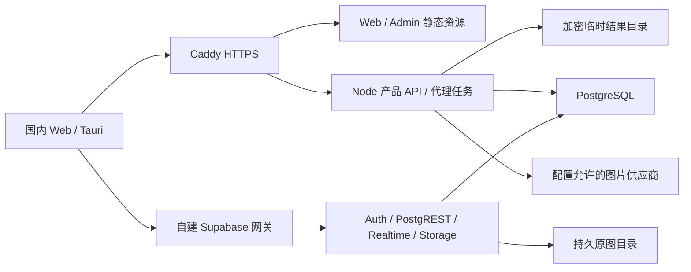

# 国内自建与海外托管双部署改善方案

方案日期：2026-11-09。状态：拟实施，尚未部署或通过双环境验收。

用户已明确两种部署方向：国内使用 `ssh aliyun-self` 对应服务器和自建 Supabase，海外使用 Cloudflare 与 Supabase 托管服务；该服务器的旧业务数据允许清理。此次只读巡检没有停止服务、清理数据或变更系统。后续实施沿用这项清理授权，清理对象为该主机的旧业务，不涉及海外项目或客户端本机数据。

本计划记录技术方案与实施顺序，不修改现有 story 的状态或验收结论。开始实现前，将国内部署范围及下列验收条件落实到产品 story，并更新 [D-13/D-15/D-16](../decisions.md) 的部署表述。用户使用的仍是运营方维护的平台账号，不恢复用户自行配置 Supabase 项目的入口。

## 服务器实测与容量判断

以下事实来自通过 `ssh -o BatchMode=yes aliyun-self` 执行的只读命令，检查时间为 2026-11-09；网络结果仅代表这次探测。

| 项目         | 实测结果                                                         | 对方案的影响                                                                   |
| ------------ | ---------------------------------------------------------------- | ------------------------------------------------------------------------------ |
| 操作系统     | Alibaba Cloud Linux 3.9，x86_64，Linux 5.10                      | 构建 Linux amd64 产物；容器引擎安装需验证发行版兼容性                          |
| CPU / 内存   | 2 个逻辑 CPU，3.5 GiB 可用总内存，无 swap                        | 首阶段按小流量验证设计，不能依据空闲状态承诺生产容量                           |
| 系统盘       | 40 GB，已用约 12 GB，可用约 26 GB                                | 原图、数据库、日志、镜像共同占盘，必须限制临时结果与轮转日志                   |
| 现有业务     | `new-api`、PostgreSQL 15、Redis 三个运行中容器                   | 用户允许清理重建，不为这些旧业务安排数据迁移                                   |
| 容器环境     | `docker` 实为 Podman 4.9.4 兼容命令，podman-compose 1.0.6        | 不能因存在 docker 命令便判定生产 Compose 可用；本机不支持 `docker compose ls`  |
| 现有数据位置 | `new-api_pg_data` 卷、`/root/new-api/data`、`/root/new-api/logs` | 实施时按容器挂载清理旧业务数据；同时检查无挂载的容器可写层                     |
| 监听端口     | 公网监听包括 SSH 与旧应用 3000；未发现 80/443 监听               | 新网关可占用 80/443；阿里云安全组与公网入站尚未验证                            |
| 宿主 Node    | v25.8.1                                                          | API 使用固定 Node 26 容器，不依赖宿主版本                                      |
| 镜像网络     | Docker Hub registry 一次连接在 5 秒超时；GHCR HEAD 返回 HTTP 405 | 前者不能据此认定永久不可达，后者仅证明收到 HTTP 响应；两者都未验证完整镜像下载 |

复验入口为 `uname -srmo`、`cat /etc/os-release`、`getconf _NPROCESSORS_ONLN`、`free -h`、`df -hT /`、`podman ps -a`、`podman stats --no-stream`、`podman inspect`、`ss -lntup`，不输出容器环境变量或私有配置。

推断：裁剪后的必要服务有机会在这台服务器承载小流量，但必须通过真实 Storage、并发生成与故障恢复测量。Supabase 官方完整组件最低为 2 核 / 4 GB RAM / 40 GB SSD，推荐 4 核 / 8 GB+ / 80 GB+。当前机器处于最低规格附近，公众生产建议提升到推荐配置；本方案不自动升级实例。

## 两种部署的目标结构

| 职责                      | 国内：aliyun-self                                 | 海外                            |
| ------------------------- | ------------------------------------------------- | ------------------------------- |
| HTTPS、静态资源、SPA 路由 | Caddy 与本地只读 Web/Admin 产物                   | Workers Static Assets           |
| 产品 API、供应商代理      | Node 26 API 容器                                  | Cloudflare Worker               |
| 代理任务状态与互斥        | Supabase PostgreSQL 中独立私有表                  | SQLite Durable Object           |
| 请求后的后台执行          | Node 进程持有上游请求，持久状态与恢复扫描配合     | Durable Object 后台请求与 alarm |
| 临时生成结果              | 本机私有目录中的加密文件，限时删除                | 私有 R2 bucket，限时删除        |
| 账号、元数据、实时同步    | 自建 Auth / PostgREST / Realtime / PostgreSQL     | Supabase 托管项目               |
| 用户原图                  | 真正的 Supabase Storage API，初期使用持久文件目录 | Supabase 私有 Storage bucket    |

建议首阶段国内外是独立的平台账号与数据区域，各自维护数据库、密钥、原图和备份。该项是本方案的建议，跨区统一身份与图库尚未被确定为产品需求。客户端绑定应包含稳定的部署标识与服务来源；切换区域不得复用另一区域的会话、工作区绑定或上传授权。DNS 调度不能隐式把已绑定客户端切换到另一套数据。

国内 Web、API、Supabase 使用明确的国内 HTTPS 域名；域名与 DNS 尚待提供。Web 与 `/api/*` 保持同源，Supabase 使用独立 origin。Tauri 构建显式指定国内 API origin 与同区域的公开 Supabase 配置。基础设施请求指向所选区域，供应商请求按该部署的允许列表发出。

## 需要修正的代码边界

### 公开部署配置

- 修复 [storageUrl](../../apps/web/src/local-data/image-sync.ts)：当前把任何非回环域名推导为 `*.storage.supabase.co`，自建域名必然访问错误服务。
- 公开配置显式提供部署标识、Supabase origin、公开 Key 和 Storage origin；海外填写官方 Storage 地址，国内填写实际网关地址。两种环境都不从域名首段推导项目身份。
- CSP、Realtime WebSocket、TUS endpoint、TUS Location 回执校验与离线配置摘要使用同一份配置。上传回执只能指向已配置的 Storage 服务，拒绝把访问令牌发送到其他 origin。
- [账号配置校验](../../apps/web/src/app/supabase-auth-config.ts) 已允许自建 HTTPS origin，继续保持 HTTPS 和禁止服务端 Key 的边界。
- [桌面打包](../../apps/desktop/scripts/package-desktop.mjs) 显式设置 `AIAO_MEDIA_API_ORIGIN`，国内构建不能采用 `media.aiao.io` 的缺省值。公开配置格式升级须验证旧配置加载与离线缓存更新，不删除本机库或原图。

### API 运行时与任务持久化

复用供应商校验、产品路由、任务 HTTP 契约、状态转换和结果加密。在现有 API 项目内增加 Node 入口，将 Cloudflare 绑定留在对应适配层；共享业务代码不依赖 `DurableObjectNamespace`、`R2Bucket` 或 `ASSETS`。只为两种实际部署所需的任务存储、结果存储和到期调度建立边界。

国内任务执行保持 [MEDIA-US-109](../stories/generation/MEDIA-US-109-relay-durable-task.md) 的行为：

1. PostgreSQL 私有表保存任务 UUID、令牌摘要、请求指纹、状态和截止时间，使用唯一约束与事务协调接单、重放和放弃；不持久化 Key、会话、提示词或请求正文。
2. 容量预检在调用供应商前完成；初始允许两个并发生图任务，容量满时明确拒绝接单。此数值是压测起点，依据整机内存和实际原图响应调整。
3. 接单成功后在同一 Node 进程立即向上游发请求，使用独立超时信号。浏览器关闭或客户端请求中止不取消已派发的任务；不引入需要持久化 Key 的异步队列。
4. 保留 180 秒上游超时、210 秒看门狗与 24 小时任务保留期。有界读取结果后，使用现有令牌派生密钥加密；文件先完整落盘，再原子提交文件名，最后更新任务状态。数据库记录提交失败时，恢复扫描核对文件与任务身份后收敛状态。
5. 进程启动与周期扫描检查逾期任务。已存在完整密文则恢复为 `received`；没有结果则进入 `needs_review`。使用任务状态与执行身份的条件更新，防止旧执行者覆盖已恢复或封存的状态。
6. 主机重启或进程崩溃可能使在途上游结果丢失。保持未知状态，不自动重试生成，也不承诺恢复供应商已经产生但尚未保存的结果。
7. 删除结果后保留任务封存行至到期，防止同 UUID 重放再次生成；到期扫描删除任务临时密文和行，不清理作品原图、冲突、tombstone 或同步日志。
8. 发布先停止接单、等待在途后台任务结束，再退出进程；停止等待上限覆盖 210 秒看门狗。`server.close()` 只处理 HTTP 连接，须另行等待后台任务集合。强制退出后的任务依照第 5/6 项恢复。

国内初期采用单 API 实例，任务状态放已有 PostgreSQL，结果放已有磁盘，不增加 Redis、MinIO 或第二个数据库。临时文件存储实现需覆盖原子写、查询、流式读、删除和容量统计。临时结果与用户原图使用独立目录和不同保留策略。

现有 [Cloudflare 本地替身](../../apps/api/scripts/cloudflare-stand-ins.mjs) 包含内存 R2，不能作为国内生产实现；`wrangler dev` 也不作为国内生产服务入口。

## 国内基础设施

- 根据 Alibaba Cloud Linux 的包来源与冲突情况安装并验证真正的 Docker Engine、Compose 插件和开机启动，清理旧 Podman 兼容入口与旧业务的启动项。Docker 对发行版衍生系统不提供自动兼容保证，安装结果必须用实际 daemon、Compose 配置解析、健康检查和重启验证。
- 使用固定版本的官方 Supabase Compose 与配套网关，保留 PostgreSQL、Auth、PostgREST、Realtime、Storage。首发裁剪 Studio/meta、分析日志、Edge Functions、图片转换和额外连接池等当前不用的服务，验证依赖后移除。
- 启用真实 Storage API 与持久卷，不能使用 [本地 Storage 表替身](../../infra/supabase/migrations/001-local-storage-standin.sql) 代替。同步原图使用私有 bucket、工作区 RLS 和与海外一致的产品迁移；临时代理密文使用独立 API 私有目录。
- Caddy 暴露 80/443，SSH 保持可用；数据库、API 容器和管理入口只走内网或回环。通过外部请求与阿里云安全组核对真实端口可达性。正确转发 WebSocket、TUS 方法与必要头，产品 API 根据可信网关还原公开 origin。
- 配置生产 SMTP、注册确认回调与密码找回；管理员页面可读取到页面不等于已通过管理员鉴权。所有密钥由服务器私有部署配置注入，不进入前端、镜像或日志。
- 静态资源与 API 镜像在本地或 CI 构建，服务器只接收 Linux amd64 发布产物。镜像优先使用已验证可拉取的受控仓库；也提供构建端导出、经 SSH 上传、校验摘要后导入的交付路径。不能把一次 registry HTTP 成功当成镜像拉取成功。
- 同一版本关联前端资源摘要、API 镜像摘要、数据库 schema 版本和部署配置摘要。新空库可使用生产初始化包，后续发布只执行审阅后的前向迁移，不重复运行空库初始化。
- 持久数据放 `/srv/aiao-media`，明确区分 PostgreSQL、Storage 原图、relay 临时密文与部署配置。设置日志轮转、临时密文总容量上限与磁盘/内存告警；磁盘余量不足时在接单和新增上传前明确拒绝，保留已存数据。
- PostgreSQL 与原图字节需要同一可恢复备份方案，备份落点在服务器之外，恢复演练核对作品关联与 SHA-256。数据库备份不等于原图备份。正式接收用户数据前验证备份落点、容量与恢复流程；后续备份与轮转也不删除 D-06 要求保留的业务记录。

## 实施顺序与验收

所有仓库任务经 `pnpm nx` 运行，先写有真实失败条件的回归，再改实现。文档门禁与单测不代替公网或真实服务验收。

| 阶段                | 改动                                                              | 关闭条件                                                                                                                      |
| ------------------- | ----------------------------------------------------------------- | ----------------------------------------------------------------------------------------------------------------------------- |
| A：部署契约         | 更新 story 与部署决策，补公开配置、Storage origin 和区域绑定回归  | 自建域名不产生 `supabase.co` 地址；错误 TUS origin 不携带凭据；海外配置、离线更新与既有本机数据回归通过                       |
| B：后端复用         | 提取实际需要的运行时边界，增加 Node 入口、PG 任务表与文件结果存储 | 相同 API 契约分别跑 Cloudflare 与 Node；并发同 UUID 只派发一次；关闭页面继续执行；杀进程后未知不重发；文件/状态提交故障可收敛 |
| C：真实本地基础设施 | 建立包含真实 Storage 的集成环境，产出固定镜像和 Compose           | 两个普通账号的元数据与原图隔离、PNG/JPEG 下载摘要、续传、删除冲突、服务重启后保留数据通过                                     |
| D：国内服务器       | 按已授权范围清理旧业务，标准化容器环境，部署产品服务              | 本机健康检查、开机重启恢复、资源采样通过；未配置域名/SMTP时只记服务器验证完成                                                 |
| E：双环境发布       | 国内域名/HTTPS/SMTP、分区发布配置、海外兼容验证                   | 国内公网注册确认/找回密码、生成/刷新取回/精确下载、Web 与桌面同步和离线恢复通过；海外原有路径回归通过                         |
| F：运维准入         | 容量测试、备份恢复和同 schema 发布回退                            | 两并发最大允许响应期间无 OOM、无重复生成、无跨账号读取；磁盘不足明确拒绝；备份恢复摘要一致；回退保留全部已有数据              |

验收必须包括：匿名和另一普通账号访问被拒；重复任务与迟到放弃的竞态；供应商超时与未知结果；进程强杀与系统重启；TUS 中断及错误 Location；临时密文过期删除；原图和同步日志不被临时清理覆盖；公网 WSS；旧 Service Worker 配置更新；桌面固定区域来源；数据库与文件双重恢复。

当前服务器未做内存压力、Storage 上传或真实生成测试，不能把“两并发”写为已支持容量。若整机内存、磁盘或恢复窗口不达标，公众发布前提升实例/磁盘配置或降低明确公开的容量限额；不通过跳过 Storage、Realtime 或恢复验证达成上线。

## 上线前需要补齐的信息

- 国内 Web/API 与 Supabase 使用的域名及 DNS 管理入口，公网 80/443 的安全组条件。
- 生产 SMTP 服务、发件域名和注册/找回回调配置。
- 服务器外的备份落点，以及首阶段允许的图库容量和用户范围。
- 国内外独立账号/数据是否按本方案落地；如要求跨区互通，先定义身份归属、复制和冲突边界，再实现该项。

上述信息影响正式公网验收；代码回归、Node 运行时、真实本地 Storage 和服务器预检可以先完成。旧业务数据清理已经获得授权，不重复申请。

## 官方依据

通过 Context7 查询 Supabase、Cloudflare、Docker 与 Node.js 文档；以下链接用于复核平台约束，不能替代实际部署结果。

- [Supabase Docker 自建与资源要求](https://supabase.com/docs/guides/self-hosting/docker)：组件可裁剪，生产配置、邮件与备份由部署方负责。
- [Supabase 生产 SMTP](https://supabase.com/docs/guides/auth/auth-smtp)：默认托管邮件服务仅供受限试用，公众账号需要生产邮件通道。
- [Supabase Storage 续传](https://supabase.com/docs/guides/storage/uploads/resumable-uploads)：托管直连 Storage 域名是部署配置，不是自建域名推导规则。
- [Cloudflare 本地开发](https://developers.cloudflare.com/workers/development-testing/local-development/)：本地资源模拟不能作为托管服务生产部署证据。
- [Docker Engine 安装](https://docs.docker.com/engine/install/)与 [RHEL 安装](https://docs.docker.com/engine/install/rhel/)：需要处理容器包冲突并验证发行版支持。
- [Node.js HTTP 服务关闭](https://nodejs.org/docs/latest-v26.x/api/http.html#serverclosecallback)：停止接受连接与业务后台任务结束是两个生命周期。
