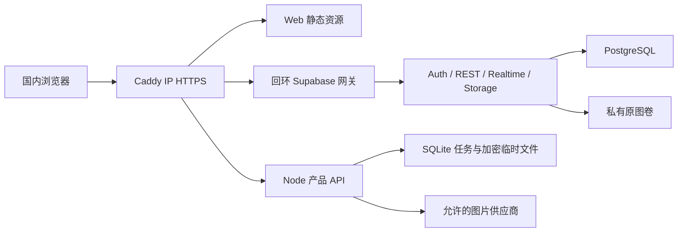

# 国内自建与海外托管双部署改善方案

方案日期：2026-11-09。国内实现与部署范围见 [MEDIA-US-006](../stories/platform/MEDIA-US-006-self-hosted-deployment.md)，运行证据和复验命令见[国内发布记录](self-hosted-release-20261109.md)。海外继续使用 Cloudflare 与 Supabase 托管服务，此次不修改海外资源。用户已授权清理 `aliyun-self` 的旧业务，并明确国内使用 Caddy 公网 IP HTTPS。

## 结论与结构

✅ 可行。保持同一套产品契约，在国内补真实的 Node 运行入口、持久化任务和 Storage；浏览器继续使用现有本机工作区。国内外分别维护平台账号、密钥与云端数据；跨区统一身份和图库复制不在本次范围内。供应商 Key 不持久化到服务端。

| 职责                       | 国内：aliyun-self                             | 海外                         |
| -------------------------- | --------------------------------------------- | ---------------------------- |
| HTTPS、静态资源与四路由    | Caddy，`https://47.103.117.118`               | Cloudflare Static Assets     |
| 产品与管理 API、供应商代理 | Node 26 单进程                                | Cloudflare Worker            |
| 代理任务状态与闹钟         | Node 内置 SQLite，独占运行目录                | SQLite Durable Object        |
| 临时生成结果               | 私有加密文件，24 小时到期                     | 私有 R2                      |
| 账号、元数据与实时同步     | 自建 Auth / PostgREST / Realtime / PostgreSQL | Supabase 托管项目            |
| 用户原图                   | 真实 Storage API 与持久文件卷                 | Supabase 私有 Storage bucket |

Web、`/api/*`、`/auth/v1/*`、`/rest/v1/*`、`/realtime/v1/*`、`/storage/v1/*` 共用公网 IP 的 443 端口。API 与 Kong 只监听回环，数据库不发布宿主端口。管理 API 仍要求真实管理员身份，当前 `/admin` 页面沿用海外的 404 行为，不把尚未接入账号的独立 Admin 壳发布出来。

## 服务器与运行预算

实测主机为 Alibaba Cloud Linux 3.9、x86_64、2 CPU、3.5 GiB RAM、40 GB 系统盘，无 swap。旧 Podman 的 `new-api`、PostgreSQL、Redis 容器、卷和旧业务目录已按授权清理；现使用真正的 Docker Engine 26.1.3 与 Compose 2.27.0，Docker 开机启动。

裁剪 Studio、分析日志、Edge Functions、图片转换和连接池，只保留现有产品必需的服务。各服务镜像固定版本，日志每容器最多 3 × 10 MB。镜像在构建机按 Linux amd64 拉取后经 SSH 导入，规避国内主机无法直接拉 Docker Hub 的问题。前端和 API 在本机构建，服务器不运行开发服务器或 `wrangler dev`。

这台机器适合初始小流量部署。两并发是 API 接单上限，尚未经过两路最大模型响应的整机压力验收。原图单文件 16 MiB；临时密文总预算 512 MiB，接单时为每个在途请求预留最大响应空间，并保留至少 512 MiB 磁盘余量。业务数据库、原图与日志共同占用系统盘，图库配额、磁盘告警及站外备份仍是扩大用户范围前的工作。

## 运行时选择

复用原有 `RelayTask` 的同步 SQL 状态机、请求指纹、令牌派生加密和 HTTP 契约。国内使用 Node 内置 SQLite，避免把整套同步事务改成异步 PostgreSQL 操作；Supabase 的账号和同步业务数据仍全部保存在 PostgreSQL。这是单 API 实例方案，不能把同一目录交给多个实例。

- 独占 SQLite 运行锁防止两个进程共享目录；容量检查和预占在上游派发前完成。
- 任务库只保存 UUID、令牌摘要、请求指纹、状态及时间，不保存供应商 Key、提示词、会话或请求正文。
- 浏览器断开不取消已经派发的后台任务。上游超时 180 秒，看门狗 210 秒，任务保留 24 小时；未知结果不自动重试。
- 结果以密文写入私有文件，fsync 后原子改名，再更新任务状态；启动恢复持久闹钟并收敛未知任务。未完成临时文件在独占锁取得后清理。
- 取回删除后保留封存记录直到到期，阻止相同 UUID 再次派发。任务到期只清理任务密文与状态，不清理作品原图、tombstone、冲突或同步日志。
- 停止服务先停止接单，再等待后台请求结束；Compose 给 API 240 秒退出窗口。强制退出或整机断电依照已有状态恢复，不承诺找回供应商尚未落盘的结果。

Cloudflare 继续使用原 Durable Object/R2；本地测试的内存 R2 替身没有进入国内部署。

## 公网 IP 证书

Caddy 2.11.9 显式配置 Let’s Encrypt ACME issuer 与 `shortlived` profile，申请带 IP SAN 的公开可信证书；`default_sni` 处理不发送 SNI 的 IP 客户端。80 端口用于 HTTP-01 及 HTTPS 跳转，443 提供业务。保留 Caddy 的数据卷，由 Caddy 管理短期证书续期，无需客户端安装自签根证书。

部分文档仍写 IP 只能用内部 CA，不能据此使用默认 `tls internal`。本部署以实际签发结果及未使用 `-k` 的公网浏览器、curl 校验为依据。HTTP-01 的 80 端口和证书数据卷须持续保留。

## 公开配置与数据边界

公开构建配置只包含 Supabase origin、anon key 和可选 Storage origin。只有标准 `*.supabase.co` 项目保留托管 Storage 地址推导；IP、自建域名直接使用自身服务，显式 Storage 配置优先。续传 Location 必须属于已配置的同一 origin 和续传路径，拒绝越界地址及自动重定向。

当前注册、确认邮件和密码找回缺少生产 SMTP。公众注册保持关闭，仅通过可信运维创建初始确认账号；管理员权限另走有审计的授权 RPC。用户登录不会自动上传本机内容，原有同步范围确认、存储标识和离线数据继续保留。

海外默认配置与 Cloudflare 路径保留兼容；未实施国内外账号迁移、跨区复制、Tauri 正式发行或本次供应商付费生图。国内新 IP 是独立浏览器 origin，不能自动看到其他 origin 的本机作品，需要沿用已有导出/导入流程。

## 后续工作

1. 配置生产 SMTP 后验收公众注册、邮件确认及找回密码；不通过开放任意邮箱自动确认绕过。
2. 为 PostgreSQL 与 Storage 原图配置服务器外的联合备份并做恢复演练；Caddy 证书和私有配置也须保留。
3. 验证真实模型的最大响应、并发和故障恢复，再决定是否扩容；建议公众规模前评估 4 CPU、8 GB RAM 和更大数据盘。
4. 完成 Web/Tauri 原图跨设备全流程、图床容量和告警；多 API 实例出现真实需求时再引入共享任务协调存储。
5. 域名可后续替换 IP，但域名切换属于浏览器 origin 迁移，需要处理现有本机数据和会话，不能只改网关地址。

## 依据与复验

- [Caddy default_sni](https://caddyserver.com/docs/caddyfile/options#default-sni)与 [ACME issuer](https://caddyserver.com/docs/caddyfile/directives/tls)：IP 证书能力以 2.11.9 的真实发行与本次签发回执复验。
- [Let’s Encrypt IP 证书](https://letsencrypt.org/docs/profiles#shortlived)：短期 IP 证书及自动更新要求。
- [Supabase Docker 自建](https://supabase.com/docs/guides/self-hosting/docker)、[Storage 续传](https://supabase.com/docs/guides/storage/uploads/resumable-uploads)、[生产 SMTP](https://supabase.com/docs/guides/auth/auth-smtp)。
- [部署文件](../../deploy/self-hosted/compose.yaml)、[发布记录](self-hosted-release-20261109.md)、[范围与 AC](../stories/platform/MEDIA-US-006-self-hosted-deployment.md)。
