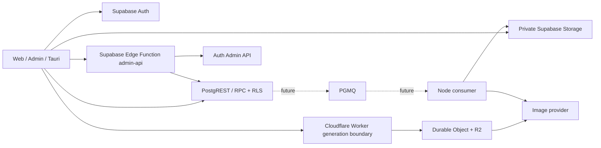

# Aiao Media Supabase-first 架构评审

- 评审日期：2026-11-15
- 状态：Proposed
- 范围：认证、注册、图片 Storage、后台管理、生成任务队列
- 结论：采用 Supabase-first；不把所有能力粗暴改成浏览器直连，也不把 PGMQ 当成 Durable Object 的无缝替代品。

## 结论摘要

| 编号 | 方案 | 结论 | 建议 |
| --- | --- | --- | --- |
| 1 | 用户认证直接走 Supabase Auth | ✅ 可行，Web 已经这样做 | Admin 也改为直接使用 Supabase Auth；服务端仍验证 JWT，不再由 Worker 接收账号密码 |
| 2 | 图片直接存 Supabase Storage | ✅ 可行，当前已经落地 | 保留现有私有 bucket、RLS、TUS 续传、文件摘要和生命周期协议，不再经过 Cloudflare Worker |
| 3 | 登录注册直接走 Supabase | ✅ 可行，Web 已经部分落地 | 统一 Web/Admin 会话；生产环境补 SMTP、注册限制和找回密码验收 |
| 4 | 后台直接调用 Supabase API | ⚠️ 可行，但不能让浏览器持有 service role key | 普通查询走 PostgREST/RPC；涉及 `auth.users`、封禁和服务端密钥的操作走 Supabase Edge Function，移除 Cloudflare Admin API |
| 5 | 队列使用 Supabase PGMQ | ⚠️ 技术可行，但不是当前阶段的直接替换 | 先保留 Durable Object；等并发、重试、跨实例消费成为真实需求后做 PGMQ PoC，再决定迁移 |

整体方向值得做。真正能立即减少应用复杂度的是统一认证、删除 Admin 登录代理、保留图片直传和收缩 Worker API 边界。PGMQ 对当前“一次一张、任务需要刷新续接”的模型未必减少复杂度，贸然迁移反而会增加消费者、幂等、结果存储和故障恢复代码。

## 当前实现事实

### 认证不是全程经过 Cloudflare

Web 已经通过 [supabase-auth.ts](../../apps/web/src/app/supabase-auth.ts) 动态创建 Supabase Auth 客户端，直接执行 `signInWithPassword`、`signUp`、`signOut` 和会话恢复。Web 的产品授权随后携带 Supabase access token 访问产品数据和生成接口。

Admin 仍然保留一套独立登录流程：[app.ts](../../apps/admin/src/app/app.ts) 调用 `/api/admin/login`，Worker 再通过 Supabase Auth 的密码登录接口取得 token。Admin 后续请求通过 [product-client.ts](../../apps/admin/src/app/product-client.ts) 调用 `/api/admin/*`。

因此第 1、3 点不是从零迁移，而是把 Admin 从“Worker 代理登录”统一到 Web 已经使用的 Supabase Auth 会话模型。

### 图片已经直接走 Supabase REST 和 Storage

[image-sync.ts](../../apps/web/src/local-data/image-sync.ts) 直接访问 `${supabaseUrl}/rest/v1` 维护图片元数据，直接访问 `${storageOrigin}/storage/v1` 上传、续传和读取原图。当前实现包含：

- 私有 `aiao-media-images` bucket；
- 按用户和工作区隔离的 Storage RLS；
- PNG/JPEG 类型和 16 MiB 大小限制；
- SHA-256 文件身份和完整性校验；
- 小文件直接上传，大文件使用 TUS 续传；
- `pending`、`uploaded`、`deleted`、`needs_review` 生命周期；
- 删除、重新上传和多设备竞争时的 revision/CAS 保护。

bucket 和 Storage policy 见 [010-image-storage.sql](../../infra/supabase/migrations/010-image-storage.sql)。这部分已经符合 Supabase-first 目标，不应为了统一接口重新套一层 Worker。

Supabase 官方文档也把 TUS 作为大文件和可恢复上传的方案；上传端点、bucket 权限和客户端超时仍需按部署环境验收：[Resumable uploads](https://supabase.com/docs/guides/storage/uploads/resumable-uploads)。

### 后台仍有一层必要但过宽的 Worker 代理

[admin-api.ts](../../apps/api/src/admin-api.ts) 当前负责：

- 通过 service role 读取 Auth 用户列表；
- 通过 Auth Admin API 封禁或解禁用户；
- 调用管理员权限 RPC；
- 管理模板和运行策略；
- 发放积分；
- 读取任务、用量和审计数据。

这套实现的优点是 service role 永远只在 Worker 中出现，浏览器只拿短期 access token。缺点是后台所有操作都要经过一套重复的 Hono 路由、参数校验、错误映射和 CORS/同源逻辑。

### 当前生成任务不是普通消息队列

[relay-task-api.ts](../../apps/api/src/relay-task-api.ts) 将任务按 `taskId` 路由到 Durable Object；[relay-task.ts](../../apps/api/src/relay-task.ts) 使用 Durable Object SQLite 保存状态，用 alarm 处理看门狗、过期和积分释放，用 R2 保存加密结果。当前上游超时为 180 秒，看门狗为 210 秒，任务保留 24 小时。

Cloudflare 绑定见 [wrangler.json](../../apps/api/wrangler.json)。因此当前服务解决的是“浏览器断开后任务仍继续执行、刷新后能够续接、结果暂存且不会重复扣积分”，不只是“把一条消息放进队列”。

## 五点逐项评审

### 1. 用户认证直接走 Supabase Auth

**结论：✅ 应该做，Web 已经完成，Admin 应统一。**

目标流程：

```text
Web/Admin 浏览器
    └── Supabase Auth signIn/signUp/refresh
            └── access token
                    ├── PostgREST/RPC + RLS
                    ├── Supabase Storage
                    └── 需要服务端能力的 Worker/Edge Function
```

收益：

- 删除 Admin 的 `/api/admin/login` 密码代理；
- 浏览器不再把账号密码交给 Cloudflare Worker；
- Web 和 Admin 共享 Supabase 的 token 刷新、过期和退出语义；
- 直接复用 Supabase Auth 支持的邮箱、OAuth、密码找回和邮箱确认能力；
- Worker 只接收 Bearer token，不再承担账号登录协议。

边界：

- 浏览器只能使用 publishable/anon key；service role key 或 secret key 只能留在服务端。Supabase 的 API key 文档明确把 service role 定位为后端密钥，并且它会绕过 RLS：[API keys](https://supabase.com/docs/guides/api/api-keys)。
- Worker、Edge Function 和数据库 RPC 仍必须验证 token，并从 `auth.uid()` 或经过验证的 JWT 得到用户身份；不能信任浏览器提交的 `userId` 或 `p_actor`。
- 当前 Admin 使用独立的 `localStorage` 会话格式。迁移时应先兼容旧会话，再切换到 Supabase 客户端会话，避免已有 Admin 被突然登出。
- 自建 Supabase、Tauri 和不同域名需要重新验收 CORS、Storage origin、刷新 token 和退出后缓存清理。

### 2. 图片直接存 Supabase Storage

**结论：✅ 已经是当前方案，保持，不需要再设计一套新上传 API。**

当前设计比“简单调用 `storage.upload()`”更完整：数据库先建立文件身份，Storage 上传后回读原字节和摘要，最后用 revision/CAS 将记录推进到 `uploaded`。这解决了上传成功但元数据提交失败、重复上传、多设备竞争和原图被删除后的重新上传问题。

保留以下边界：

- 原图只进入私有 bucket；
- 浏览器直接携带 Supabase session 访问 Storage；
- Storage policy 只允许当前用户访问自己的工作区路径；
- 图片元数据继续走 PostgREST/RPC，并由数据库 RLS 和触发器校验；
- `pending` 和 `needs_review` 记录继续由清理或运维修复流程处理；
- 预览继续按需读取，不把原图写回 RxDB 或缓存为长期公共 URL。

优点是少一层大文件代理、上传延迟更低、TUS 续传可以直接使用 Supabase Storage 的协议。代价是 Supabase Storage 成为浏览器的直接依赖，CORS、配额、跨区域延迟和 Storage 备份必须由部署方案承担。

### 3. 登录注册直接走 Supabase

**结论：✅ 应该做，和第 1 点合并实施。**

Web 当前已经直接执行 Supabase Auth 登录和注册。改造重点不是重新开发注册，而是：

1. Admin 使用同一个 Supabase Auth 客户端或同一套会话协议；
2. 删除 Admin 的密码登录 Worker 路由；
3. 所有产品接口只接受 Supabase access token；
4. 账号禁用状态在产品授权层和生成入口同时检查；
5. 补齐生产 SMTP、邮箱确认、密码找回、注册频率限制和异常账号恢复。

Supabase 默认邮件服务并不等于面向公众的生产邮件系统。正式开放公众注册前必须配置并验证自定义 SMTP：[Auth SMTP](https://supabase.com/docs/guides/auth/auth-smtp)。当前部署记录已经把公众注册邮件列为剩余验收项；国内自建部署目前保持关闭公众注册的策略。

直接走 Supabase 的优点是认证协议由平台维护，产品只处理业务授权。缺点是登录、注册和同步都更依赖 Supabase 的可用性；如果 Supabase 故障，用户无法新登录或刷新会话，但已经打开的本机工作区仍应继续可用。

### 4. 后台直接调用 Supabase API

**结论：⚠️ 可以移除 Cloudflare Admin API，但不能让浏览器直接调用 Supabase Auth Admin API 或携带 service role。**

后台操作应拆成两类：

| 操作 | 浏览器直连 PostgREST/RPC | 需要服务端边界 |
| --- | --- | --- |
| 当前管理员读取自己的 session | ✅ | — |
| 已发布模板、审计只读数据 | ✅ 可通过受限 view/RPC | 复杂分页或聚合可放 RPC |
| 当前用户自己的积分和任务 | ✅ RLS/RPC | — |
| 管理员调整积分、发布模板 | ⚠️ 只能调用经过管理员授权的 RPC | 推荐用 RPC 或 Edge Function |
| 读取全部 Auth 用户 | ❌ | Edge Function 或现有 Node/Worker |
| 封禁/解禁 Auth 用户 | ❌ | Edge Function 或现有 Node/Worker |
| 修改 `auth.users`、调用 Auth Admin API | ❌ | 必须使用服务端 secret/service role |

推荐的目标实现：

```text
Admin 浏览器
    ├── Supabase Auth 直接登录
    ├── PostgREST/RPC 读取普通业务数据
    └── supabase.functions.invoke('admin-api')
            └── Supabase Edge Function
                    ├── 用用户 JWT 校验管理员身份
                    ├── 用 service role 调用 Auth Admin API
                    └── 用受限 RPC 修改业务表并写审计
```

这样可以删掉 Cloudflare 的 `/api/admin/*`，但保留必须存在的服务端边界。Supabase 官方也要求 service role 只在安全的后端环境使用：[Securing your API](https://supabase.com/docs/guides/api/api-keys) 和 [Edge Function secrets](https://supabase.com/docs/guides/functions/secrets)。

数据库函数需要同时做以下调整：

- 不再接收浏览器传入的 `p_actor` 作为可信身份；函数内部使用 `auth.uid()`；
- 管理员检查集中到一个稳定的 `media_is_admin()` 函数；
- 修改积分、账号、内容和发布状态的 RPC 使用幂等 `request_id`；
- 所有管理员写操作在数据库内完成审计记录；
- 读取 Auth 用户和执行封禁的逻辑留在 Edge Function，避免给 `authenticated` 角色开放 `auth.users` 或 service role 能力。

直接 PostgREST/RPC 的优点是少一层 Worker 路由、响应更快、业务数据权限集中在 RLS/数据库。缺点是 SQL/RPC 会承载更多业务规则，错误码和接口契约更容易和 Supabase 实现细节绑定。因此建议“普通数据直连，特权能力 Edge Function”，不要追求“后台百分之百浏览器直连”。

### 5. 队列使用 Supabase PGMQ

**结论：⚠️ 可行，但当前不是低风险替换。**

PGMQ 适合做“持久化任务消息队列”，但它不能单独替代当前 RelayTask。仍然需要：

- 任务状态表；
- 消费者进程；
- provider secret 管理；
- 外部请求超时和看门狗；
- 结果存储；
- 任务幂等和积分结算；
- 失败重试、人工核对和过期清理。

Supabase Queues/PGMQ 的官方消费模型是读取消息、在可见性窗口内处理，再删除或归档消息；官方示例也把 Edge Function 作为消费者之一：[Supabase Queues](https://supabase.com/docs/guides/queues) 和 [PGMQ extension](https://supabase.com/docs/guides/database/extensions/pgmq)。当前文档把 PGMQ 标为 Public Alpha，正式采用前需要确认目标 Supabase 项目和自建版本的可用性、升级策略和备份恢复能力。

推荐的 PGMQ 任务模型：

```text
客户端
  └── create_generation_task RPC
        ├── 校验 auth.uid()、账号状态和积分
        ├── 写 media_generation_tasks
        ├── 预留积分
        └── 在同一数据库事务中发送 { taskId } 到 PGMQ

消费者
  └── Node worker 或经过压测的 Edge Function
        ├── read taskId
        ├── 从数据库读取任务正文
        ├── 从服务端 secret 读取 provider 凭据
        ├── 调用上游模型
        ├── 将结果写入私有 Storage 或结果表
        ├── CAS 更新任务状态并结算积分
        └── 成功后 delete 消息，失败则保留或归档
```

队列消息只能放 `taskId`、版本和少量不可敏感的调度信息，不能放 provider key、用户 session、完整提示词或原始图片。任务正文和敏感配置必须留在受保护的数据库或消费者运行时中。

PGMQ 的关键风险：

1. **它不提供外部副作用的 exactly-once。** 消费者可能已经成功调用上游，但在删除消息前崩溃，消息随后重新可见。必须用 task ID、CAS、结果唯一约束和 provider 幂等键防止重复扣积分；如果上游不支持幂等键，就无法保证“只生成一次”。
2. **它不负责长任务执行。** 当前上游超时是 180 秒。Supabase Edge Functions 的执行时间按计划不同，官方限制包含 150 秒和 400 秒档位，因此不能默认把当前任务直接搬到免费 Edge Function；至少要在目标套餐和自建运行时做真实压测：[Edge Function limits](https://supabase.com/docs/guides/functions/limits)。
3. **它不负责结果保留。** 当前结果使用令牌派生密钥加密后写入私有 R2，并由任务状态控制取回和删除。迁移到 PGMQ 后仍需 Storage 或其他结果存储，不能把 24 MiB 结果塞进消息。
4. **它会增加消费者运维。** PGMQ 解决消息持久化，不会自动提供常驻消费者、并发控制、部署滚动、进程恢复和上游网络治理。国内自建环境最终仍需要 Node worker 或其他长期运行进程。
5. **它不自动统一两个区域。** 国内和海外是独立 Supabase 项目和独立账号数据，PGMQ 也应按区域独立运行，不增加跨区任务复制。

当前 Durable Object 的优势是按 task ID 天然串行化，SQLite 状态、alarm、R2 结果和任务令牌已经围绕刷新续接设计完成。Cloudflare Durable Objects 官方支持持久化 alarm，Worker `waitUntil` 只适合延长短任务，不能单独替代当前的持久任务模型：[Durable Object alarms](https://developers.cloudflare.com/durable-objects/api/alarms/) 和 [Workers limits](https://developers.cloudflare.com/workers/platform/limits/)。在当前一次一张的需求下，继续使用 DO 的工程风险低于立即迁移 PGMQ。

## 当前方案与 Supabase-first 方案对比

| 维度 | 当前方案 | Supabase-first 方案 | 评审判断 |
| --- | --- | --- | --- |
| Web 认证 | 直接 Supabase Auth | 不变 | 当前已正确 |
| Admin 登录 | Worker 代理密码登录，再拿 Supabase token | Admin 直接 Supabase Auth | 应立即统一 |
| 图片元数据 | 直接 PostgREST + RLS | 不变 | 当前已正确 |
| 图片原图 | 直接 Supabase Storage | 不变 | 当前已正确 |
| 普通后台数据 | Worker 代理 PostgREST | 浏览器直连受限 RPC/view | 可减少重复 API |
| Auth 用户管理 | Worker 使用 service role + Auth Admin API | Supabase Edge Function 使用 service role | 仍需服务端边界 |
| 生成任务 | Durable Object SQLite + alarm + R2 | 初期保留；长期可评估 PGMQ + Node consumer | 不立即迁移 |
| secret 边界 | Worker/Node 服务端 | Edge Function/Node/Worker 服务端 | 不能下放到浏览器 |
| 数据权限 | Supabase RLS + Worker 校验 | Supabase RLS/RPC 为主 | 需要重写 actor 来源和函数授权 |
| 部署复杂度 | Cloudflare Worker、DO、R2、Node 适配 | 减少业务 Worker；增加 Edge Function 或 Node consumer | 认证/后台降低，队列未必降低 |
| 故障恢复 | 任务状态和结果已有专门协议 | PGMQ 需要重新设计重复消费和结果恢复 | 当前方案更成熟 |
| 供应商锁定 | Cloudflare 绑定较深 | Supabase 绑定更深 | 两者都存在供应商锁定，不能假设 PGMQ 更通用 |

## 推荐目标架构



目标边界如下：

- Supabase Auth、PostgREST/RPC、Storage 是浏览器的默认产品后端；
- Worker 不再代理登录、图片上传和普通后台查询；
- Admin 的 Auth Admin API、封禁和其他特权操作迁移到 Supabase Edge Function；
- 生成任务短期继续由 Worker + Durable Object + R2 承担；
- PGMQ 只作为未来任务调度层候选，不作为当前图片同步或普通后台 API 的替代；
- 如果未来 PGMQ PoC 通过，消费者优先采用 Node worker，避免把 180 秒级别的上游调用强行塞进短生命周期函数；
- 浏览器永远不直接读取或写入 PGMQ，不接触 service role，不携带 provider secret。

## 实施顺序

### 阶段一：统一认证，保持业务行为不变

1. 在 Admin 引入 Supabase Auth 客户端和独立迁移兼容层。
2. Admin 直接执行登录、刷新和退出。
3. `/api/admin/login` 进入弃用期，只保留旧客户端兼容，不再接收新代码调用。
4. `/api/admin/*` 先继续接受 Bearer token，确保迁移期间后台业务不变。
5. 验收 Web/Admin 同时打开、刷新、过期、退出、切换账号和 Tauri CORS。

### 阶段二：收缩 Worker 业务 API

1. 将模板只读、当前用户积分、任务报告和同步管理迁移到直接 PostgREST/RPC。
2. 将客户端传入的 actor/user ID 从管理员 RPC 中删除，统一改为 `auth.uid()`。
3. 保留幂等 request ID、revision/CAS 和审计记录。
4. 删除已经没有调用方的 Worker 代理路由。
5. 运行真实本地 Supabase、真实账号浏览器和离线回归。

### 阶段三：迁移后台特权能力

1. 新建 Supabase Edge Function `admin-api`。
2. Function 使用请求中的用户 JWT 验证管理员 membership 和账号状态。
3. 只有 Function 内部使用 service role 调用 Auth Admin API。
4. 将用户列表、封禁/解禁、积分调整、内容发布和审计写入迁移到 Function/RPC。
5. Admin 改为直接调用 Supabase Auth、PostgREST/RPC 和 Edge Function。
6. Worker `/api/admin/*` 完成灰度后删除。

### 阶段四：PGMQ 仅做可回退 PoC

PoC 必须与当前 DO 任务实现并行，不先删除现有实现。至少完成以下测试后再评估切换：

- 数据库事务内“任务记录 + 积分预留 + 入队”原子完成；
- 消费者崩溃后消息重新可见，任务不会重复扣积分；
- 上游成功、消费者在 ack 前崩溃时，结果可以被恢复且不会重复提交；
- 上游调用 180 秒、看门狗和 visibility timeout 的边界通过；
- 消费者滚动发布、断电、重启和单实例锁通过；
- 任务结果写入私有 Storage，取回、确认、删除和过期清理通过；
- 国内自建和海外托管分别通过真实环境验证；
- 并发、限流、积压、失败重试和人工核对指标可观测。

如果 PoC 不能证明上游副作用幂等，就保留 Durable Object。队列技术不能替代业务幂等设计。

## 最终评审意见

**第 1、2、3 点直接采纳。** 其中第 2 点已经是当前实现，第 1、3 点需要把 Admin 统一到同一套 Supabase Auth 会话。

**第 4 点有条件采纳。** 移除 Cloudflare Admin API 是合理的，但目标应是“Admin 直接调用 Supabase + Edge Function 承担特权操作”，不是“浏览器直接使用 service role 或 Auth Admin API”。

**第 5 点暂缓切换。** PGMQ 适合未来多消费者、任务积压、重试和数据库事务化调度，但当前 DO 已经解决了生成任务最难的刷新续接、结果加密、任务寻址和状态收敛。先做 PGMQ PoC，证明确实降低整体复杂度后再迁移。

推荐的最终策略是：**Supabase 负责认证、业务数据、RLS、图片 Storage 和未来的任务消息；Cloudflare/Node 只保留需要服务端 secret、长时间外部调用和部署边界的能力。**
