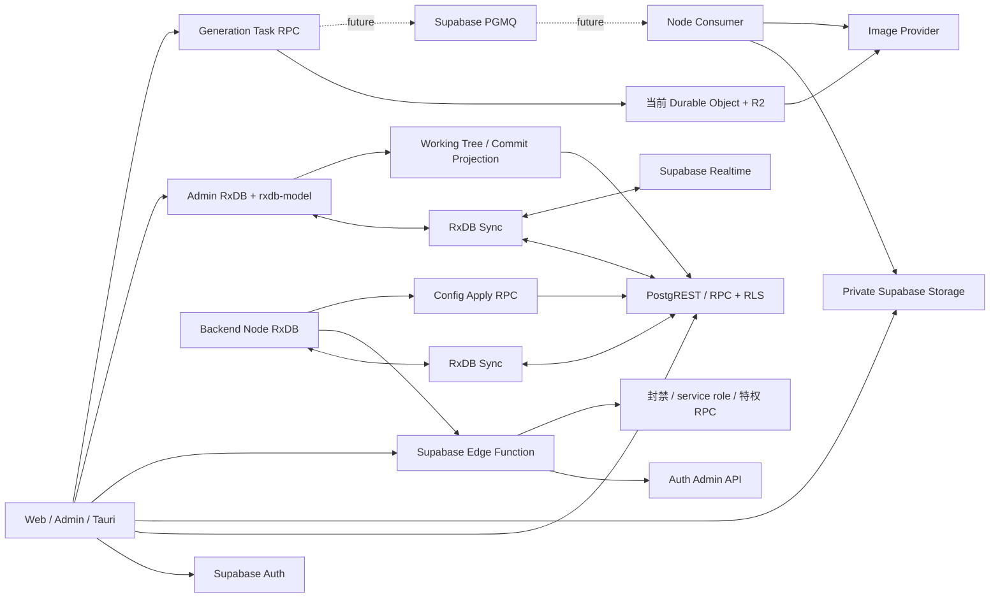

# Aiao Media Supabase-first 架构研究与评审

- 评审日期：2026-11-15
- 状态：Proposed
- 范围：认证、注册、图片 Storage、后台管理、后台 RxDB 同步、`rxdb-model`、分支与提交同步、生成任务队列
- 评审目标：减少 Cloudflare 业务代理层，保留必要的特权和长任务边界

## 评审结论

| 编号 | 方案                                 | 可行性                       | 评审结论                                                                                                                                                      |
| ---- | ------------------------------------ | ---------------------------- | ------------------------------------------------------------------------------------------------------------------------------------------------------------- |
| 1    | 用户认证直接走 Supabase Auth         | ✅ 可行                      | Web 已经这样做；Admin 应统一使用 Supabase Auth，不再把密码交给 Cloudflare Worker。                                                                            |
| 2    | 图片直接存 Supabase Storage          | ✅ 已落地                    | 保留当前私有 bucket、RLS、TUS 续传、摘要校验和生命周期协议，不再增加图片代理。                                                                                |
| 3    | 登录注册直接走 Supabase              | ✅ 可行                      | Web/Admin 共用 Auth 会话；生产环境补齐 SMTP、邮箱确认、找回密码和注册限制。                                                                                   |
| 4    | 后台直接调用 Supabase                | ✅ 有条件可行                | 业务表、受保护 view、普通 RPC 直接调用 Supabase；Auth Admin API、封禁/解禁用户、`service_role`/secret 操作必须经过 Edge Function。                            |
| 5    | 队列使用 Supabase PGMQ               | ✅ 技术可行，⚠️ 暂不直接替换 | 立即做 PoC。PGMQ 适合作为任务调度层，但不能替代任务状态、结果存储、幂等和长任务消费者。当前 Durable Object 继续保留，PoC 通过后再决定切换。                   |
| 6    | 后台服务也使用 RxDB 同步             | ✅ 可行，建议采用            | 后台 Node 服务运行本地 RxDB，通过 `@aiao/rxdb-adapter-supabase` 和 `@aiao/rxdb-plugin-sync` 与 Supabase 双向同步；同步身份使用普通 JWT，不使用 service role。 |
| 7.1  | 使用 `rxdb-model` 做后台显示和编辑   | ✅ 可行，建议采用            | Admin 领域实体统一接入 `rxdb-model`，让列表、详情、表单、校验、撤销和本地编辑都走 RxDB。                                                                      |
| 7.2  | 使用 RxDB 分支和提交逻辑同步配置变更 | ✅ 可行，⚠️ 需要领域投影     | 业务变更和分支元数据已有同步能力；完整 `Commit`/`CommitChangeSet` 图不能直接依赖普通同步，需要新增领域级 commit projection 和后台应用协议。                   |

最终建议是：**Supabase 负责 Auth、业务数据、RLS、Storage、普通 RPC 和未来的 PGMQ；RxDB 负责前端与后台的本地数据模型、离线读写、同步、分支和提交；Edge Function 只承载 Auth Admin、封禁用户以及所有 service role/secret 操作；Cloudflare/Node 只保留长任务、provider secret 和任务消费者边界。**

这不是把所有请求都改成浏览器直连。正确的边界是：**普通业务数据直连 Supabase，特权操作经过 Edge Function，长任务由专门消费者执行。**

## 当前实现事实

### Web 认证已经直连 Supabase

Web 通过 [supabase-auth.ts](../../apps/web/src/app/supabase-auth.ts) 创建 Supabase Auth 客户端，直接执行 `signInWithPassword`、`signUp`、`signOut`、会话恢复和 token 自动刷新。Web 后续使用 Supabase access token 访问产品数据和生成接口。

Admin 仍然有一套独立的 Worker 代理登录流程：[app.ts](../../apps/admin/src/app/app.ts) 调用 `/api/admin/login`，Worker 再调用 Supabase Auth 密码登录接口取得 token；后续请求由 [product-client.ts](../../apps/admin/src/app/product-client.ts) 调用 `/api/admin/*`。

因此第 1、3 点不是从零建设，而是把 Admin 从 Worker 代理会话迁移到与 Web 相同的 Supabase Auth 会话模型。

### 图片已经直连 Supabase Storage

[image-sync.ts](../../apps/web/src/local-data/image-sync.ts) 直接访问 Supabase REST 和 Storage。当前实现包含：

- 私有 `aiao-media-images` bucket；
- 按用户和工作区隔离的 Storage RLS；
- PNG/JPEG 类型和 16 MiB 大小限制；
- SHA-256 文件身份和完整性校验；
- 小文件直接上传，大文件使用 TUS 续传；
- `pending`、`uploaded`、`deleted`、`needs_review` 生命周期；
- 删除、重新上传和多设备竞争时的 revision/CAS 保护。

bucket 和 policy 见 [010-image-storage.sql](../../infra/supabase/migrations/010-image-storage.sql)。这部分已经符合 Supabase-first 目标，不应再套一层 Cloudflare 图片 API。Supabase 官方把 TUS 作为大文件和不稳定网络下的可恢复上传协议，且推荐大文件使用直接 Storage hostname。[Supabase Resumable Uploads](https://supabase.com/docs/guides/storage/uploads/resumable-uploads)

### Admin 当前仍由 Worker 代理

[admin-api.ts](../../apps/api/src/admin-api.ts) 当前负责：

- 使用 service role 读取 Auth 用户列表；
- 通过 Auth Admin API 封禁或解禁用户；
- 调用管理员权限 RPC；
- 管理模板和运行策略；
- 发放积分；
- 读取任务、用量和审计数据。

这套实现的优点是 service role 只在 Worker 中出现，浏览器只拿短期 access token。缺点是普通业务查询和特权操作被混在同一套 Hono 路由中，后台所有功能都要重复经过参数校验、错误映射、CORS/同源和 Worker 部署。

### 当前生成任务不是普通消息队列

[relay-task-api.ts](../../apps/api/src/relay-task-api.ts) 将任务按 `taskId` 路由到 Durable Object；[relay-task.ts](../../apps/api/src/relay-task.ts) 使用 Durable Object SQLite 保存状态，用 alarm 处理看门狗、过期和积分释放，用 R2 保存加密结果。当前上游超时为 180 秒，看门狗为 210 秒，任务保留 24 小时。

Cloudflare 绑定见 [wrangler.json](../../apps/api/wrangler.json)。当前服务解决的是浏览器断开后任务继续执行、刷新后续接、结果暂存、重复扣积分防护和任务状态收敛，不只是“把一条消息放进队列”。

### RxDB 已具备后台同步的基础

仓库已有 [Supabase RxDB 适配器](../../../packages/rxdb-adapter-supabase/README.md) 和 [同步插件](../../../packages/rxdb-plugin-sync/README.md)，已具备：

- Supabase 作为 remote adapter；
- 本地 SQLite/PGlite/wa-sqlite；
- `pullChanges`、`mergeChanges`、`pullChangesBatch`；
- Supabase Realtime 变更通知；
- `rxdb_change` 变更日志；
- `rxdb_branch` 分支元数据；
- `syncManager.sync()`；
- `syncManager.syncBranches()`。

因此后台服务可以运行一个和前端同构的 Node RxDB 实例，而不是重新维护一套“后台配置 API + 内存状态 + 手写缓存”。

### RxDB 已具备工作树和提交基础，但提交图尚未成为普通同步协议

[working-tree 插件](../../../packages/rxdb-plugin-working-tree/README.md) 已有：

- `status()`；
- `diff()`；
- `commit()`；
- `discard()`；
- `restore()`；
- `listCommits()`；
- `commitChanges()`；
- `switchBranch()`；
- 从提交创建分支；
- 分支合并。

但 `Commit`、`CommitChangeSet`、`CommitBranchRef`、`WorkingTreeEntry` 等属于 RxDB 系统实体。HTTP 等普通同步适配器会排除系统实体；Supabase 适配器目前能同步业务变更和分支元数据，不能据此推断完整 commit graph 和 `CommitChangeSet` 会自动同步。

所以以下判断是错误的：

```text
前端 commit()
  └── RxDB sync()
        └── 后台自然得到完整 RxDB 提交历史
```

当前真实能力更接近：

```text
业务实体变更       → 可以通过现有 RxDB sync 同步
分支元数据         → 可以通过 syncBranches() 同步
内部 commit 图     → 需要新增同步协议或领域投影
CommitChangeSet    → 需要新增同步协议或领域投影
```

## 五点方案评审

### 1. 用户认证直接走 Supabase Auth

**结论：✅ 应该立即做。**

目标流程：

```text
Web / Admin / Tauri
    └── Supabase Auth signIn / signUp / refresh / signOut
            └── access token
                    ├── PostgREST / RPC + RLS
                    ├── Supabase Storage
                    └── 需要服务端能力的 Edge Function / Worker / Node
```

收益：

- 删除 Admin 的 `/api/admin/login` 密码代理；
- 浏览器不再把账号密码交给 Cloudflare Worker；
- Web 和 Admin 共享 token 刷新、过期、退出和密码恢复语义；
- 复用 Supabase Auth 的邮箱、OAuth、邮箱确认和密码找回能力；
- Worker 只接收 Bearer token，不再承担账号登录协议。

边界：

- 浏览器只使用 publishable key；旧项目里的 `anon` 是兼容名称，按 Supabase 2026 密钥迁移文档逐步迁移；
- secret key/旧 `service_role` 只能放在 Edge Function、Worker、Node 等服务端；它们具有绕过 RLS 的特权；
- 服务端和 RPC 必须验证 token，并从 `auth.uid()` 或验证后的 JWT 得到用户身份；不能信任浏览器传入的 `userId`、`p_actor` 或管理员标记；
- Admin 现有独立 `localStorage` 会话需要兼容迁移，不能直接让所有已有管理员掉线；
- 自建 Supabase、Tauri 和不同域名需要重新验收 CORS、Storage origin、刷新 token、退出后缓存清理和跨区域网络。

参考：[Supabase Auth](https://supabase.com/docs/guides/auth)、[Supabase API keys](https://supabase.com/docs/guides/getting-started/api-keys)、[Migrating to publishable and secret API keys](https://supabase.com/docs/guides/getting-started/migrating-to-new-api-keys)。

### 2. 图片直接存 Supabase Storage

**结论：✅ 当前已经落地，保持现状。**

当前设计比简单调用 `storage.upload()` 更完整：数据库先建立文件身份，Storage 上传后回读原字节和摘要，最后用 revision/CAS 将记录推进到 `uploaded`。这解决了上传成功但元数据提交失败、重复上传、多设备竞争和原图被删除后的重新上传问题。

保留以下边界：

- 原图只进入私有 bucket；
- 浏览器携带 Supabase session 访问 Storage；
- Storage policy 只允许当前用户访问自己的工作区路径；
- 图片元数据继续走 PostgREST/RPC，并由数据库 RLS 和触发器校验；
- `pending` 和 `needs_review` 记录继续由清理或运维修复流程处理；
- 预览按需读取，不把原图写回 RxDB，也不缓存为长期公共 URL。

优点是少一层大文件代理、上传延迟更低、TUS 续传可以直接使用 Supabase Storage。代价是 Supabase Storage 成为客户端直接依赖，CORS、配额、跨区域延迟、备份和 bucket policy 必须纳入部署验收。

### 3. 登录注册直接走 Supabase

**结论：✅ 应该和第 1 点合并实施。**

Web 当前已经直接执行 Supabase Auth 登录和注册。改造重点是统一客户端和会话协议：

1. Admin 使用同一个 Supabase Auth 客户端协议；
2. 删除 Admin 的密码登录 Worker 路由；
3. 所有产品接口只接受 Supabase access token；
4. 账号禁用状态在产品授权层、后台操作和生成入口同时检查；
5. 配置生产 SMTP、邮箱确认、密码找回、注册频率限制和异常账号恢复；
6. 分别验证海外 Supabase 和国内自建 Supabase 的邮件、回调 URL 和 CORS。

Supabase 默认邮件服务不等于面向公众的生产邮件系统。正式开放注册前必须配置并验证自定义 SMTP：[Auth SMTP](https://supabase.com/docs/guides/auth/auth-smtp)。

### 4. 后台直接调用 Supabase，但特权操作必须经过 Edge Function

**结论：✅ 采纳，但必须按权限分层。**

“后台直接调用 Supabase”不应理解为“浏览器可以拿 service role 调任何 Supabase API”。后台操作拆成三类：

| 操作                                    | Admin 浏览器是否直连 Supabase | 正确入口                                                |
| --------------------------------------- | ----------------------------- | ------------------------------------------------------- |
| 当前管理员读取自己的 session            | ✅                            | Supabase Auth                                           |
| 当前管理员可见的业务表查询              | ✅                            | PostgREST + RLS                                         |
| 受限 view、列表、聚合查询               | ✅                            | PostgREST 或 `SECURITY INVOKER` RPC                     |
| 当前用户自己的积分、任务、用量          | ✅                            | RLS/RPC，身份由 `auth.uid()` 确定                       |
| 管理员读取普通业务配置                  | ✅                            | RLS + 管理员授权 RPC/view                               |
| 管理员修改模板、策略、发布状态          | ✅/⚠️                         | 受管理员授权的 RPC；复杂编排可由 Edge Function 调用 RPC |
| 读取全部 Auth 用户                      | ❌                            | Supabase Edge Function                                  |
| 封禁/解禁 Auth 用户                     | ❌                            | Supabase Edge Function + Auth Admin API                 |
| 修改 `auth.users` 或调用 Auth Admin API | ❌                            | Supabase Edge Function 内部使用 secret/service role     |
| 任何绕过 RLS 的读取或写入               | ❌                            | Supabase Edge Function；浏览器禁止持有特权 key          |

目标流程：

```text
Admin 浏览器
    ├── Supabase Auth 直接登录
    ├── PostgREST / RPC 读取和修改普通业务表
    └── supabase.functions.invoke('admin-api')
            └── Supabase Edge Function
                    ├── 验证请求中的用户 JWT
                    ├── 检查管理员 membership 和账号状态
                    ├── 使用 secret/service role 调 Auth Admin API
                    └── 调用受限 RPC、写审计和返回结果
```

必须修改数据库函数：

- 删除浏览器传入的可信 `p_actor`，函数内部使用 `auth.uid()`；
- 管理员检查集中到稳定的 `media_is_admin()` 或等价函数；
- 积分、账号、内容、发布状态写操作使用幂等 `request_id`；
- 每个管理员写操作在数据库内写审计记录；
- 普通业务 RPC 使用 `SECURITY INVOKER`，让调用者身份和 RLS 生效；
- 只有 Edge Function 可以执行 Auth Admin、封禁和绕过 RLS 的 service role 操作。

这样能删除 Cloudflare `/api/admin/*` 中的普通业务代理，同时保留必须存在的特权边界。Supabase 官方 API key 文档将 secret key 定位为服务端密钥；Auth Admin 方法也要求服务端特权密钥。[Supabase API keys](https://supabase.com/docs/guides/getting-started/api-keys)

优点：

- 普通查询少一层 Worker 转发；
- RLS、RPC、审计规则集中在 Supabase；
- Admin 与 Web 使用同一种 token 和权限模型；
- Auth Admin 和 service role 不会下放到浏览器。

缺点：

- SQL/RPC 会承载更多业务规则，接口契约与 Supabase 绑定更深；
- Edge Function 需要独立部署、日志和权限回归；
- 直连接口需要明确区分缓存、实时订阅、错误码和权限失败；
- 如果 RLS 写错，浏览器直连会直接暴露错误，因此必须把 RLS 测试作为迁移门禁。

### 5. 队列使用 Supabase PGMQ

**结论：✅ 立即研究并做 PoC；⚠️ 当前不直接删除 Durable Object。**

Supabase Queues 基于 PostgreSQL 的 PGMQ 扩展，提供持久化消息、可见性窗口和消息删除/归档模型。它适合作为“任务调度层”，但不能单独替代当前 RelayTask 的完整能力。参考：[Supabase Queues](https://supabase.com/docs/guides/queues)、[PGMQ](https://supabase.com/docs/guides/queues/pgmq)。

#### 推荐的 PGMQ 任务模型

```text
客户端
  └── create_generation_task RPC
        ├── 校验 auth.uid()、账号状态和积分
        ├── 写 media_generation_tasks
        ├── 预留积分
        └── 在同一数据库事务中发送 { taskId, taskRevision, kind } 到 PGMQ

Node Consumer
  ├── read taskId
  ├── 读取任务正文和当前 revision
  ├── 读取服务端 provider secret
  ├── 调用上游模型
  ├── 将结果写入私有 Supabase Storage 或结果表
  ├── 用 taskId + revision 做 CAS 更新
  ├── 结算积分
  └── 成功后 delete/archive 消息；失败则按策略重试
```

消息只放调度信息：

```json
{
  "kind": "image-generation",
  "taskId": "uuid",
  "taskRevision": 3
}
```

禁止放入消息：

- provider key；
- Supabase session；
- secret/service role；
- 完整提示词；
- 原始图片；
- 大型生成结果。

任务正文和敏感配置留在受保护的数据库或消费者运行时中。

#### PGMQ 必须验证的风险

1. **消息至少一次交付不等于外部副作用 exactly-once。** 消费者可能已经调用 provider 成功，但在删除消息前崩溃；消息重新可见后会再次投递。必须使用 task ID、CAS、结果唯一约束、积分结算状态和 provider 幂等键。若 provider 没有幂等键，不能承诺“只生成一次”。
2. **PGMQ 不负责任务状态。** 仍需要 `media_generation_tasks` 保存排队、执行、成功、失败、过期、结果 token、积分和错误信息。
3. **PGMQ 不负责结果保留。** 结果必须继续写私有 Storage 或结果表，不能把大型结果塞入消息。
4. **PGMQ 不负责消费者运维。** 仍需要 Node consumer 的拉取、并发、租约续期、重试、滚动部署、重启恢复和积压监控。
5. **180 秒上游调用不能默认放进 Edge Function。** Supabase Edge Function 的最大 wall-clock duration 受套餐和平台限制，当前任务必须按目标套餐、自建环境和实际 provider 延迟压测；长任务优先使用 Node consumer。[Edge Function limits](https://supabase.com/docs/guides/functions/limits)
6. **PGMQ 不自动解决国内和海外双区域。** 两个 Supabase 项目应按区域独立运行队列和消费者，不做隐式跨区复制。
7. **扩展、备份和恢复必须纳入验收。** 自建 Supabase 需要确认 PGMQ extension 版本、迁移、备份恢复和监控能力。

#### 当前 Durable Object 与 PGMQ 对比

| 维度         | 当前 Durable Object + R2      | Supabase PGMQ + Node Consumer           |
| ------------ | ----------------------------- | --------------------------------------- |
| 任务寻址     | `taskId` 天然绑定一个 DO 实例 | 消费者从共享队列读取任务                |
| 状态存储     | DO SQLite 已经存在            | 需要新增/复用 Postgres 任务表           |
| 刷新续接     | 当前协议已完成                | 需要重新实现任务查询和结果取回          |
| 串行化       | 单 task 天然串行              | 需要 task lease/CAS/幂等控制            |
| 重试         | alarm 和看门狗已实现          | 需要 visibility timeout、重试和死信策略 |
| 结果存储     | R2 已实现加密结果             | 迁移到 Supabase Storage 或继续 R2       |
| 多消费者     | 需要额外设计                  | PGMQ 更适合水平扩展                     |
| 积压与优先级 | 需要额外设计                  | PGMQ 更容易统一调度，但仍需业务字段     |
| 供应商依赖   | Cloudflare DO/R2              | Supabase Postgres/PGMQ/Storage          |
| 当前迁移风险 | 低，已有生产协议              | 高，需要重做故障恢复和真实压测          |

PGMQ 适合以下触发条件：

- 任务种类明显增加；
- 需要多个消费者和水平扩展；
- 需要优先级、延迟重试、统一积压监控；
- 多个后台服务要共享同一套数据库任务调度；
- 能接受 Node consumer 的持续运行和运维。

当前一次一张图片、任务需要刷新续接、上游调用较长时，Durable Object 仍然更简单。PoC 不通过就保留现有实现。

## 6. 后台服务必须使用 RxDB 同步

**结论：✅ 采用。后台不是另写一套 Supabase CRUD 服务，而是运行 RxDB 同步节点。**

### 目标结构

```text
Admin Angular
  └── rxdb-model
        └── Admin RxDB
              ├── local adapter: PGlite / SQLite
              ├── history
              ├── working-tree
              ├── sync
              └── Supabase adapter
                      └── Supabase PostgREST + Realtime + RLS

Node Backend Service
  └── Backend RxDB
        ├── local adapter: PGlite / SQLite
        ├── sync + history
        ├── working-tree
        └── Supabase adapter
                └── 同一套业务实体、分支和变更日志
```

后台服务生命周期：

1. 以专用 Supabase Auth 服务账号或用户 JWT 启动，不使用 service role 作为普通同步身份；
2. 初始化本地 RxDB、实体 schema、history、sync 和 working-tree 插件；
3. 连接 Supabase adapter，执行 RLS 自检、远端 backend identity 检查和 Realtime 订阅；
4. 启动 `syncManager.sync()` 和必要的 `syncBranches()`；
5. 业务服务只读写本地 RxDB，网络恢复后由同步层推拉；
6. 冲突按 revision/CAS、实体版本和业务规则处理；
7. 需要 Auth Admin、封禁或绕过 RLS 的操作调用 Edge Function，不从后台同步节点直接使用 service role。

后台服务使用普通 JWT 有三个作用：

- RLS 仍然有效，错误的查询不会变成全库读写；
- 审计记录可以落到明确的服务账号；
- 前端、后台和其他设备共享同一套 RxDB 同步协议。

如果某个后台任务确实需要平台级权限，调用链应是：

```text
Backend RxDB service
  └── Supabase Edge Function
        └── secret/service role
              └── Auth Admin / 特权 RPC / service-only Storage
```

不要让“后台服务需要同步”成为给所有后台进程发 service role 的理由。

### 同步范围

可以直接进入现有同步协议的内容：

- `MediaPromptTemplate`；
- `MediaProviderPolicy`；
- `MediaPlatformModel`；
- 工作区配置；
- 普通业务任务和用量投影；
- `rxdb_change` 业务变更；
- `rxdb_branch` 分支元数据。

不应直接加入普通业务同步范围的内容：

- RxDB 内部连接状态；
- 本地 adapter 元数据；
- 完整 RxDB 系统表；
- 尚未设计远端兼容协议的 `CommitChangeSet` 内部行。

这样可以让后台服务与前端共享业务模型和同步协议，同时避免把 RxDB 内部实现细节暴露成公共数据库契约。

## 7.1 使用 `rxdb-model` 做后台显示和编辑

**结论：✅ 采用。Admin 的领域编辑不再维护一套手写表单状态机。**

相关能力已经存在：

- [@aiao/rxdb-model](../../../packages/rxdb-model/README.md)；
- [@aiao/rxdb-model-angular](../../../packages/rxdb-model-angular/README.md)；
- [@aiao/rxdb-model-react](../../../packages/rxdb-model-react/README.md)；
- [@aiao/rxdb-model-vue](../../../packages/rxdb-model-vue/README.md)。

Angular 侧已有 `EntityListComponent`、`EntityDetailComponent`、`EntityFormComponent`、`EntityTableComponent`、`QueryTableComponent` 和 Query Builder。Admin 当前主要由 [admin-console.ts](../../apps/admin/src/app/admin-console.ts) 手写 Angular signals、模板和远端请求状态。

### 目标数据模型

新增或整理共享领域实体，例如：

```text
@aiao-media/domain
  ├── MediaPromptTemplate
  ├── MediaProviderPolicy
  ├── MediaPlatformModel
  ├── MediaConfigCommit
  ├── MediaConfigCommitChange
  └── MediaAdminAccountProjection
```

每个可编辑实体至少需要：

- `@Entity` 元数据；
- RxDB schema；
- Supabase 表字段映射；
- `workspaceId`、owner 或 tenant 字段；
- revision/CAS 字段；
- `createdBy`、`updatedBy`、时间戳；
- 分支上下文字段或可解析的 `branchId`；
- `rxdb-model` 可识别的字段描述、关系和校验。

### Admin 目标调用链

```text
EntityList / EntityTable
  └── EntityDetail / EntityForm
        └── RxDB Repository
              └── 本地保存
                    └── working-tree 捕获
                          └── commit
                                └── RxDB sync
                                      └── Supabase
```

收益：

- 列表和详情读取本地 RxDB，网络断开仍能查看已经同步的数据；
- 编辑、校验、保存、撤销和重做使用同一套实体模型；
- 前端 Admin 和后台 Node 服务共享 schema、字段名和 revision 语义；
- 变更可以进入 working tree 和 commit projection；
- 以后增加 React/Vue 管理端时，复用同一套领域实体和模型能力。

边界：

- `rxdb-model` 负责显示、编辑和交互，不负责绕过 Supabase 权限；
- 业务写入仍受本地 schema、同步协议、RLS、RPC 和审计约束；
- Auth 用户列表、封禁、Auth Admin API 继续由 Edge Function 提供专用动作；
- 不能为了让表单好用而把 service role key 或管理密钥放入 Admin bundle。

## 7.2 RxDB 分支、提交和后台同步

**结论：✅ 采用领域级提交同步；⚠️ 暂不把 RxDB 内部系统表直接暴露给 Supabase。**

### 业务目标

后台配置需要同时表达三件事：

1. 当前配置内容；
2. 这次配置由哪个分支、哪个提交、哪个操作者产生；
3. 后台服务是否已经拉取、校验、应用或发布这次变更。

### 推荐流程

```text
Admin RxDB 本地编辑
  └── rxdb-model
        └── RxDB entity save/update
              └── working-tree 捕获
                    └── db.workingTree.commit(message)
                          ├── 本地 RxDB 内部 Commit
                          ├── 生成 MediaConfigCommit 投影
                          └── 生成 MediaConfigCommitChange 投影
                                  ↓
                         rxdb-plugin-sync 推送
                                  ↓
                         Supabase 业务表 / commit projection 表
                                  ↓
                         Backend RxDB 拉取
                                  ↓
                         校验 parent、fingerprint、权限和 revision
                                  ↓
                         应用配置 / 发布 / 回报状态
```

### 领域级 commit projection

不要直接把 RxDB 内部 `Commit` 和 `CommitChangeSet` 当作 Supabase 公共表。新增领域表：

```text
media_config_commits
  ├── id
  ├── workspace_id
  ├── branch_id
  ├── parent_ids
  ├── author_id
  ├── message
  ├── operation_id
  ├── content_fingerprint
  ├── created_at
  └── status

media_config_commit_changes
  ├── id
  ├── commit_id
  ├── sequence
  ├── entity
  ├── entity_id
  ├── operation
  ├── patch
  ├── inverse_patch
  └── content_fingerprint
```

建议 `status` 至少包含：

```text
prepared → synced → validated → applied → released
                              └── rejected
```

`media_config_commit_changes` 是领域协议，不是 RxDB 内部表的镜像。它只包含后台需要校验、应用、回滚和审计的变更单元。

### 一次提交的可靠性要求

`workingTree.commit()` 和 projection 生成之间存在崩溃窗口，不能只监听一次 `commits$` 就认为投影一定完成。需要同时实现：

- `commitId` 唯一约束；
- `operationId` 幂等键；
- `content_fingerprint` 内容指纹；
- `parent_ids` 父提交校验；
- projection 写入失败后的重试；
- 启动时扫描 `listCommits()`，补齐缺失 projection；
- 后台只接受完整 commit envelope；
- 未完成的 projection 不得进入 `validated` 或 `released`；
- 后台应用配置和更新 commit 状态使用同一 Supabase RPC 事务；
- 发生重复推送时不得重复应用配置、重复发放积分或重复发布。

推荐的后台原子动作：

```text
apply_media_config_commit(commitId, operationId)
  ├── 校验 commit 状态和 parent_ids
  ├── 校验全部 commit_changes 已到齐
  ├── 校验 fingerprint 和当前 revision
  ├── 原子写入配置表
  ├── 写入审计记录
  ├── 更新 commit status = applied
  └── 返回已应用的 revision
```

### 分支同步边界

现有 `syncBranches()` 可以同步分支元数据，但不等于完整同步分支上的所有内部提交对象。目标分层如下：

```text
RxDB branch metadata
  └── 现有 rxdb_branch + syncBranches()

业务配置实体
  └── 现有 rxdb_change + RxDB Supabase sync

领域提交投影
  └── media_config_commits + media_config_commit_changes
        └── 普通 RxDB 实体同步 + apply RPC

完整 RxDB 内部 commit graph
  └── 未来需要独立 CommitSyncAdapter 时再实现
```

如果未来确实要求在不同设备之间还原完整 RxDB 提交图，再设计独立协议：

```text
CommitSyncAdapter
  ├── pushCommits()
  ├── pullCommits()
  ├── pushCommitChangeSets()
  └── pullCommitChangeSets()
```

在此之前，不要把系统表直接加入普通同步范围，因为这会把本地存储实现、清理策略、压缩策略和版本兼容性变成 Supabase 公共契约。

## 当前方案与目标方案对比

| 维度          | 当前方案                           | Supabase-first + RxDB 目标方案            | 优点变化                    | 新增代价                                  |
| ------------- | ---------------------------------- | ----------------------------------------- | --------------------------- | ----------------------------------------- |
| Web Auth      | 直接 Supabase Auth                 | 不变                                      | 已经简单                    | 无                                        |
| Admin 登录    | Worker 代理密码登录                | Admin 直接 Supabase Auth                  | 删除密码代理，统一会话      | 需要迁移旧 session                        |
| 图片上传      | 直接 Supabase Storage              | 不变                                      | 已经绕过 Worker，支持 TUS   | 继续承担 Storage CORS/配额                |
| 普通后台查询  | Worker `/api/admin/*` 代理         | PostgREST/RPC + RLS 直连                  | 少一层 Hono、序列化和部署   | RLS/RPC 需要严格审计                      |
| Auth 用户管理 | Worker service role                | Edge Function + Auth Admin API            | 特权边界独立，普通 API 更薄 | 新增 Edge Function 部署和日志             |
| 封禁/解禁用户 | Worker service role                | Edge Function                             | 规则集中，浏览器无特权 key  | 需要管理员 JWT 校验                       |
| 普通业务写入  | Worker 参数校验后调用 RPC          | 浏览器 JWT + `auth.uid()` RPC             | 业务路径短，审计集中        | 不能再信任客户端 actor                    |
| 前端本地数据  | 前端 RxDB                          | 前端 RxDB + Supabase sync                 | 保持 local-first            | 需要统一实体 schema                       |
| 后台服务数据  | 手写 API/缓存状态                  | 后台 Node RxDB + Supabase sync            | 前后端共享模型和同步协议    | 后台进程需要本地库、游标和身份            |
| Admin UI      | 手写 signals、模板和请求状态       | `rxdb-model` + RxDB repository            | 显示、编辑、撤销、提交统一  | 需要领域实体和组件迁移                    |
| 配置变更      | 业务 API 写配置                    | branch + working-tree + commit projection | 配置和变更记录一起同步      | 需要 projection、fingerprint 和 apply RPC |
| 生成任务      | Durable Object SQLite + alarm + R2 | 初期保留；未来可 PGMQ + Node consumer     | 当前任务协议稳定            | PGMQ PoC、消费者、幂等和监控              |
| secret 边界   | Worker/Node                        | Edge Function/Worker/Node                 | 边界更清晰                  | 多运行时部署治理                          |
| 供应商锁定    | Cloudflare 较深                    | Supabase 较深                             | 减少业务 API 代码           | 仍然存在平台绑定                          |

## 推荐目标架构



目标边界：

- Supabase Auth、PostgREST/RPC、Storage 是客户端默认产品后端；
- Admin 普通业务表和普通 RPC 直接调用 Supabase；
- Auth Admin API、封禁/解禁、secret/service role 操作只能在 Edge Function；
- 前端和后台服务都运行 RxDB 同步，不各自维护一套 CRUD 状态机；
- `rxdb-model` 负责后台配置显示和编辑；
- working-tree、分支和提交投影负责配置变更的可追踪同步；
- 当前生成任务继续由 Durable Object + R2 承担；
- PGMQ 作为未来任务调度层，通过 PoC 后再切换；
- provider secret、Supabase secret/service role 和原始生成结果不会进入浏览器或 PGMQ 消息。

## 实施顺序

### 阶段一：先统一 Auth，保持用户行为不变

1. Admin 引入 Supabase Auth 客户端和旧 session 迁移兼容层；
2. Admin 直接执行登录、注册、刷新、退出和密码恢复；
3. `/api/admin/login` 进入弃用期，不再接收新代码调用；
4. 现有产品接口先继续接受 Bearer token，保证迁移期间业务可用；
5. 验收 Web/Admin 同时打开、刷新、过期、退出、切换账号和 Tauri CORS。

### 阶段二：收缩 Worker 普通业务 API

1. 将模板只读、当前用户积分、任务报告、用量和同步管理迁移到 PostgREST/RPC；
2. 删除 RPC 中浏览器传入的可信 actor/user ID；
3. 用 `auth.uid()`、membership 和 RLS 判定身份；
4. 保留 `request_id`、revision/CAS 和审计记录；
5. 删除已经没有调用方的 Worker 普通代理路由；
6. 运行真实本地 Supabase、真实账号浏览器和离线回归。

### 阶段三：迁移特权后台能力到 Edge Function

1. 新建 Supabase Edge Function `admin-api`；
2. Function 验证用户 JWT、管理员 membership 和账号状态；
3. 只有 Function 内部使用 secret/service role；
4. 迁移用户列表、封禁/解禁、Auth Admin、特权积分调整和审计动作；
5. Admin 改为直接调用 Auth、PostgREST/RPC 和 Edge Function；
6. Worker `/api/admin/*` 灰度后删除。

### 阶段四：建立后台 RxDB 同步节点和 `rxdb-model` Admin

1. 先定义共享领域实体和 Supabase 表 schema；
2. 为业务实体补齐 RLS、revision/CAS、创建者、更新者和 workspace 字段；
3. Admin 接入 RxDB Supabase sync 和 working-tree；
4. Admin 配置页迁移到 `rxdb-model-angular`；
5. Node 后台服务接入本地 RxDB、同步、分支和 Realtime；
6. 用同一套实体读写和冲突规则验证前端、后台和离线场景。

### 阶段五：配置分支和提交投影

1. 明确 branch、commit、commit change、发布和回滚状态；
2. 新增 `media_config_commits` 和 `media_config_commit_changes`；
3. 为 projection 实现 `operation_id`、fingerprint、parent 和补偿扫描；
4. 实现后台 `apply_media_config_commit` 原子 RPC；
5. 验收断网提交、重复推送、后台重启、父提交缺失、revision 冲突和回滚；
6. 暂不把 RxDB 内部系统表加入普通 Supabase 同步。

### 阶段六：PGMQ 可回退 PoC

PoC 必须与当前 Durable Object 并行，不能先删除现有实现。至少通过以下测试：

- 任务记录、积分预留和入队在同一数据库事务中完成；
- 消费者崩溃后消息重新可见，任务不会重复扣积分；
- provider 成功但 ack 前崩溃时，结果可恢复且不会重复提交；
- provider 幂等键、task CAS 和结果唯一约束有效；
- 180 秒上游调用、visibility timeout、租约续期和看门狗边界通过；
- 消费者滚动发布、断电、重启和单实例锁通过；
- 结果写入私有 Storage，取回、确认、删除和过期清理通过；
- 国内自建和海外托管分别通过真实环境验证；
- 并发、限流、积压、失败重试、死信和人工核对可观测；
- PGMQ 扩展升级、备份和恢复通过。

如果 PoC 不能证明外部 provider 副作用可幂等恢复，就继续使用 Durable Object。队列技术不能替代业务幂等设计。

## 研究后的最终判断

- **第 1、2、3 点：直接采纳。** 第 2 点当前已经落地，第 1、3 点重点是 Admin 统一到 Supabase Auth。
- **第 4 点：直接采纳，但必须分层。** 业务表和普通 RPC 直连 Supabase；Auth Admin API、封禁/解禁和 service role 操作全部经过 Edge Function。
- **第 5 点：立即研究，分阶段采用。** PGMQ 可以成为统一任务调度层，但当前不能作为 Durable Object 的无条件替代。
- **第 6 点：直接采纳。** 后台服务必须使用 RxDB 同步，使用普通 JWT 和 RLS；特权操作调用 Edge Function。
- **第 7.1 点：直接采纳。** `rxdb-model` 作为 Admin 配置显示和编辑层，避免手写第二套状态系统。
- **第 7.2 点：采纳领域级投影。** 使用 RxDB 分支、working-tree 和 commit 生成可同步的配置提交记录；完整内部 commit graph 另行设计，不直接暴露系统表。

架构研究已经转成可验收用户故事，并在 2026-11-15 进入实施：普通业务直连、特权 Edge Function、后台 RxDB、`rxdb-model` 配置入口、领域级 commit projection、原子 apply/回滚 RPC 和 PGMQ PoC 已有代码与包级测试证据；真实 Supabase、Realtime、Playwright、双区域和生产切换仍待验收：

- [MEDIA-US-208 Supabase 后台直连与特权 Edge Function 边界](../stories/account/MEDIA-US-208-supabase-admin-boundary.md)
- [MEDIA-US-306 后台服务 RxDB 双向同步](../stories/local-first/MEDIA-US-306-backend-rxdb-sync.md)
- [MEDIA-US-307 `rxdb-model` 驱动后台配置编辑](../stories/local-first/MEDIA-US-307-admin-rxdb-model.md)
- [MEDIA-US-308 配置分支提交与后台应用同步](../stories/local-first/MEDIA-US-308-config-branch-commit-sync.md)
- [MEDIA-US-110 PGMQ 生成任务队列 PoC](../stories/generation/MEDIA-US-110-pgmq-task-queue-poc.md)

这些故事已经补齐角色、范围边界、验收标准、交付阶段、依赖和实现入口；下一步按依赖顺序进入 schema、Edge Function、后台 RxDB 和 PGMQ PoC 设计。

## 研究依据

- [Supabase Auth](https://supabase.com/docs/guides/auth)
- [Supabase API keys](https://supabase.com/docs/guides/getting-started/api-keys)
- [Migrating to publishable and secret API keys](https://supabase.com/docs/guides/getting-started/migrating-to-new-api-keys)
- [Supabase Resumable Uploads](https://supabase.com/docs/guides/storage/uploads/resumable-uploads)
- [Supabase Queues](https://supabase.com/docs/guides/queues)
- [Supabase PGMQ](https://supabase.com/docs/guides/queues/pgmq)
- [Supabase Edge Function limits](https://supabase.com/docs/guides/functions/limits)
- [Supabase Edge Function secrets](https://supabase.com/docs/guides/functions/secrets)
- [RxDB Supabase adapter](../../../packages/rxdb-adapter-supabase/README.md)
- [RxDB sync plugin](../../../packages/rxdb-plugin-sync/README.md)
- [RxDB working-tree plugin](../../../packages/rxdb-plugin-working-tree/README.md)
- [RxDB model](../../../packages/rxdb-model/README.md)
