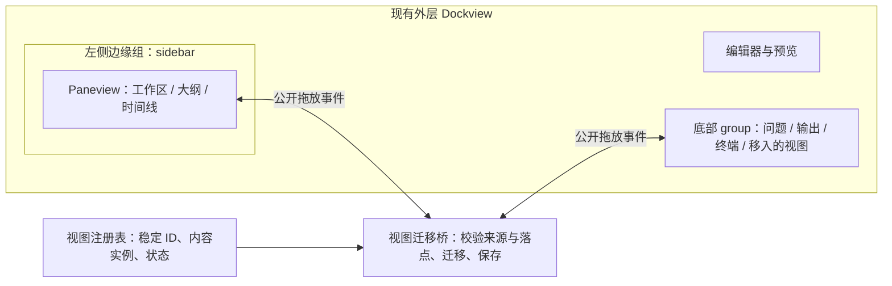

# VS Code 视图容器与 Dockview 可行性研究

研究日期：2026-11-09。范围：侧栏区块折叠、调高、排序，以及单个区块与底部面板之间的双向拖放。依赖以项目实际安装的 `dockview-core@8.8.3` 为准，官方当前文档通过 Context7 查询，并与本地类型声明和实现核对。

✅ 值得做。保留当前外层 Dockview，在侧栏嵌入同一个包导出的 Paneview，用一层共享的视图迁移桥连接两者。需要调整视图所有权、生命周期和布局存储；不需要新增布局或拖放依赖。

## 交互拆解

| 用户操作                       | 8.8.3 可以直接复用的能力                          | 应用需要负责的部分                   |
| ------------------------------ | ------------------------------------------------- | ------------------------------------ |
| 点击区块头折叠 / 展开          | `panel.api.setExpanded()`、`onDidExpansionChange` | 自定义标题、工具按钮、键盘与 ARIA    |
| 拖区块间的横线调高             | Paneview 内置 Splitview 和 sash、最小正文高度     | 正文独立滚动、尺寸约束               |
| 拖标题上下排序                 | Paneview 原生 DnD，同实例内自动 `movePanel()`     | 监听布局变化并持久化                 |
| 拖到终端标签附近，成为同组标签 | Dockview 外部 DnD 的落点覆盖层、标签插入序号      | 把 Paneview 视图转换成 Dockview 面板 |
| 拖到终端内容边缘，成为相邻分组 | Dockview 的方向落点、分组和尺寸管理               | 按实际落点创建面板                   |
| 从底部拖回侧栏                 | Paneview 外部 DnD 的上 / 下落点                   | 把 Dockview 面板转换回 Paneview 区块 |

这里的“手风琴”允许多个区块同时展开。普通标签组一次只展示一个活动面板，不能直接承担这一语义。每个区块各放一个 Dockview group 虽然可以调大小，但仍需自行实现折叠约束和区块头；Paneview 已经提供这些基础能力。

在 vscode.dev 中文版实测：展开“大纲”，把其标题拖到“终端”标签，底部得到“问题 / 输出 / 大纲 / 终端”，侧栏移除“大纲”；再拖回侧栏“时间线”附近，大纲重新成为独立区块。当前界面中文标签使用“时间线”。

VS Code 源码的对应关系：`ViewPaneContainer` 内部创建 `PaneView`，内部排序调用 `movePane()`；跨容器调用工作台的 `viewDescriptorService.moveViewsToContainer()`。因此，跨区域移动本来就包含业务视图的容器归属变化。

## 推荐结构



每个逻辑视图使用稳定且全局唯一的 ID，例如 `view:workspace`、`view:outline`、`view:timeline`。同一时间只能归属一个容器。内容实例由注册表持有，Paneview 和 Dockview 创建各自的展示壳。

侧栏的整体宽度继续由现有左侧 edge group 管，内部高度由 Paneview 管；窄屏继续使用当前抽屉模式。接入原生 `dockview-core` 桥，可以让现有框架宿主共用交互，不必分别实现 Angular / React / Vue 拖放。

## 双向拖放如何接

这些 API 在本地 8.8.3 的包入口均有导出：`createPaneview`、`getPaneData`、`getPanelData`、`positionToDirection`。同页、同一个 `dockview-core` 模块实例可以直接读取其公开的本地拖放载荷，不必自行写 MIME 协议，也不要创建另一份 `LocalSelectionTransfer`。

### Paneview → Dockview

1. 在 `dockApi.onUnhandledDragOver` 中用 `getPaneData()` 识别视图，并核对注册表、源容器、可移动性及目标区域；符合规则才 `event.accept()`。
2. 在 `dockApi.onDidDrop` 中同步读取并保存来源，记录侧栏顺序、折叠状态和上次展开高度。
3. 从 Paneview 移除展示壳，保留内容实例，再向 Dockview 添加同 ID 的面板。
4. `positionToDirection(event.position)` 映射落点；`event.group` 是参照组，`event.index` 是标签插入序号。`center` 转成 `within`，`bottom` 转成 `below`。布局外沿的落点允许没有参照组。

下面只展示事件与落点映射，`transfer` 代表应用负责实现的来源校验和迁移事务：

```ts
import { getPaneData, positionToDirection } from 'dockview-core';

dockApi.onUnhandledDragOver(event => {
  const source = transfer.resolvePane(getPaneData());
  if (source && transfer.canDock(source, event)) event.accept();
});

dockApi.onDidDrop(event => {
  const source = transfer.resolvePane(getPaneData());
  if (!source || !transfer.canDock(source, event)) return;
  transfer.toDockview(source, {
    ...(event.group ? { referenceGroup: event.group } : {}),
    direction: positionToDirection(event.position),
    ...(event.index === undefined ? {} : { index: event.index })
  });
});
```

不要固定使用 `within`，否则边缘拖放无法拆分；不要丢掉 `index`，否则拖到某标签前方却总被追加到末尾。

### Dockview → Paneview

1. 在 `paneApi.onUnhandledDragOver` 中用 `getPanelData()` 识别来源，检查 `viewId === dockApi.id`、`panelId` 和注册表中的可移动视图类型，然后接受。
2. 在 `paneApi.onDidDrop` 中，`event.panel` 是目标区块，`event.position` 是 `top` 或 `bottom`。插入序号为目标区块序号，加上落在下半区时的 `1`。
3. 从 Dockview 移除展示壳，再 `paneApi.addPanel({ id, index, headerSize, isExpanded, size, ... })`，将原内容实例挂回。

对于本研究的侧栏与底部互移，源与目标不在同一个面板数组，无需处理同数组移位修正。同一 Paneview 内的排序由库处理。该版本的 `onDidDrop` 用于库未自动处理的落点；内部排序保存应订阅 `onDidLayoutChange`。

保留外层侧栏组的 `locked = 'no-drop-target'`：这样外层不会把底部标签直接塞进承载整个侧栏的组，内部 Paneview 处理视图插入。空侧栏没有区块时没有内置区块落点，需要给空容器补明确的放回区域，并提供“移动到资源管理器 / 重置视图位置”命令。

## 生命周期和持久化

**移除展示壳会触发销毁。** 本地实现中 `PaneviewComponent.removePanel()` 最终调用 `pane.dispose()`，继而调用正文和标题组件的 `dispose()`。`renderer: 'always'` 负责 Dockview 面板在非活动时保留渲染，不能自动跨越“移除旧面板、创建新面板”保留业务实例。

注册表应拥有内容实例和业务订阅；容器适配器的 `dispose()` 只清理自身事件并卸下内容。真正关闭视图或卸载工作台才释放业务实例。迁移要有明确的开始 / 提交 / 失败还原边界，原生拖动取消时不改变归属。移动前记录焦点，移动后按需恢复，并让正文控件重新测量尺寸。

**外层 `dockApi.toJSON()` 不会递归收集嵌套 Paneview 布局。** 实现使用兼容旧记录的扩展字段，保留原生 `grid` / `panels` / `edgeGroups`：

```ts
interface WorkbenchLayout extends SerializedDockview {
  viewLayout?: {
    version: 1;
    dockVisible: boolean;
    views: Record<
      string,
      {
        containerId: string;
        index: number;
        size: number;
        expanded: boolean;
        visible: boolean;
        detached: boolean;
      }
    >;
  };
}
```

`index` 记录侧栏中的位置，`size` 始终记录上次展开高度；移出后保留这两个侧栏返回参数。Dockview 网格继续负责移出视图的分组、方向和标签序号。`detached` 区分侧栏成员和已移出成员，`dockVisible` 记录底部面板整体关闭：整体关闭只收起移出视图，不改变其归属和用户的显隐偏好。

恢复前联合校验：侧栏成员不能同时出现在网格；显示的移出成员必须出现在打开的网格；整体关闭时移出成员必须不在网格。未知版本、未知视图、错误容器、非法尺寸一律拒绝，并保留当前布局。旧的裸 `SerializedDockview` 没有 `viewLayout`，按默认侧栏读取。新增注册视图没有旧记录时使用自身默认值。

8.8.3 的 Paneview JSON 在折叠时保存 `expanded: false` 和标题高度，例如 `size: 28`，没有序列化内部 `_expandedSize`。实现会在折叠前捕获展开高度，重展开时通过 `panel.api.setSize({ size })` 应用，并受当前容器约束。

两层布局变化合并到现有 300ms 防抖保存流程；迁移和恢复期间不保存中间状态。RxDB 的 `layout` 属性仍为 JSON，无需修改存储 schema。没有布局记录的新项目恢复默认视图归属，切回原项目恢复其独立布局。

## 现有代码需要改哪里

| 位置                                                                                           | 现状与改动                                                                                                                                                          |
| ---------------------------------------------------------------------------------------------- | ------------------------------------------------------------------------------------------------------------------------------------------------------------------- |
| [workbench-layout.ts](../src/workbench/workbench-layout.ts)                                    | `.wb-side` 内的文件、搜索和 Git 视图是固定 DOM；为可独立布局的视图容器提供稳定挂载点                                                                                |
| [workbench-explorer-view.ts](../src/workbench/workbench-explorer-view.ts)                      | `createExplorerPane()` 只创建折叠区块 DOM；把区块标题适配到 Paneview，正文保留独立实例                                                                              |
| [mount.ts](../src/workbench/mount.ts)                                                          | `renderFiles()` 调用 `tree.replaceChildren()` 重建区块；改成更新稳定正文，避免重建布局壳；文件树的键盘、拖文件、重命名绑定应随正文迁移                              |
| [workbench-dockview.ts](../src/workbench/workbench-dockview.ts)                                | `hosts` 目前只有整个 `sidebar` 和固定工具；加入视图注册与迁移。沿用 `program()` 抑制中间移除事件，避免 `onDidRemovePanel` 的异步 `stash()` 把刚移回侧栏的内容又搬走 |
| 同上：`createGroupActions()`、`toggleTools()`                                                  | `isToolGroup()` 要求组内全部是固定四种工具；混入大纲后会失去底部样式和组按钮。整体开合也只处理四种工具，需要明确容器成员和可移动视图的显隐规则                      |
| [workbench-layout-state.ts](../src/workbench/workbench-layout-state.ts)                        | 保留侧栏壳只待在左侧的规则，增加已注册视图 ID、嵌套 Paneview 及跨容器唯一性校验；不要把可移动视图当作整个 `sidebar` 过滤掉                                          |
| [catalog.ts](../src/workbench/catalog.ts)、[rxdb-catalog.ts](../src/workbench/rxdb-catalog.ts) | 当前写入接口只接受 `SerializedDockview`；扩展布局类型与迁移，覆盖普通目录和 RxDB 目录实现                                                                           |

这里研究的是承载交互。大纲的数据生成、时间线的数据来源属于独立业务能力；本次验证使用带输入框的内容视图，没有实现这两项业务。

## 验证证据与实施门槛

用已安装 8.8.3 的 ESM 文件和项目现有 Dockview CSS，在独立临时页面建立“左侧 edge group + 内层 Paneview + 编辑区 + 底部终端”。通过浏览器鼠标实际拖动验证，结果见 [probe 记录](artifacts/dockview-paneview-8.8.3-probe.json)。

| 验证项                    | 观察结果                                                                              |
| ------------------------- | ------------------------------------------------------------------------------------- |
| 横线拖动调高              | 工作区 `88 → 236px`，大纲 `954 → 806px`                                               |
| 折叠                      | 大纲 `expanded: false`，高度 `28px`                                                   |
| 内部排序                  | `workspace / outline / timeline → timeline / workspace / outline`                     |
| 大纲拖到终端标签前        | 底部同组 `outline / terminal`，侧栏剩 `timeline / workspace`；落点 `center`、序号 `0` |
| 大纲从底部拖回工作区前    | 侧栏 `timeline / outline / workspace`；底部只剩终端                                   |
| 大纲拖到终端内容右侧      | 新建相邻 group，大纲组 `3`、终端组 `2`；落点 `right`                                  |
| 往返保活                  | 同一个正文 DOM、只有一个实例，输入值“拖出再拖回，状态必须保留”未丢失                  |
| 两层布局分别序列化 / 恢复 | 移出的视图仍在 Dockview，侧栏顺序与折叠标记保留，正文实例无重复                       |
| 折叠后保存、恢复、展开    | 验证到原生 JSON 未保存上次展开高度的问题，恢复后展开为 `300px`                        |

以上是前期隔离原型证据。实现已接入应用源码，并由单元测试、Chromium 鼠标拖动和 CDP 触摸指针拖动覆盖唯一归属、移除不销毁内容、落点与序号、v1 布局迁移、排序、标签合并、边缘拆分、双向往返、空容器、关闭 / 重开及项目切换。真实物理移动设备尚未单独验收；触摸空侧栏仍通过菜单放回。

文件树键盘导航、重命名、文件拖放和头部动作已保留；输入操作在视图隐藏或移出底部后会先恢复对应视图，再把输入行挂到可见正文。

## 已实现

- `workbench-views.ts` 注册稳定标题和正文，创建原生 Paneview，处理双向迁移、隐藏、恢复、空容器放回和失败还原。
- 资源管理器中的「文件夹 / 无打开的文件夹」「打开的编辑器」已接入。大纲和时间线的数据能力保持独立范围，后续可通过同一注册接口加入。
- 区块允许同时展开；分隔线调高、标题排序、底部标签插入与边缘拆分使用 Dockview 8.8.3 自身能力。
- 区块右键可移到底部、隐藏或重置；底部视图标签右键可移回资源管理器；侧栏更多菜单可重新显示隐藏视图。
- 文件树事件委托跟随逻辑视图，移出后仍支持文件选择、键盘导航、重命名和文件拖放。侧栏折叠状态不影响移出后的正文显示。
- 布局按项目保存，同时保留展开高度、顺序、显隐、归属和底部分组；兼容旧布局。

验证入口：`aiao-vscode:test` / `coverage`、`aiao-vscode:test-browser --args=src/benchmark/workbench-views.browser.spec.ts`、`aiao-vscode-e2e:e2e --args=--grep=视图区块`。浏览器测试实际拖动分隔线和标题，覆盖内部排序、标签插入、边缘拆分、双向迁移、空侧栏放回及原正文与输入保留。

## 来源

- [Dockview Paneview 概览](https://dockview.dev/docs/other/paneview/overview/)、[Paneview API](https://dockview.dev/docs/api/paneview/api)、[Paneview 面板 API](https://dockview.dev/docs/api/paneview/panelApi)
- [Dockview 外部拖放](https://dockview.dev/docs/core/dnd/external/)、[拖放事件](https://dockview.dev/docs/core/events/)
- [VS Code PaneView 源码](https://github.com/microsoft/vscode/blob/main/src/vs/base/browser/ui/splitview/paneview.ts)、[ViewPaneContainer 源码](https://github.com/microsoft/vscode/blob/main/src/vs/workbench/browser/parts/views/viewPaneContainer.ts)
- 本地版本核对：`apps/aiao-vscode/node_modules/dockview-core/package.json`、`dist/cjs/paneview/*.d.ts`、`dist/cjs/api/component.api.d.ts` 和 `dist/package/main.esm.mjs`。上游当前文档用于发现接口，8.8.3 类型与实际运行结果用于判断本项目能否采用。
