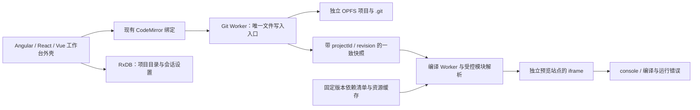

# 浏览器开发工作台可行性研究

## 结论

**✅ 值得做：受控前端模板的本地优先开发工作台。** CodeMirror 三端绑定、OPFS Git 工作区、受控编译与隔离预览
已接成开发闭环，普通工具链导出构建与仓外消费分别验收。
交付合同见 [US-404](US-404-browser-development-workbench.md)。

**当前不立项完整 Node IDE。** 任意 npm / Nx 项目、安装脚本、SSR、终端与原生扩展需要另一档
运行时。OPFS 是存储，Git 是版本管理，两者都不提供 Node 进程。

选型依据来自仓库源码、官方实现与 Context7 文档核对；四类模板、Angular JIT / AOT、
Git 重开与普通构建的实测入口和证据由 US-404 统一维护。固定模板通过不等于任意工程兼容。

## 仓库现在有什么

| 能力              | 核对依据                                                                                                                                                             | 能复用什么 / 还缺什么                                                |
| ----------------- | -------------------------------------------------------------------------------------------------------------------------------------------------------------------- | -------------------------------------------------------------------- |
| 三框架编辑器      | [US-402](../../../../requirements/stories/ui/US-402-code-editor.md)、[`findLanguageByName` / `SUPPORT_LANGUAGES`](../../../../packages/code-editor/src/languages.ts) | 文本编辑、语言支持与主题；不包含项目文件系统、编译器或运行器         |
| 浏览器 Git + OPFS | [`GitWorkbenchRuntime`](../../../../apps/aiao-vscode/src/workbench/git/git-runtime.ts)                                                                               | 固定 JSPI 的工作区内核；导入导出、异常恢复和多 Worker 行为有独立验收 |
| OPFS 文件管理     | [`OpfsStorageFilesystem`](../../../../packages/rxdb-plugin-storage/src/filesystem/opfs-filesystem.ts)                                                                | 可借鉴目录与流式文件处理；storage 的窄接口不能直接当 Git 的 Node fs  |
| 代码文件预览      | [`OpfsFilePreview`](../../../../apps/dev-rxdb-react/src/app/pages/opfs/components/OpfsFilePreview.tsx)                                                               | 代码只读展示，不执行项目                                             |
| 数据库实体历史    | [working-tree 包](../../../../packages/rxdb-plugin-working-tree/README.md)                                                                                           | 管 adapter 写入的实体变更，不管理 Git objects / refs / index         |

复验方式：阅读上述符号；`pnpm nx show projects --json` 可核对存在 aiao-vscode 应用项目。
Git 原型的已知限制与选型依据以 [Git + OPFS 研究](../../../../requirements/domain-research/browser-git-opfs.md)为准。

## 官方实现分别证明了什么

### Angular：完整开发链路，成本也完整

源码入口确实位于 Angular 主仓库的 `adev/src/app/features/playground/`，教程内容位于
`adev/src/content/tutorials/playground/`。
[`Playground`](https://github.com/angular/angular/blob/fdb4517612cf191da3c3e2df251f9f79f026448b/adev/src/app/features/playground/playground.component.ts)
复用编辑器与 `NodeRuntimeSandbox`。
[`NodeRuntimeSandbox`](https://github.com/angular/angular/blob/fdb4517612cf191da3c3e2df251f9f79f026448b/adev/src/app/editor/node-runtime-sandbox.service.ts)
的运行链为 `WebContainer.boot → mount → npm install → npm run start → server-ready`；
模板 [`package.json`](https://github.com/angular/angular/blob/fdb4517612cf191da3c3e2df251f9f79f026448b/adev/src/content/tutorials/playground/common/package.json)
把 `start` 定义为 `ng serve`。

[`typescript-vfs.worker.ts`](https://github.com/angular/angular/blob/fdb4517612cf191da3c3e2df251f9f79f026448b/adev/src/app/editor/code-editor/workers/typescript-vfs.worker.ts)
服务于自动补全、诊断和类型提示，不能据此描述成独立 Angular 编译 Worker。项目编译随
WebContainer 内的开发服务器运行；也不能把 WebContainers 的内部网络虚拟化等同于本应用自己实现 Service Worker 文件服务器。

[WebContainer 快速开始](https://webcontainers.io/guides/quickstart)要求 SharedArrayBuffer 与 COOP / COEP；
[浏览器支持](https://webcontainers.io/guides/browser-support)有额外平台差异，
[API](https://webcontainers.io/api)提供商用 `configureAPIKey`。
因此采用前需核对目标浏览器、部署响应头与商业许可；它适合确实需要 Node 的后续范围。

### Vue：受控 SFC 项目的直接参考

[`compileFile`](https://github.com/vuejs/repl/blob/9b5bc873415bbc6fcba6080b9402d140175d5b03/src/transform.ts)
调用 SFC compiler 的 `parse`、`compileScript`、`compileTemplate`、`compileStyleAsync`。
[`moduleCompiler`](https://github.com/vuejs/repl/blob/9b5bc873415bbc6fcba6080b9402d140175d5b03/src/output/moduleCompiler.ts)
重写模块到 `__modules__` 系统，外部依赖经 import map 解析。
[`Sandbox`](https://github.com/vuejs/repl/blob/9b5bc873415bbc6fcba6080b9402d140175d5b03/src/output/Sandbox.vue)
创建 iframe，再执行 `compileModulesForPreview` 的结果。

这是编译器与模块系统的参考，不能直接照搬 iframe 权限：上游 `srcdoc` 同时允许
`allow-scripts` 和 `allow-same-origin`。在 IDE 同源页面这样运行用户代码，会暴露宿主存储与页面。
URL 序列化适合分享示例，不替代 OPFS 项目与 `.git` 的持久化和备份。

### React：Sandpack 可复用，运行服务也要算成本

React 文档的
[`SandpackRoot`](https://github.com/reactjs/react.dev/blob/0821e7d9428a6c58c922765b891bbffba9ed6249/src/components/MDX/Sandpack/SandpackRoot.tsx)
使用 unstyled `SandpackProvider` 与自定义 `bundlerURL`；
[`CustomPreset`](https://github.com/reactjs/react.dev/blob/0821e7d9428a6c58c922765b891bbffba9ed6249/src/components/MDX/Sandpack/CustomPreset.tsx)
组合 Sandpack 编辑器、布局与自定义交互。

[`loadSandpackClient`](https://github.com/codesandbox/sandpack/blob/7d60a4334980eef304d53b1c3df371ed6dbcf491/sandpack-client/src/clients/index.ts)
区分 runtime、node、static；
[`SandpackRuntime`](https://github.com/codesandbox/sandpack/blob/7d60a4334980eef304d53b1c3df371ed6dbcf491/sandpack-client/src/clients/runtime/index.ts)
把文件与编译请求交给 bundler iframe。不能用“浏览器版 esbuild”概括全部路线。
[headless client](https://sandpack.codesandbox.io/docs/advanced-usage/client)可以接已有编辑器；
[自托管 bundler](https://sandpack.codesandbox.io/docs/guides/hosting-the-bundler)仍需部署与依赖服务评估。

## 本项目的路线选择

| 路线                        | 能覆盖的项目                                        | 本项目新增成本                                        | 建议                                        |
| --------------------------- | --------------------------------------------------- | ----------------------------------------------------- | ------------------------------------------- |
| WebContainers               | Node 开发服务器、包管理与较完整工程                 | 运行时许可、响应头、浏览器差异、VFS 与 OPFS 同步      | 真实需要 Node 时再评审                      |
| Sandpack headless           | 上游支持的 runtime / node / static 模板             | 自托管、依赖服务、离线缓存、与现有 Git 文件所有权对齐 | 阶段 A 的备选，不以默认公共服务作为产品前置 |
| 自有工作区 + 受控编译与预览 | 固定依赖的 HTML / JS / TS、React、Vue、Angular 模板 | 模块与资源解析、三个编译适配、沙箱和诊断              | 推荐；先跑探针再固化编译工具                |

轻量方案限制项目能力，保留完整文件与真实 Git；不必模拟 Node 文件系统和进程。
首版可静态部署，但仍需要单独预览站点、正确 CORS / CSP 和版本固定的编译器、依赖资源，
不是把一个 iframe 加进现有页面就完成。

Git 文件系统独占代码与 `.git`，预览只接收快照；不能再次直接写同一 OPFS 目录。
RxDB 仅保存项目元数据和会话，不能假设数据库事务会原子覆盖文件写入。
框架绑定和模板运行时是两个维度：三端宿主共享同一工作台内核，每个宿主都可打开三种框架模板。

### 三个框架的受控范围

| 模板                 | 候选运行方式                              | 首版限制与阶段 A 必验点                                                                         |
| -------------------- | ----------------------------------------- | ----------------------------------------------------------------------------------------------- |
| HTML / CSS / JS / TS | 浏览器 ESM + TS 转译、统一模块与资源解析  | 相对模块、CSS / 图片、固定依赖；TS 转译不等于完整类型检查                                       |
| React                | JSX / TSX 转译 + 固定 React ESM 依赖      | 多文件组件与状态更新；不执行框架构建插件、SSR 或包安装脚本                                      |
| Vue                  | SFC compiler + 统一模块解析               | script setup、普通 CSS / scoped style、子组件；不含 Sass 等预处理器                             |
| Angular              | 浏览器编译器 / JIT 的 standalone 模板探针 | 先验证 TS 装饰器转换、signals、inject、组件依赖、诊断与导出一致性；不承诺等价 Angular CLI / AOT |

Angular 浏览器 JIT 的可用性由本项目固定版本探针与导出 AOT 构建证明，
不能从 Angular 官方 WebContainer 示例推导。支持边界仍是受控 standalone 模板，
不扩展为 Angular CLI / AOT 的浏览器内完整替代。

### 需要先收紧的边界

- **依赖**：模板生成时固定精确版本、入口、传递依赖与资源摘要；浏览器不解任意 semver，
  不执行 `postinstall`。离线只覆盖已完整缓存的模板，缺资源明确报错；不能默认 CDN 永久在线。
- **文件**：编辑缓冲、已保存 revision 与已提交 Git OID 分开。编译取一致快照，旧项目 / 旧 revision
  的结果不得覆盖新预览；输出和缓存不进入 Git。
- **预览**：使用与 IDE 不同的 origin，且不共享 IDE cookie 作用域；消息绑定 iframe、会话与 revision，
  CSP 限制资源和连接，不提供宿主文件写入或凭据接口。项目之间采用 opaque origin 或逐项目 origin 等经实测方案，
  避免 localStorage / IDB / OPFS 和资源跨项目泄漏；需要预览 OPFS 时不能采用禁止该能力的 opaque origin。
- **恢复与退出**：独立 OPFS 不在数据库备份中，项目归档须含源码与 `.git`；配额不足、中断、多标签写入
  与重开后不一致要有回归。框架模板导出后还要在浏览器外完成干净安装、构建和运行验证。

## 最小验证与投入顺序

1. 固定 Chromium 与依赖版本，验证四类模板的多文件编辑、编译、隔离预览和普通工具链导出构建。
   同时验证 Git 原型的文件快照、真实保存回执、重开与原生 Git 互通，记录耗时和内存，不先承诺性能。
2. 探针通过后接工作台：文件树、已有编辑器、保存、运行、日志、本地提交和恢复，三端共享内核。
3. 最后关闭导入导出、断网、资源回收、异常恢复与独立消费验收。AI、远端 Git、部署与多人协作另立范围。

实现范围、验收状态与可重跑证据以 US-404 为准；本附件不另存一套交付状态。

## 参考

- [US-404：范围、阶段与验收](US-404-browser-development-workbench.md)
- [AI 原生开发环境候选](../../../../requirements/domain-research/ai-native-builder.md)；本故事只承接手工开发工作台切片
- [Git + OPFS 技术研究](../../../../requirements/domain-research/browser-git-opfs.md)
- [Vue REPL](https://github.com/vuejs/repl)
- [WebContainer 浏览器支持](https://webcontainers.io/guides/browser-support)
- [Sandpack client](https://sandpack.codesandbox.io/docs/advanced-usage/client)
