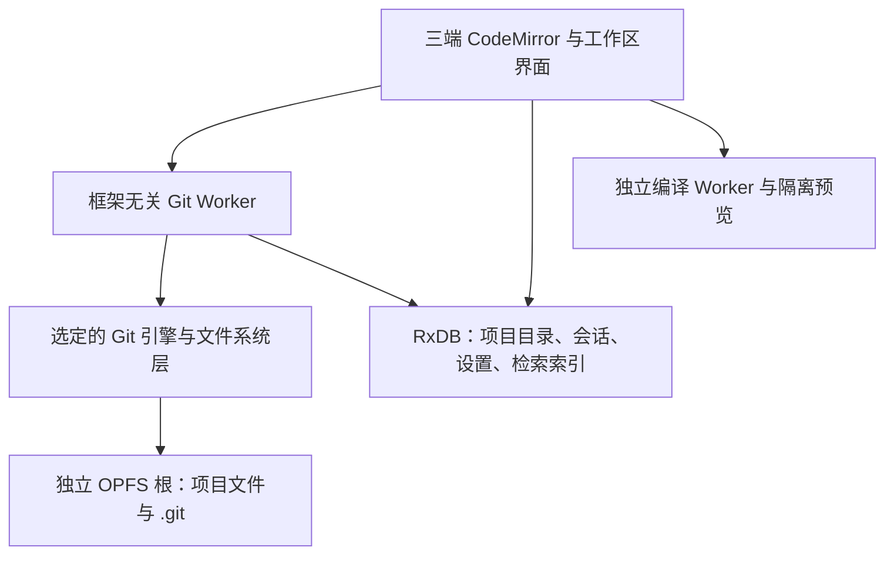

# 浏览器代码工作区：Git + OPFS

> [AI 原生本地优先开发环境](ai-native-builder.md)的技术补充，不单独作为候选或用户故事。
> 调研日期：2026-10-18。已完成 Chromium 合成仓库性能基准，见[实测报告](browser-git-benchmark.md)；
> 浏览器工作区产品集成尚未完成。

**结论：✅ 值得验证。** OPFS 保存工作区与 `.git`，Git 引擎提供版本管理，现有三端
CodeMirror 提供编辑界面，已经有拼出浏览器代码工作区的基础。代码编译、依赖解析与隔离预览
仍是独立工作，不能据此承诺浏览器可以运行任意 Node / Nx 项目。

## 研究分支 011 的复验与最终决策（2026-10-31）

分支 `011-browser-git-opfs` 在当前依赖（`wasm-git 0.0.17`、`isomorphic-git 1.44.4`）上，
用 Chromium 156、M1 Max、100 个文件的 fixture 跑了一轮真实 Worker + OPFS 验收；原始报告见
[`browser-git-research-011.json`](../../benchmarks/reports/browser-git-research-011.json)。本轮新增了
`branch → checkout` 验收，三种配置都保持提交 OID、tree 和文件字节一致，Worker 重开后状态仍为 clean。

| 配置 | clone | 热 status | 提交 | 重开总耗时 | 同秒等长改写 | 分支切换 / 文件互通 |
| ---- | ----: | --------: | ---: | ---------: | ------------: | -------------------: |
| isomorphic-git + OPFS | 244 ms | 65 ms | 53 ms | 144 ms | ❌ 漏检 | ✅ |
| wasm-git JSPI + OPFS | 279 ms | 10 ms | 70 ms | 222 ms | ✅ | ✅ |
| wasm-git Asyncify + OPFS | 303 ms | 11 ms | 68 ms | 225 ms | ✅ | ✅ |

单次采样只用于正确性与数量级判断，不能当作性能门禁。`isomorphic-git` 的漏检在 1.44.4 仍存在，
所以它继续保留为备选；`wasm-git` pthreads 的既有覆盖写入与重开失败仍阻止采用。

1000 文件档的同轮复验也通过三种配置的分支、tree、文件字节和重开状态；热 status 为
`isomorphic 736 ms`、`JSPI 45 ms`、`Asyncify 52 ms`，但 JSPI / Asyncify 重开仍需约 1.3 s 的整库恢复，
所以这些数字只用于范围判断，不构成产品性能承诺。

**最终决策：✅ GO 做受限研究原型；❌ NO-GO 立即产品化。** 下一阶段固定 `wasm-git` JSPI / Asyncify
（Worker、独立 OPFS 根、仓库级 Web Lock）继续补齐 Git 正确性、导入导出和异常恢复；不并行建设
两套引擎，也不自研 Rust Git。只有在 Git 闭环、刷新重开、原生 Git 互通、配额/中断/多标签协调、
浏览器矩阵和三端编辑器接入全部通过后，才按领域毕业路径建立 story、登记 roadmap 并请求 owner 解锁。
任意 Node / Nx 运行时、依赖安装、远端认证、隔离预览和完整 AI IDE 仍不在本分支承诺内。

## 两条路线

**建议优先验证 wasm-git 的 JSPI / Asyncify 工作区原型。** 本轮统一 MEMFS 和 OPFS 实测显示，
它们在多项操作与缓存热路径上有优势；OPFS 重开存在整库加载成本。isomorphic-git 的异步 API
仍便于接入，但固定版本的同秒等长修改检测未通过。pthreads 的覆盖写入与重开 status 也有阻断。
完整数据和限制见[性能评估](browser-git-benchmark.md)，不并行建设两套产品实现。

| 维度       | wasm-git                                                            | isomorphic-git                                     |
| ---------- | ------------------------------------------------------------------- | -------------------------------------------------- |
| 实现       | libgit2 编译为 WebAssembly；调用 `callMain` 或上游封装              | JavaScript 实现 Git；直接调用异步 API              |
| OPFS 接入  | 上游已有三种 OPFS 构建和统一 loader                                 | 接收兼容 Node `fs` 的实现；OPFS 需要文件系统适配层 |
| Worker     | 三种 OPFS 构建均要求 Worker                                         | 建议放 Worker；使用 OPFS 同步访问句柄时要求 Worker |
| 宿主条件   | pthreads 构建需跨源隔离；JSPI / ASYNCIFY 构建不需 SharedArrayBuffer | Git 引擎本身不要求跨源隔离；额外条件由 FS 实现决定 |
| 主要验证点 | 构建选择、持久化顺序、缓存恢复、命令与类型封装                      | FS 语义、元数据持久化、实际 Git 功能覆盖           |
| 许可       | GPL v2 + linking exception                                          | MIT；FS 依赖另核对                                 |

**下一道门槛是产品正确性与浏览器覆盖。** 固定 JSPI / Asyncify 构建验证工作区行为、Git index
元数据、`.git` 重开及导出互通。明确支持的项目类型，符号链接和可执行位等能力必须保真或显式拒绝。
isomorphic-git 先补同秒改写回归并修复接入，再测优化后的 OPFS FS；当前无缓存薄桥不代表其性能上限。

wasm-git 官方示例是 OPFS 接入入口，但上游自动选择在跨源隔离时优先 pthreads，
该构建本轮正确性未通过，应先固定构建。后续继续用相同 fixture 和真实项目比较，
不以 WASM 或 JS 的实现语言判优。

### Rust：保留复用现有实现的路线，暂不自研 Git

Rust 可以用于后续封装与优化，但 Rust 编译为 WASM 不会自动带来 OPFS 文件系统、浏览器网络、
认证或持久化正确性。当前目标是浏览器代码工作区，从零实现 Git 的对象 / pack、index / refs、
网络协议和合并语义会把范围扩大为另一项长期工程，暂不投入。

未来确有需求时，优先复用 gitoxide / gix，或封装 libgit2，再验证目标平台。gitoxide 文档记录了
部分 crates 的 WASM 编译支持，这不等于完整浏览器 Git 引擎已可直接接入；其功能状态也需要逐项核对。
Rust 的 git2 绑定同样使用 libgit2，换语言不会自动消除已有的宿主适配工作。

重评触发条件是：实际仓库证明当前实现存在难以解决的性能或功能缺口，或出现值得承担成本的
Web / 桌面共享 Rust 内核需求。先稳定应用实际使用的 Git 操作边界，不提前建设多引擎插件体系。

### wasm-git：官方 OPFS 已存在，但三个构建语义不同

核对上游源码树 `38eeaccd488535aeaf0e8de01dcdc6148379c839`，其 `package.json` 声明版本
`0.0.17`。npm latest 同为 `0.0.17`，已下载并列出官方 tarball，确认 OPFS 三种构建与 loader
均已发布；本仓库已完成基准的安装、打包和浏览器执行，产品集成尚未完成。

- `lg2_opfs.js`：WasmFS + pthreads，需要 COOP / COEP 及 `SharedArrayBuffer`。
- `lg2_opfs_jspi.js`：用 JSPI 挂起 WASM 栈，需要浏览器支持相应 API，无需跨源隔离。
- `lg2_opfs_async.js`：用 Asyncify，无需跨源隔离；作为单独候选构建验证其体积与开销。
- `lg2_opfs_auto.js`：上游提供统一 API 和能力选择，也允许指定构建。原型先固定构建跑验收，
  不把上游的自动选择当成错误恢复策略；OPFS 不可用时明确拒绝。

JSPI / ASYNCIFY 源码使用 MEMFS 缓存，把 `/opfs` 下的 syscall 写入镜像到 OPFS；关闭写入文件时落盘。
JS 侧编辑应调用 `git.writeFile()` / `opfsWriteFile()`，不能假定任意 `FS.writeFile()` 都持久化。
重开仓库需要 `syncRepo()` / `opfsLoadTree()`。上游 `rename` 实现包含复制后删除，不能据此
推导出 Git refs / index 更新具备原生文件系统的原子性。pthreads 示例另有 WasmFS `getcwd()`
兼容处理。这些都是原型应覆盖的真实边界。

`callMain` 暴露的是 libgit2 `lg2` 示例命令子集，不能直接套完整 Git CLI；命令表没有
`branch` / `rebase` 子命令；源码有 `checkout -b <name>` 从当前 HEAD 创建并切换分支的路径，
具体参数与持久化需原型验收。上游 `git.clone()` 封装还会先删除同名本地仓库，
产品不能直接把它暴露为无损打开 / 更新操作。

上游 `COPYING` 为 GPL v2 + linking exception，接入时保留对应许可与声明；它不是 MIT 包。

### isomorphic-git：OPFS 不等于 Node fs

官方接受 `fs.promises`：基础方法包括 `readFile`、`writeFile`、`unlink`、`readdir`、
`mkdir`、`rmdir`、`stat`、`lstat`，具体方法以固定版本为准。带符号链接的仓库还需要
`readlink` / `symlink`；文件 mode 的处理也必须明确。

OPFS 的文件与目录句柄不直接满足这套接口。已有可验证候选：

- [`@jsonjoy.com/fs-fsa-to-node`](https://github.com/streamich/memfs/tree/master/packages/fs-fsa-to-node)：
  接收 `FileSystemDirectoryHandle`，提供 callback / Promise 接口，可用于 OPFS；来自 memfs 项目，
  Apache-2.0。当前源码的 `symlink` 不支持、`chmod` 无实际效果、`Stats.mode` 为 `0`，
  不能据接口兼容就承诺保留符号链接和可执行位。
- [`@zenfs/dom` WebAccess](https://zenfs.dev/dom/)：官方明确支持 OPFS；需检查它的目录预加载、
  缓存与元数据语义是否适合 Git 工作区。可配置 `disableAsyncCache` 关闭默认内存预载，
  mode 等元数据跨重载保真仍需验证。许可为 LGPL-3.0-or-later，另有 Web 应用打包例外。

两者的异步路径不要求同步 FS 桥。isomorphic-git 检测到 `fs.promises` 后只使用 Promise API，
因此优先验证这条路径；Worker 用于避免 Git 任务阻塞界面，不为了模拟同步 `fs` 引入主线程等待。

先评估这些现有 FS facade，再决定是否自建薄适配层；
不能因为方法同名就判定兼容。需要验证路径规范化、错误码、目录行为、时间与大小元数据，
以及 Git index 对这些信息的使用。符号链接、可执行位等不支持能力必须明确拒绝或限制仓库范围，
不能把它们静默转换成普通文本或统一 mode。

## 在本仓库怎么放

- 编辑器复用 [`code-editor`](../../packages/code-editor/README.md) 及 Angular / React / Vue
  绑定；当前 demo 的编辑器不代表已经具备 JS/TS 编译运行能力。
- [`OpfsStorageFilesystem`](../../packages/rxdb-plugin-storage/src/filesystem/opfs-filesystem.ts)
  已有文件读写、目录和根隔离，可复用实现经验；
  [`StorageFilesystem`](../../packages/rxdb-plugin-storage/src/filesystem/storage-filesystem.ts)
  是 storage 服务的窄接口，缺少 Git FS 语义，删除不存在文件还要求静默成功，不能直接当 Node `fs`。
- 仓库内容由 Git 文件系统层独占，和 storage 插件管理的根目录分开。直接写 OPFS 会绕过
  storage metadata，不能同时让两个服务拥有相同文件路径。wasm-git 上游 loader 的 `/opfs`
  映射到 origin 的 OPFS 根，未提供独立 root handle 配置；目录命名空间与路径限制是我方接入时的验收项。
- [`working-tree`](../../packages/rxdb-plugin-working-tree/README.md) 捕获的是经 RxDB adapter
  写入的实体变更；它的提交图与 Git objects / refs / index 是两套格式。OPFS 文件写入不在其捕获范围。
- [`StorageFileMeta`](../../packages/rxdb-plugin-storage/src/file-meta.entity.ts) 当前为
  `log: false`、`sync: None`；文件体也不随数据库复制。项目跨设备获取通过 Git remote 单独验收。
- RxDB 保存 Git commit OID 作为关联信息，数据库 commit ID 另存；Git 成功后更新索引，
  重开时可重建索引。Git 文件系统与数据库之间不假装存在一个原子事务。
- 数据库加密和数据库备份不自动覆盖独立 OPFS 仓库；项目导出应包含文件与 `.git`，
  代码仓库的加密需求另行设计。

## 浏览器边界

OPFS 按 origin 隔离，要求安全上下文，受站点存储配额限制；清除站点数据会删除仓库。
OPFS 也不等于用户磁盘上的可见目录。因此要验证配额失败、刷新恢复与带历史导出；
可请求持久存储，但不能把浏览器内副本当成唯一备份。

两种引擎都受浏览器网络规则约束。Git Smart HTTP 远端需要允许 CORS，或使用同源服务 / 自控代理；
GitHub 等远端不能仅凭 API token 就假定可以直连。代理与私库认证另作验收，不使用公共代理传私库凭据。
单机编辑与提交可以纯静态托管，接入远端后的服务要求由 Git 服务的 CORS 能力决定。

Git Worker 解决任务隔离与界面响应，OPFS 解决存储隔离；运行项目代码需要独立的预览权限边界。
先支持 HTML / CSS / JS 的受控预览，再评估 TS 转译与框架模板、依赖解析、资源 URL 和刷新机制。
`pnpm install`、终端、原生模块、任意 Nx 构建和 SSR 属于另一档运行时工作。

## 先写验收，再写接入

两条路线使用相同小仓库 fixture，先固定浏览器与构建，再扩 Chromium / Firefox / WebKit。

1. 本地 `init → 新增 / 修改 / 删除 → status → add → commit → log → branch / checkout`，
   包括未提交变更的 checkout 冲突；从 CORS 可控远端 clone / fetch / push 后，用原生 Git
   检查提交 OID、tree 和文件字节互通。
2. 刷新及关闭重开后，HEAD、历史、暂存区、未提交文件与删除状态保持一致；导出包含 `.git`，
   原生 Git 可打开，重导入后仍可继续提交。
3. 同仓库操作串行化；多标签写入通过仓库级 Web Lock 协调。Worker 中断、配额不足及 refs / index
   写入失败后重开，不能误报提交成功；残留锁与部分写入必须可诊断。
4. UTF-8、二进制、嵌套目录、点文件、CRLF、路径越界、符号链接与可执行位；不支持项明确失败，
   不改坏仓库内容。Git 内部必要空目录在导出 / 重导入后可恢复，普通工作目录遵循 Git 不跟踪空目录的语义。
5. 同一份大量小文件 fixture 记录冷启动、clone、status、commit、重开耗时与内存；单独记录
   wasm-git 非隔离构建加载 MEMFS 缓存的成本，不先承诺速度。
6. Git 闭环通过后，连接三端现有编辑器，验收同一份编辑 / 保存 / 提交行为，再增加隔离预览。

这轮研究的产物是选型依据。进入实现时先补红测，Git / FS 核心保持框架无关；新增框架 API 时
遵守 Angular / React / Vue 对称要求。

## 来源

- [wasm-git README（固定源码树）](https://github.com/petersalomonsen/wasm-git/blob/38eeaccd488535aeaf0e8de01dcdc6148379c839/README.md)
- [wasm-git OPFS bridge](https://github.com/petersalomonsen/wasm-git/blob/38eeaccd488535aeaf0e8de01dcdc6148379c839/emscriptenbuild/library_opfs.js)
- [wasm-git loader](https://github.com/petersalomonsen/wasm-git/blob/38eeaccd488535aeaf0e8de01dcdc6148379c839/lg2_opfs_auto.js)
- [wasm-git COPYING](https://github.com/petersalomonsen/wasm-git/blob/38eeaccd488535aeaf0e8de01dcdc6148379c839/COPYING)
- [wasm-git 命令表](https://github.com/petersalomonsen/wasm-git/blob/38eeaccd488535aeaf0e8de01dcdc6148379c839/libgit2patchedfiles/examples/lg2.c)
- [wasm-git checkout](https://github.com/petersalomonsen/wasm-git/blob/38eeaccd488535aeaf0e8de01dcdc6148379c839/libgit2patchedfiles/examples/checkout.c)
- [wasm-git npm 元数据](https://registry.npmjs.org/wasm-git/latest)
- [isomorphic-git FS 接口](https://github.com/isomorphic-git/isomorphic-git/blob/main/docs/fs.md)
- [isomorphic-git FS 类型](https://github.com/isomorphic-git/isomorphic-git/blob/main/src/typedefs.js)
- [isomorphic-git 浏览器 clone 示例](https://github.com/isomorphic-git/isomorphic-git/blob/main/docs/guide-quickstart.md)
- [isomorphic-git 许可](https://api.github.com/repos/isomorphic-git/isomorphic-git/license)
- [memfs FSA facade 源码](https://github.com/streamich/memfs/blob/master/packages/fs-fsa-to-node/src/FsaNodeFs.ts)
- [memfs FSA Stats](https://github.com/streamich/memfs/blob/master/packages/fs-fsa-to-node/src/FsaNodeStats.ts)
- [ZenFS WebAccess 源码](https://github.com/zen-fs/dom/blob/main/src/access.ts)
- [ZenFS 配置](https://github.com/zen-fs/core/blob/main/src/config.ts)
- [gitoxide WASM 编译支持记录](https://github.com/gitoxidelabs/gitoxide/blob/main/etc/reports/23-02.md)
- [gitoxide 功能状态](https://github.com/gitoxidelabs/gitoxide/blob/main/crate-status.md)
- [MDN OPFS](https://developer.mozilla.org/en-US/docs/Web/API/File_System_API/Origin_private_file_system)
