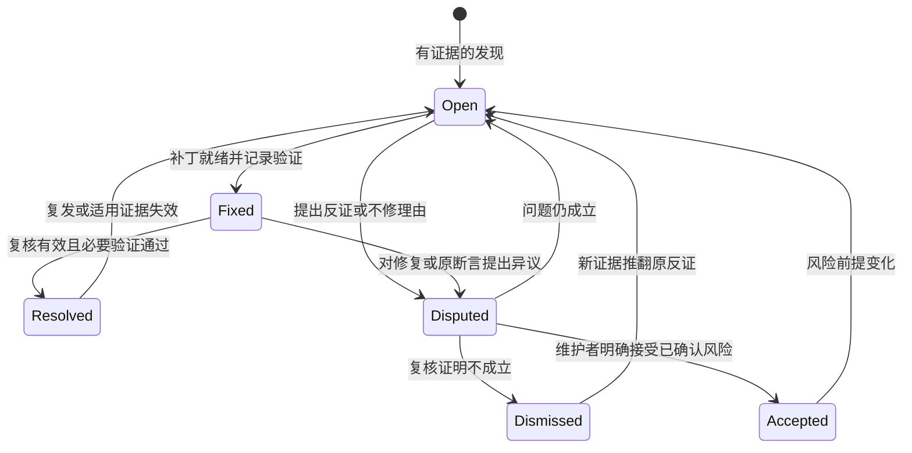

# 全量与增量 AI 代码评审方案

方案状态：待评审。项目 skill 与共享问题记录规范已落地；本文定义范围、增量状态与后续自动化的设计依据，不参与故事状态统计。
设计日期：2026-11-08。

✅ **值得做。** 用项目自己的 skill 支持全量、增量、分支/项目选择和单问题处理；把有问题的项与修复、异议结果持久保存，让不同 AI 会话接得上。

## 1. 交付入口与职责

可直接使用 [ai-code-review skill](../.agents/skills/ai-code-review/SKILL.md)。当前由执行 skill 的 AI 会话使用现有 Git、Nx 和文件工具完成工作，不需要新增模型 SDK、后台服务或尚不存在的 Nx target。

| 内容               | 事实源                                                               | 作用                                                             |
| ------------------ | -------------------------------------------------------------------- | ---------------------------------------------------------------- |
| 操作入口           | [SKILL.md](../.agents/skills/ai-code-review/SKILL.md)                | 识别请求、选择模式与范围、路由评审或单问题处理                   |
| 问题状态与处置     | [reviews/](reviews/README.md) 中按项目保存的 Markdown                | 持续记录有问题的项、修复结果、反证与不修决定                     |
| 记录结构与状态     | [模板](reviews/review.template.md)、[CONVENTIONS.md](CONVENTIONS.md) | 多模型共用协议；不为每个模型定义一种报告                         |
| 增量覆盖与执行快照 | Git common dir 下的本地 JSON                                         | 说明审过什么、继承什么、还缺什么；可以没有问题但仍有有效覆盖记录 |
| 质量检查           | 现有 [统一 CI](../.github/workflows/ci-template.yml)                 | lint、typecheck、test、coverage、build 与 e2e 提供可复验结果     |

**Markdown 是问题与处置的事实源，JSON 是覆盖与运行的事实源。** 问题索引可以由 Markdown 重建；覆盖记录不能从“没有问题文件”推断。

## 2. 操作、分支与项目分别选择

参数表示 skill 的任务约定，不是已安装的命令行工具；中文请求与下面的参数含义相同。

| 操作                   | 实际范围                              | 可更新内容                                      |
| ---------------------- | ------------------------------------- | ----------------------------------------------- |
| `full` 全量评审        | 所选分支、项目与 range 的全部必审内容 | 所选项目的问题、实际覆盖与各自检查点            |
| `incremental` 增量评审 | 同一作用域有效基线后的变化及关联影响  | 新增/复核问题、变化与继承覆盖、完整后推进检查点 |
| `fix --issue=ID`       | 指定问题、所属分支及其必要修复链      | 此问题的修复代码、回归和处理事件                |
| `verify --issue=ID`    | 指定问题的原证据、当前实现与修复/异议 | 此问题的复核证据与状态                          |
| `dispute --issue=ID`   | 指定问题的反证和不修理由              | 此问题的异议事件，不能伪装成修复                |

选择维度：

- `branch`：待审分支，冻结为实际提交 SHA。未指定取当前 checkout；detached 时用该 worktree 标识隔离。
- `project`：一个、多个或全部真实 Nx 项目名。未指定沿用本次任务已明确的项目，否则取全部；不猜相似名称。
- `range=project`：默认，评审所选项目在该分支的代码；全量覆盖全项目，不限于分支 diff。
- `range=branch`：显式选择时，评审该分支相对 `base` 的净变化与相关契约；它与全项目覆盖分开记账。
- `worktree`：显式纳入当前 checkout 的未提交内容；默认只评审提交快照，并在结果中写清这一点。不能把当前工作区的改动叠加到另一条指定分支。
- `independent`：要求当前模型独立复审；默认允许接续其他模型的有效覆盖，保留原始归属。

调用示例：

```text
$ai-code-review incremental
$ai-code-review full --branch=codex/feature-x --project=rxdb
$ai-code-review incremental --branch=codex/feature-x --project=rxdb-angular
$ai-code-review full --branch=codex/feature-x --project=rxdb --range=branch --base=main
$ai-code-review incremental --project=rxdb --worktree
$ai-code-review full --project=rxdb --independent
$ai-code-review fix --issue=RV-<id>
$ai-code-review verify --issue=RV-<id>
$ai-code-review dispute --issue=RV-<id> 原触发前提不存在，请记录反证
```

只审 `codex/feature-x` 的 `rxdb`，就只推进这个项目、分支与 range 的覆盖；补读其他项目用于核对调用关系，不等于完成了其他项目评审。
单问题修复不扩大为批量修复，也不更新整个项目或整条分支的完整评审检查点。跨框架/跨包同根因修复仍应统一完成必要契约。

## 3. 按项目保存问题，只记录有问题的项

新记录的统一位置如下，应用项目也使用真实 Nx 名称归档：

```text
requirements/reviews/
  README.md
  review.template.md
  rxdb/
    RV-<uuid>.md
  rxdb-angular/
    RV-<uuid>.md
  dev-rxdb-p2p/
    RV-<uuid>.md
```

一个问题一个文件。普通项目名直接作目录名；特殊字符按 UTF-8 百分号编码，真实名称保存在 `project` 字段，例如 `@aiao/source` 对应 `%40aiao%2Fsource`。
新编号使用 `RV-` 加无连字符 UUID，避免不同模型争抢递增序号；旧 ID 不重分配，单问题请求可使用唯一前缀。

没有缺陷就不创建目录、空报告或“无问题”条目；覆盖结果放终端与本地 JSON。出现过问题的文件继续保存，关闭后不删除，以 `status` 区分当前处置。
同一项目、分支和根因再次被发现，追加原记录；全量/增量、project/branch 范围、不同 base 的发现来源写入事件，不改变问题主身份。按模型、日期或运行复制一份报告会破坏闭环。

跨项目同根因问题归根因项目，其他项目记在 `affected_projects`；同一问题在不同分支各建记录并通过 `related_findings` 关联。
每条记录状态只对自己的分支成立：A 分支修复不自动关闭 B 分支，cherry-pick 后也要核对实际代码与回归。

既有应用内或根目录旧报告继续可定位。按需要迁移时保留原 ID 与来源，每个问题只保留一份可编辑事实源；已经清理掉的历史不凭空恢复。

## 4. 修复、异议与复核闭环

状态定义唯一入口为 [CONVENTIONS.md](CONVENTIONS.md#状态定义)：



### 4.1 单问题修复

加载完整问题记录，确认目标分支和源码快照，按触发条件复现，先写有意义的回归，再修改必要代码。执行适用的 Nx targets，记录实际通过、失败或未运行的部分。
修复事件必须说明：改了哪些路径、修复前后行为、补丁 SHA 或工作区快照、验证命令与结果、剩余缺口。状态先为 `Fixed`，验证与复核满足要求才为 `Resolved`。
仅有补丁、仅编译通过或只由模型自述“应该修好”，都不能替代问题所需层级的证据。`Resolved` 表示该分支的修复已核对，不表示已经合入 main。

单问题修复默认只改这一根因；为满足三框架对称或共享契约所需的关联改动属于同一修复，其他独立问题另行处理。

### 4.2 不修复与异议

不修时同样写处理结果：具体不同意哪条断言、反证对应的快照与代码/测试、建议怎样裁决、还有哪些不确定性。
必须区分：问题不成立、触发前提被上游排除、问题成立但希望延期、维护者接受风险。前两类可以通过有效复核得到 `Dismissed`；已确认缺陷的风险接受由维护者明确决定后写成 `Accepted`。
提出异议先记为 `Disputed`。模型不能因为不想修、影响看似很小或两个模型意见一致，就自动关闭已确认缺陷。

### 4.3 保留每次实际处理

每个事件至少记录：eventId、时间、操作、实际执行者、输入/输出快照、状态变化、结论、验证及未解决项。
发现、修复、复核和异议分别留事件；正文可修正当前根因判断，但不能覆盖或删掉其他模型已提供的处理证据。
旧问题本轮未再被提及不代表修好；证据变化时添加复核义务，revert 或删除文件同样要核对存活路径。

## 5. 不同模型如何接续

默认使用当前执行 skill 的 AI，不依赖特定厂商。每次实际动作记录 `provider / model / version / session` 与角色；信息无法取得时写 `unknown`，不能编造模型身份或把客户端名当模型名。
同一模型可以发现、修复并验证，按步骤如实记录；也可由模型 A 评审、模型 B 修复、模型 C 复核。交接依赖相同记录和证据，不依赖对方会话记忆。

| 需要                      | 行为                                                                       |
| ------------------------- | -------------------------------------------------------------------------- |
| 另一个模型继续增量评审    | 继承代码和上下文仍有效的既有覆盖，逐单元保留原评审者；当前模型检查新的变化 |
| 要求当前模型独立复审      | 使用该实际评审者独立的检查点；无有效基线就全量检查所选范围                 |
| 另一个模型修复/复核某问题 | 读取相同记录追加新事件，原发现与之前处置保留                               |
| 模型提出不同意见          | 追加反证与异议，按证据复核；不按票数判定                                   |
| 模型身份不可审计          | 可以继续任务并记录 unknown；不能复用“该模型独立审过”的声明                 |

**覆盖接续与模型响应缓存分开。** 接续继承的是“哪位评审者看过哪些有效输入”，不能表述为当前模型亲自重新审过。
响应缓存必须匹配真实模型、参数、提示词、规则与全部输入；不能拿 A 的响应伪装成 B 的调用结果。
切换修复模型不改变问题 ID；修复引起代码变化会触发后续增量复核，不能直接把新源码写成项目已审。

Skill 不自动启动额外模型或付费调用。用户选择其他会话执行同一 skill 即可交接；额外模型调用、并行执行或远端评论沿用用户授权。

## 6. 增量基线与作用域

| 标识       | 含义                                                              |
| ---------- | ----------------------------------------------------------------- |
| `H`        | 当前待审提交，或独立工作区快照                                    |
| `B`        | 分支差异模式的目标分支 tip                                        |
| `M`        | `B/H` 唯一 merge base，仅用于分支差异模式                         |
| `L`        | 同一作用域上一次完整评审的源码快照                                |
| `scopeId`  | 仓库、分支/worktree、项目、range、base ref、提交/工作区视图的组合 |
| `strategy` | 默认接续，或按实际模型身份隔离的独立复审                          |

`scopeId` 不包含修复者，也不能只由当前分支名组成。项目/分支差异范围、不同项目、不同分支与提交/工作区视图的检查点互不冒用。
多个项目各自保存覆盖；所选项目全部完成后才可声明整个请求完成。单项目 checkpoint 不等于全仓或整条分支的完整覆盖。

项目模式全量种子为项目在 `H` 的受版本控制内容；分支差异模式全量种子为 `git diff M H` 中属于所选项目的变更。
增量调度比较 `L` 与 `H` 两棵树，工作区模式比较保存的文件清单；最近一次提交的 diff 不能代替同范围的完整覆盖。
默认提交模式在有未提交代码时明确指出排除范围；其他分支通过冻结的 Git 内容或已有目标 checkout 读取，保护当前工作区。

## 7. 失效、上下文与完整性

| 事件                                           | 动作                                                                 |
| ---------------------------------------------- | -------------------------------------------------------------------- |
| 首次运行、检查点丢失、作用域变化或无法验证覆盖 | 对当前选择范围全量评审；不能从没有报告推断已审                       |
| 正常追加提交                                   | 重审变化文件与关联影响，保留仍有效的已有覆盖                         |
| rebase/force push 导致旧 head 不再是祖先       | 重建并全量评审当前选择范围                                           |
| 分支差异模式 base tip 或 merge base 改变       | 重审所选分支差异，并提供相关目标契约                                 |
| 规则、提示词中的审阅标准、上下文选择规则不兼容 | 失效受影响覆盖，边界不清就对选择范围全量评审                         |
| 项目新增消费者、删边、移动或删除文件           | 重新枚举清单与图，核对两端及存活引用                                 |
| 切换模型                                       | 默认接续保留原归属；独立复审按当前身份重新选基线，响应缓存按模型隔离 |
| 历史缺失、无/多 merge base、上下文不足         | 报告缺口，不能形成完整通过结论                                       |

每个项目按相关文件组评审，保留跨文件组合检查：完整实现、必要旧行为、相关测试、直接依赖及调用点。
公共类型或运行时语义变化加入消费者与 API 入口；core/plugin/任一绑定变化核对 Angular、React、Vue 对应契约；共享 conformance 变化核对所有后端入口。
复用既有 [API 审计](../scripts/audit/api-surface.mjs)、[包组合事实源](package-graph.json)和[共享套件审计](../scripts/audit/working-tree-suite-callsites.mjs)作为线索，不能以类型未变代替行为兼容。

项目图必须对应待审快照，每轮与旧路径/依赖取并集。候选目录清单和文件内容都参与指纹，捕获上次从未读过的新消费者；不能只摘要模型已读 diff。
边界无法证明时对选择范围扩大重审；补读关联项目不自动扩大完整评审声明。文本超大时分批，二进制或生成物逐项说明排除原因，不能静默截断。

## 8. 持久化与并发

本地执行状态位于 Git common dir 的 `ai-review/v1/`，不提交缓存、原始上下文或无问题 Markdown：

```text
checkpoints/<scopeId>/<strategyKey>.json
runs/<runId>/manifest.json
runs/<runId>/coverage.json
units/<model-and-input-key>/result.json
```

完整检查点包含实际快照、政策指纹、文件/上下文指纹、required/covered/outstanding 清单及逐单元的评审来源。
模型响应指纹包含实际身份、调用参数、提示词/规则、输出结构、源码与上下文清单；模型仅有可变别名时不把缓存声明为稳定独立评审证据。
修复/异议状态以 Markdown 为准，JSON 索引必须允许重建，不得用旧缓存覆盖用户在记录中的新处置。

运行完成与没有缺陷分别描述。完整覆盖允许仍有 Open/Disputed 问题；预算耗尽、补读不足或快照过时则为未完成，不推进完整检查点。
按作用域加锁，使用临时文件和原子替换，提交前核对旧检查点版本与当前来源 refs。问题 Markdown 写前核对原文件摘要；并发变化时重读归并事件，而非最后写入者覆盖全部内容。
单问题关闭也核对输入快照；其他模型同时改了代码或记录时先保留双方证据，不能用陈旧结论关闭新版本问题。

## 9. 输出与后续自动化

终端回复展示：操作、项目、分支与快照、range、全量/增量、实际重审与继承来源、未完成内容及新增/处理问题链接。
没有问题就只在回复中给结论和覆盖限制；Markdown 不抄通过文件清单。每条问题包含影响、触发条件、路径/符号/片段证据、处置和实际验证结果。

当前 skill 不强制在线 API 调用。后续如接自动 runner，保留相同记录与覆盖协议，按请求配置预算、超时和有限重试；失败不能假装空问题。
PR 发布作为后续能力：受信工作流只读取冻结代码，分别配置模型调用和写评论权限，评论绑定实际 head SHA，发布前后核对过时状态。
现有 [pr.yml](../.github/workflows/pr.yml)的 `ci` 和 [ci-template.yml](../.github/workflows/ci-template.yml)的 `gate` 保持质量门禁职责；AI 先给建议，拟启用阻断时再评估并接入汇总。

## 10. 验收场景

Skill 的结构校验与文档一致性检查不等于自动评审引擎已经实现。以下场景用于实际执行和后续 runner 的行为验收，不把尚未执行的回放写成通过。

| 编号 | 请求/变化                          | 可判定结果                                                    |
| ---- | ---------------------------------- | ------------------------------------------------------------- |
| 1    | 全量评审一个项目                   | 该项目完整范围入账，其他项目未被冒称完成                      |
| 2    | 同一作用域原样增量重跑             | 继承有效覆盖，记录原评审者，不重复建问题                      |
| 3    | 无检查点直接增量                   | 对选择范围全量，不从空报告推断已审                            |
| 4    | 指定另一分支的某项目               | 读取目标快照与目标项目关系，当前工作区无关改动保留            |
| 5    | project 与 branch range 切换       | 不互用完整检查点，结果解释清楚各自范围                        |
| 6    | 只修改一个独立项目                 | 重审该项目变化及关联影响，其他有效覆盖保留                    |
| 7    | 只修指定 ID                        | 只做该根因必要改动，记录修复结果，不推进项目检查点            |
| 8    | 模型 A 评审、B 修复、C 复核        | 同一 Markdown 依次追加实际身份、快照、回归与状态              |
| 9    | 换模型继续增量/独立复审            | 前者保留原归属，后者走本模型基线，缓存不跨模型冒用            |
| 10   | 修复已写但验证失败或未完成         | 保留失败与缺口，不能标 Resolved                               |
| 11   | 单独提出不修异议                   | 记录反证和理由，Disputed 与 Dismissed/Accepted 有明确证据区别 |
| 12   | 同一缺陷存在于两条分支             | 独立记录并关联，修好一条不关闭另一条                          |
| 13   | 多模型发现相同问题                 | 同分支同根因追加证据，不按模型复制文件                        |
| 14   | 已关闭问题复发                     | 保留原修复或不修结果并重开，不删除历史证据                    |
| 15   | 全部项目没有发现                   | 无空问题目录和无问题 Markdown，真实覆盖仍可保存               |
| 16   | rebase、base 前移、规则改变        | 按失效规则重审当前选择范围                                    |
| 17   | 删除、改名、revert、新消费者       | 旧问题和存活引用进入复核，净 diff 为零不能丢问题              |
| 18   | 三框架或共享测试入口变化           | 对应绑定/后端均有契约核对，不能只看文件名                     |
| 19   | 单问题证据被并发改动               | 检测内容摘要变化，归并事件或保留冲突，不能陈旧关闭            |
| 20   | 部分评审、预算耗尽或快照改变       | 保留实际覆盖和剩余清单，不推进完整检查点                      |
| 21   | 项目名含特殊字符、旧编号、唯一前缀 | 可逆归档、唯一定位；歧义时列候选，不误修                      |
| 22   | 未提交视图与提交视图               | 分开保存检查点，实际排除/纳入范围清楚                         |

后续自动化先用临时 Git 仓库、固定响应和异常注入验证范围、状态机与并发，再用真实分支回放评估有效发现比例、重大缺陷遗漏、误关问题、token 与耗时。
基准由维护者核对所有发现与已知缺陷；不能把某个模型的全量输出直接当真相。达到质量目标前保持建议模式。

## 11. 复验与维护

当前文件入口：skill 负责操作分流，两份参考分别负责评审与单问题处理；模板和 CONVENTIONS 负责共享记录，不在每个模型适配中重复维护。
规则变化先同步 skill、模板和共享约定，再决定哪些历史覆盖失效；旧问题结论以其适用快照解释，不覆盖历史处置证据。

```bash
pnpm nx format:check --files=requirements/incremental-ai-code-review.md,requirements/README.md,requirements/CONVENTIONS.md,requirements/reviews/README.md,requirements/reviews/review.template.md
pnpm nx exec --projects=@aiao/source --excludeTaskDependencies -- node scripts/audit/requirements-consistency.mjs --check
```

Git 比较与祖先语义依据 [git diff](https://git-scm.com/docs/git-diff) 和 [git merge-base](https://git-scm.com/docs/git-merge-base)；项目范围以 [Nx 项目图与 affected](https://nx.dev/docs/features/ci-features/affected)及目标快照配置核对。
本方案不承诺模型零漏检；要求范围、来源、修复和异议都能被核查，并让不同模型接续同一份事实。
