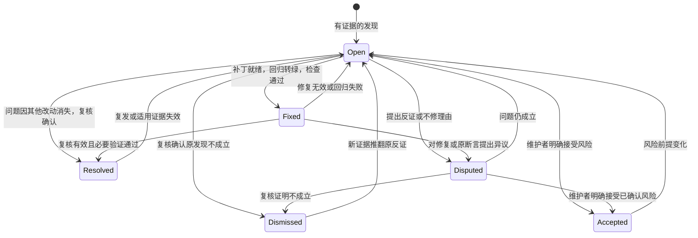

# 全量与增量 AI 代码评审方案

方案状态：待评审。项目 skill、记账脚本与共享问题记录规范已落地；本文写设计依据与验收场景，不参与故事状态统计。
设计日期：2026-11-08。

✅ **值得做。** 用项目自己的 skill 支持全量、增量、分支 / 项目选择和单问题处理；把有问题的项与修复、异议结果持久保存，让不同 AI 会话接得上。

## 1. 交付入口与职责

可直接使用 [ai-code-review skill](../.agents/skills/ai-code-review/SKILL.md)。评审由执行 skill 的 AI 会话完成；快照、归属、覆盖等确定性部分交给记账脚本，不依赖模型 SDK、后台服务或新的 Nx target。

| 内容           | 事实源                                                                          | 作用                                                         |
| -------------- | ------------------------------------------------------------------------------- | ------------------------------------------------------------ |
| 操作入口       | [SKILL.md](../.agents/skills/ai-code-review/SKILL.md)；Claude Code 入口只做转引 | 识别请求、选择模式与范围、路由评审或单问题处理               |
| 评审标准       | [rubric.md](../.agents/skills/ai-code-review/references/rubric.md)              | 报什么、不报什么、严重程度与证据写法；摘要进覆盖单元键       |
| 记账脚本       | `scripts/ai-review/ai-review.mjs`（[scripts 索引](../scripts/README.md)）       | 快照、项目归属、必审清单、覆盖登记与状态、问题 ID 与记录查找 |
| 问题状态与处置 | [reviews/](reviews/README.md) 中按项目保存的 Markdown                           | 有问题的项、修复结果、反证与不修决定                         |
| 记录结构与状态 | [模板](reviews/review.template.md)、[CONVENTIONS.md](CONVENTIONS.md#状态定义)   | 多模型共用的记录协议与状态转移表                             |
| 覆盖与进度     | `<git common dir>/ai-review/v1/coverage.jsonl`                                  | 谁按什么标准审过哪些内容；可以没有问题、但仍有覆盖           |
| 质量检查       | 现有 [统一 CI](../.github/workflows/ci-template.yml)                            | lint、typecheck、test、coverage、build 与 e2e 提供可复验结果 |

**Markdown 是问题与处置的事实源，JSONL 是覆盖的事实源。** 覆盖引用它产出的记录 ID，记录不在了，覆盖随之失效；不能从「没有问题文件」推断已经审过。

## 2. 操作、分支与项目分别选择

参数是 skill 的任务约定，不是已安装的命令行工具；Codex 写 `$ai-code-review`，Claude Code 写 `/ai-code-review`，中文请求含义相同。

| 操作                   | 实际范围                               | 可更新内容                       |
| ---------------------- | -------------------------------------- | -------------------------------- |
| `incremental` 增量评审 | 从未覆盖或覆盖已失效的单元             | 新增 / 复核问题、本次登记的覆盖  |
| `full` 全量评审        | 整个范围，只认本次开始之后登记的覆盖   | 同上                             |
| `fix --issue=ID`       | 指定问题及其必要修复链                 | 此问题的修复代码、回归和处理事件 |
| `verify --issue=ID`    | 指定问题的原证据、当前实现与修复或异议 | 此问题的复核证据与状态           |
| `dispute --issue=ID`   | 指定问题的反证和不修理由               | 此问题的异议事件，不能伪装成修复 |

选择维度：

- `branch`：默认当前检出位的提交快照。`--branch` 读冻结的 git 对象；记录写到该分支的检出位，没有检出位就只在终端输出。
- `project`：默认取当前快照相对默认分支改到的项目（`ai-review affected`）；`--project=all` 才审全仓。待审超过 3 个项目或 200 个文件时，先列计划等用户确认。
- `range=project`：默认，评审所选项目在快照里的全部文件，不限于分支 diff。
- `range=branch`：显式选择时，评审 `merge-base(base, H)` 以来属于所选项目的改动；`base` 默认 `origin/HEAD`。
- `worktree`：显式纳入当前检出位的未提交内容；默认只评审提交快照，并在结果里写清。不能叠加到另一条指定分支。
- `independent`：只认当前评审者签名登记的覆盖；默认允许接续其他模型的有效覆盖，并保留来源。

规模参照：本仓库 105 个 Nx 项目、约 6,900 个必审文件、约 117 万行；只 `rxdb` 一个项目就有 327 个文件、约 8.6 万行。默认范围因此取分支改到的项目，全仓必须显式选择。

## 3. 按项目保存问题，只记录有问题的项

```text
requirements/reviews/
  README.md
  review.template.md
  rxdb/
    RV-<uuid>.md
  rxdb-angular/
    RV-<uuid>-<slug>.md
  aiao__source/
    RV-<uuid>.md
```

- 一个问题一个文件，应用项目也写在仓库根。目录名是 Nx 项目名去掉开头的 `@`、`/` 换成 `__`；真实名称写在 `project` 字段，目录名不需要可逆。
- 新编号是 `RV-` 加无连字符 UUIDv7，按时间排序，不同模型并行分配也不会撞号；旧 ID 不重分配，单问题请求可以用唯一前缀。
- 没有缺陷就不建目录、空报告或「无问题」条目；覆盖放本地 JSONL。出现过问题的文件继续保存，关闭后不删除，以 `status` 区分当前处置。

**记录跟随代码树。** 记录受版本控制，随代码分支分叉与合并；状态描述所在代码树的最近一次复核结果，同一根因只保留一份可编辑记录：

- 写在被评审快照的检出位，随 merge / cherry-pick 一起走；`found_*` 字段只记首次发现来源。
- 同一棵树里同一根因只留一份；各分支分别发现、合并后出现两份时，保留较早的一份，并入另一份的事件，删除重复文件，在保留的记录里追加 merge 事件写明来源 ID。
- 状态只对最近一次复核的快照成立：A 分支修好了，不代表 B 分支也修好了；cherry-pick 之后要在目标分支上 verify。
- 跨项目同根因问题归根因项目，其他项目记在 `affected_projects`。

既有应用内或根目录旧报告继续可定位。按需要迁移时保留原 ID 与来源，每个问题只保留一份可编辑事实源；已经清理掉的历史不凭空恢复。

## 4. 修复、异议与复核闭环

状态转移表的唯一入口是 [CONVENTIONS.md](CONVENTIONS.md#状态定义)，下图与之一致：



### 4.1 单问题修复

加载完整问题记录，确认目标分支和源码快照，按触发条件复现，先写有意义的回归，再修改必要代码。执行适用的 Nx targets，记录实际通过、失败或未运行的部分。
回归转绿且检查通过才写 `Fixed`；检查没过的尝试不改状态，只追加事件写明失败。`Resolved` 需要复核事件，表示该快照上的问题已核对不存在，不表示已经合入 main。

单问题修复默认只改这一根因；为满足三框架对称或共享契约所需的关联改动属于同一修复，其他独立问题另行处理。修复改了代码，下一次增量评审自然会重审这些文件，fix 本身不登记覆盖。

### 4.2 不修复与异议

不修时同样写处理结果：具体不同意哪条断言、反证对应的快照与代码或测试、建议怎样裁决、还有哪些不确定性。
必须区分：问题不成立、触发前提被上游排除、问题成立但希望延期、维护者接受风险。前两类可以通过有效复核得到 `Dismissed`；已确认缺陷的风险接受由维护者明确决定后写成 `Accepted`。
模型不能因为不想修、影响看似很小或两个模型意见一致，就自动关闭已确认缺陷。

### 4.3 保留每次实际处理

每个事件至少记录：eventId、时间、操作、实际执行者、输入 / 输出快照、状态变化、结论、验证及未解决项。
发现、修复、复核、异议和重开分别留事件；正文可修正当前根因判断，但不能覆盖或删掉其他模型已提供的处理证据。
旧问题本轮没再被提及不代表修好；评审重审到相关文件时核对旧问题，消失的列为待 verify，复发的重开。

## 5. 不同模型如何接续

默认使用当前执行 skill 的 AI，不依赖特定厂商。评审者签名是 `<provider>/<model>`，只取会话里实际看得到的模型 ID；看不到就写 `unknown`，不编造，也不把客户端名当模型名。
同一模型可以发现、修复并复核，按步骤如实记录；也可以由模型 A 评审、模型 B 修复、模型 C 复核。交接依赖相同的记录、覆盖与证据，不依赖对方的会话记忆。

| 需要                        | 行为                                                                               |
| --------------------------- | ---------------------------------------------------------------------------------- |
| 另一个模型继续增量评审      | 继承仍有效的覆盖，`status` 的 `reviewers` 列出来源；当前模型只审失效与未覆盖的单元 |
| 要求当前模型独立复审        | `--independent=<签名>` 只认该签名登记的覆盖；身份未知不能独立复审                  |
| 另一个模型修复 / 复核某问题 | 读取同一记录追加新事件，原发现与之前处置保留                                       |
| 模型提出不同意见            | 追加反证与异议，按证据复核；不按票数判定                                           |
| 模型身份不可审计            | 签名写 `unknown`，可以继续默认接续，不能声称独立审过                               |

继承的是「哪位评审者按哪版标准看过哪些内容」，回复里必须写明来源，不能表述为当前模型亲自重新审过。
Skill 由会话执行，没有模型响应缓存。它不自动启动额外模型或付费调用；用户选择其他会话执行同一 skill 即可交接，额外模型调用、并行执行或远端评论沿用用户授权。

## 6. 覆盖按内容寻址

| 概念     | 含义                                                                            |
| -------- | ------------------------------------------------------------------------------- |
| 快照     | 提交视图是提交 SHA 与树；工作区视图用临时 index 捕获的树，真实 index 不动       |
| 项目归属 | 快照里每个 `project.json` 的 `name`，文件归 root 最深的项目，根项目只收其余文件 |
| 必审单元 | `range=project`：所选项目的全部文件；`range=branch`：merge base 到快照的改动    |
| 单元键   | 评审标准摘要、range、路径、新旧两侧 blob 的哈希                                 |
| 一条覆盖 | 单元键、评审时依赖的上下文文件 blob、产出的记录 ID、评审者、时间                |
| 有效     | 上下文 blob 与当前快照一致，引用的记录都还在                                    |

- 评审记录、锁文件和二进制文件不进必审单元，原因列在 `excluded`；生成物等不审的文件要登记 `skip` 和理由，单独列出。
- 「全量」只认本次开始之后登记的覆盖（`--since`），「独立」只认同一签名；两者都是过滤条件，不是另一套状态。
- 不按分支或提交保存检查点。rebase、force push、base 前移都不改变内容，按提交记账会让每条新分支、每次 rebase 都从零开始；按内容记账时，同样内容在别的分支审过也能继承，完整性仍按本次快照与范围逐单元判定。

## 7. 失效、上下文与完整性

| 事件                            | 动作                                                              |
| ------------------------------- | ----------------------------------------------------------------- |
| 首次运行、没有任何覆盖          | 全部单元待审；不能从没有报告推断已审                              |
| 正常追加提交                    | 只有 blob 变了或上下文变了的单元待审，其余继承                    |
| rebase、force push、base 前移   | 内容没变的单元继续有效；range=branch 下两侧 blob 有变化的单元待审 |
| 评审标准改动                    | 单元键全部变化，覆盖全部失效                                      |
| 上下文文件改动                  | 依赖它的单元失效，`status` 的 `invalid` 写明原因                  |
| 引用的问题记录不见了            | 产出它的单元失效，问题会被重新发现                                |
| 新消费者、删边、移动或删除文件  | 新文件本身是新单元；删除在 range=branch 下是单元，旧问题进入复核  |
| 切换模型                        | 默认接续保留来源；独立复审按签名过滤                              |
| 无 merge base 或多个 merge base | range=branch 直接报错，不形成完整结论                             |

每个项目按相关文件组评审，保留跨文件组合检查：完整实现、必要旧行为、相关测试、直接依赖及调用点。
公共类型或运行时语义变化加入消费者与 API 入口；core / plugin / 任一绑定变化核对 Angular、React、Vue 对应契约；共享 conformance 变化核对所有后端入口。
复用既有 [API 审计](../scripts/audit/api-surface.mjs)、[包组合事实源](package-graph.json)和[共享套件审计](../scripts/audit/working-tree-suite-callsites.mjs)作为线索，不能以类型未变代替行为兼容。
补读关联项目不自动扩大完整评审声明；超大文本分批，生成物逐项说明排除原因，不能静默截断。

## 8. 持久化与并发

- 覆盖只追加写进 `<git common dir>/ai-review/v1/coverage.jsonl`，每批一次写入，不需要锁；同一仓库的所有 worktree 共享，不提交、不进 PR。
- 读取时忽略最后一段未写完的半行；下一批写入发现末尾是写断的半行，先另起一行写封存标记，读取时跳过被封存的半行，其余行损坏直接报错。
- `--since` 按时刻比较（不按字符串），开始时间带不带毫秒、写不写时区都一样。
- `range=branch` 的项目名按 merge base 与快照两侧的并集认：整个删掉或改了名的项目，删除单元记在原名下。
- 问题 Markdown 写前用 `git hash-object` 记下摘要、写入前再核对；并发变化时重读并合并事件，不让最后写入者覆盖全部内容。
- 运行完成与没有缺陷分别描述：范围审完时仍可以有 `Open` / `Disputed` 问题；资源用完或补读不足就是未完成。
- 单问题关闭也核对输入快照；其他模型同时改了代码或记录时先保留双方证据，不能用陈旧结论关闭新版本问题。

## 9. 输出与后续自动化

终端回复展示：操作、项目、分支与快照、视图、range、全量 / 增量 / 独立、本次新审与继承来源、未完成内容及新增 / 处理问题链接，并按 AGENTS.md「代码审查」给总评。
没有问题就只在回复中给结论和覆盖限制；Markdown 不抄文件清单。每条问题包含影响、触发条件、证据、处置和实际验证结果。

当前 skill 不强制在线 API 调用。后续如接自动 runner，沿用同一个记账脚本与记录协议，按请求配置预算、超时和有限重试；失败不能假装没有问题。
PR 发布作为后续能力：受信工作流只读取冻结代码，分别配置模型调用和写评论权限，评论绑定实际 head SHA，发布前后核对过时状态。
现有 [pr.yml](../.github/workflows/pr.yml) 的 `ci` 和 [ci-template.yml](../.github/workflows/ci-template.yml) 的 `gate` 保持质量门禁职责；AI 先给建议，拟启用阻断时再评估并接入汇总。

## 10. 验收场景

「脚本用例」列标出 `scripts/ai-review/ai-review.spec.mjs` 已自动验证的部分；其余要在实际评审或后续 runner 回放中验收，不把尚未执行的回放写成通过。

| 编号 | 请求 / 变化                        | 可判定结果                                                      | 脚本用例 |
| ---- | ---------------------------------- | --------------------------------------------------------------- | -------- |
| 1    | 全量评审一个项目                   | 只有该项目的单元入账，`byProject` 不冒称其他项目完成            | 部分     |
| 2    | 同一范围原样增量重跑               | 继承有效覆盖，列出原评审者，不重复建问题                        | ✅       |
| 3    | 没有任何覆盖直接增量               | 全部单元待审，不从空报告推断已审                                | ✅       |
| 4    | 指定另一分支的某项目               | 读取目标快照与目标项目图，当前工作区无关改动保留                | 部分     |
| 5    | project 与 branch range 切换       | 覆盖互不冒用，结果解释清楚各自范围                              | ✅       |
| 6    | 只修改一个独立项目                 | 默认范围只含改到的项目，其他项目不进本次范围                    | ✅       |
| 7    | 只修指定 ID                        | 只做该根因必要改动，记录修复结果，不登记覆盖                    | —        |
| 8    | 模型 A 评审、B 修复、C 复核        | 同一 Markdown 依次追加实际身份、快照、回归与状态                | —        |
| 9    | 换模型继续增量 / 独立复审          | 前者继承并列出来源，后者只认本签名，身份未知拒绝独立复审        | ✅       |
| 10   | 修复已写但验证失败或未完成         | 状态不变，保留失败与缺口                                        | —        |
| 11   | 单独提出不修异议                   | 记录反证和理由，Disputed 与 Dismissed / Accepted 有明确证据区别 | —        |
| 12   | 同一缺陷在两条分支分别被发现       | 合并前各在自己的树里；合并后只留一份并并入事件                  | —        |
| 13   | 多模型发现相同问题                 | 同一棵树同根因追加证据，不按模型复制文件                        | —        |
| 14   | 已关闭问题复发                     | 保留原修复或不修结果并重开，不删除历史证据                      | —        |
| 15   | 全部项目没有发现                   | 无空问题目录和无问题 Markdown，覆盖照常登记                     | ✅       |
| 16   | rebase、base 前移、评审标准改变    | 前两者只重审内容变了的单元，后者全部失效                        | ✅       |
| 17   | 删除、改名、revert、新消费者       | 删除进入 range=branch 单元，净 diff 为零不能丢问题              | 部分     |
| 18   | 三框架或共享测试入口变化           | 对应绑定 / 后端均有契约核对，不能只看文件名                     | —        |
| 19   | 单问题证据被并发改动               | 检测摘要变化，合并事件或保留冲突，不能陈旧关闭                  | —        |
| 20   | 部分评审、预算耗尽或快照改变       | 保留实际覆盖和剩余清单，`complete` 为 false                     | ✅       |
| 21   | 项目名含特殊字符、旧编号、唯一前缀 | 目录名可用、唯一定位；歧义时列候选，不误修                      | ✅       |
| 22   | 未提交视图与提交视图               | 两种视图按内容分别计账，实际排除 / 纳入范围清楚                 | ✅       |
| 23   | 问题记录文件丢失（工作树被清理）   | 引用它的覆盖失效，问题会被重新发现                              | ✅       |

后续自动化先用临时 Git 仓库、固定响应和异常注入验证范围、状态机与并发，再用真实分支回放评估有效发现比例、重大缺陷遗漏、误关问题、token 与耗时。
基准由维护者核对所有发现与已知缺陷；不能把某个模型的全量输出直接当真相。达到质量目标前保持建议模式。

## 11. 复验与维护

入口分工：skill 负责操作分流，两份参考分别负责评审与单问题处理，评审标准单独成文；记账脚本负责全部确定性计算；模板和 CONVENTIONS 负责共享记录，不在每个模型适配中重复维护。
评审标准改动会让全部覆盖失效，只在判定标准真的变化时修改；旧问题结论以其适用快照解释，不覆盖历史处置证据。

```bash
pnpm nx run @aiao/source:test-scripts
pnpm nx format:check --files=requirements/incremental-ai-code-review.md,requirements/CONVENTIONS.md,requirements/reviews/README.md,requirements/reviews/review.template.md
pnpm nx exec --projects=@aiao/source --excludeTaskDependencies -- node scripts/audit/requirements-consistency.mjs --check
```

Git 比较与祖先语义依据 [git diff](https://git-scm.com/docs/git-diff) 和 [git merge-base](https://git-scm.com/docs/git-merge-base)；项目范围以 [Nx 项目图与 affected](https://nx.dev/docs/features/ci-features/affected) 及目标快照配置核对。
本方案不承诺模型零漏检；要求范围、来源、修复和异议都能被核查，并让不同模型接续同一份事实。
