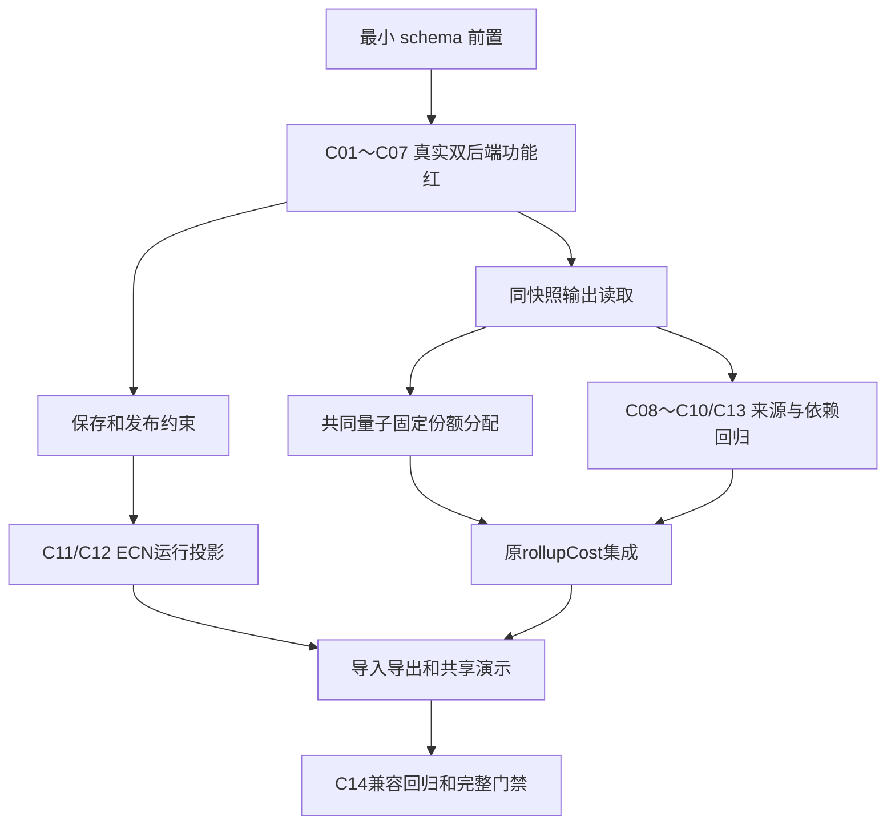

# 实施计划：BOM 联产品

## 决策

采用固定份额；头父件继续作第一输出与过程锚点；produce 行作其他输出。份额显式、定点精确合计，不使用价格动态分配。不改变既有单产调用默认值，不回写物料单价。

主会话已复核三个兼容边界：`root.jointCost`与既有根成本并列；成本上下文的来源映射只影响成本；已发布头份额变更必须走新修订，不能扩张ECN写入白名单。完整C01～C14已回挂US-513阶段B，故事保持In Progress。

## 数据与写入

1. 在头和行发生项添加可空规范十进制 `jointCostShare`，扩展 produce 枚举；其余方向的行份额必须 NULL。
2. produce 必须是精确发布输出修订、正比例数量，禁止不在首个合同内的用量/条件/成员字段；复用既有组合外键与单位入口，不新造规则 DSL。
3. 份额检查使用现有9位定点整数聚合。普通头发布和 ECN 转换后的运行投影共用日期切片校验，包含空切片与重复输出修订检查。
4. 新列对旧库的部署仍服从既有迁移合同。不要在插件 init 时吞掉 schema 漂移；提供必要迁移记录与初始化失败证据。

## 读取与成本

1. 结构展开仍只沿 consume。数量结果新增 produce 产出明细，按 L 缩放；by_product 的 P' 规则不动。
2. 将现有过程净成本计算与固定份额分配分离，主产物所得成本回到既有根结果字段，全部输出及净成本进入可选 jointCost 明细。没有联产时不新增空结果字段。
3. `CostRollupContext.jointCostSources` 是可选的输出修订→生产头映射。候选查询、选定输出验证、读取与 manifest 在同一事务执行。
4. 按生产头计算依赖做 memo 与递归栈检查。来源选择加入跨请求身份；单位换算沿用现有 kernel，数量/金额串不经 number。
5. 第一个可对外交付的联产切片必须包括下游消费与来源拒绝；不能只把 enum、输出列表或孤立成本面板算作完成。

共同量子的数值合同见 [research](research.md)。分配乘积使用 BigInt 精确中间值并在共同量子上只舍入一次，不能先调用已按逐项34位舍入的乘法再做第二次舍入。尾差接收者是最后正份额输出，零份额始终为0。

## 闭环分阶段与依赖

阶段一交付 schema、真实保存/发布约束、L比例产出、同快照输出读取与固定份额分配；只证明 C01～C07，不把整个 US-513 B 置 Done。阶段二必须接入原有 rollupCost，完成显式来源、下游单位换算和派生依赖环；阶段三接 ECN 运行投影及旧协议兼容。阶段四完成导入/导出、共享演示与全门禁才对外关闭整条故事。

## 验证顺序

- 先写 C01～C07 的双后端保存、发布与手工数值失败测试，确认功能红后实现最小输出与分配。
- 再写 C08～C10/C13 的真实下游单位换算、来源候选、跨库与派生成本环失败测试，确认后接入成本递归。
- 再写 C11/C12 的 ECN 发布/改期/取消失败测试，统一运行投影聚合并证明旧协议未扩大。
- 最后消费真实 API 扩展共享演示种子/面板与导出契约；保持三端同 API、同字段可见性，跑 C14 回归。

所有运行任务通过 `pnpm nx`，由主会话集中串行/分段执行并保留本地缓存。包含持久升级、保存期间编辑/撤回与修订边界的完整联产核心49/49、v2集成16/16、共享种子6/6已有实际通过证据；通用保存修复另有SQLite仓储13/13、EntityStatus69/69通过。完整core、演示与门禁按quickstart继续记录，不将部分通过扩大为整故事完成。

## 变更范围与门禁

主要涉及 `rxdb-plugin-bom` 实体、双后端 DDL、数量/成本、ECN 运行投影、导出与测试数据；若三端编辑组件必须展示 produce 只读原因，三端同时接入共享状态，不能各自实现成本规则。

公共类型与 README、API baseline、包图、需求 AC 同步。新增/修改非核心包四项覆盖率≥80%；若确需改核心则对应≥90%。strict、ESLint零警告、构建、既有PG并发测试与受影响全分支门禁通过后才能关闭US-513阶段B。

## 导入导出版本决策

保留v1常量与位置列不变，仅联产数据选择v2并在头/发生项末列附份额。v2独立dependencies段携带输出物料/精确已发布修订，导入只核对目标库既有事实，不写这些记录。先核对自然键、归属、发布状态与单位/修订身份，再进入既有逐行SAVEPOINT草稿写入；依赖失败必须整批零残留。

拒绝“v2在导入过程中自动发布输出修订”的方案，因为这会改变草稿导入协议，并需要为过去生效的输出引入隐式历史旁路。正常roundtrip在目标库先经正常API明确发布输出依赖，之后导入并由调用方明确发布剩余草稿；空库直接导入的失败也是验收的一部分。
