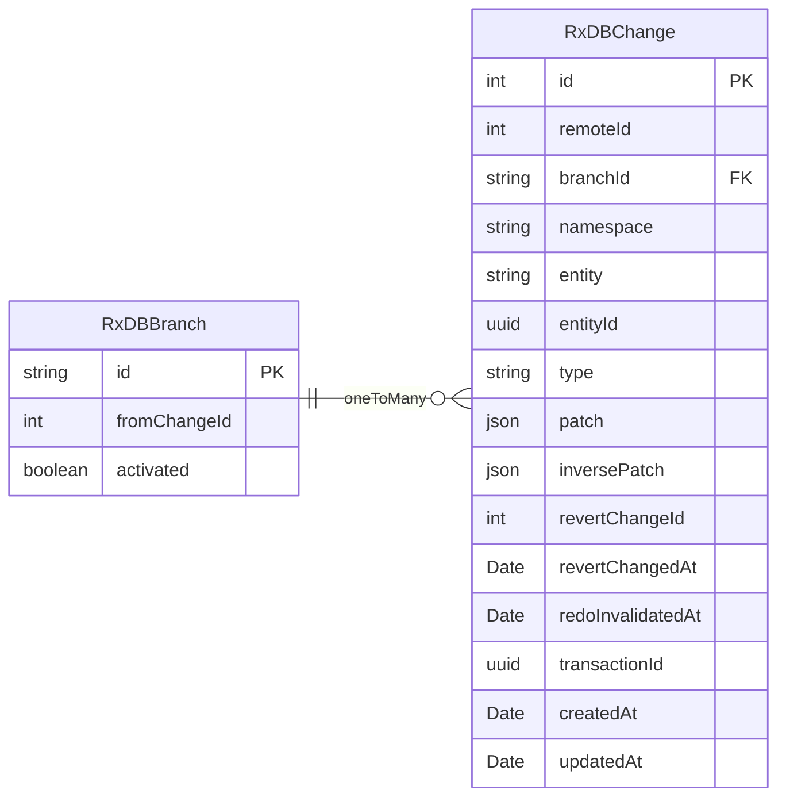

# 分支管理

RxDB 提供类似 Git 的分支管理能力，让你可以在本地创建多个数据分支，安全地进行实验性修改，然后选择性地合并或切换分支。

## 快速开始

分支与历史由 `@aiao/rxdb-plugin-history` 提供，不在 core 里：

```bash
pnpm add @aiao/rxdb-plugin-history
```

```typescript
import { RxDB, SyncType } from '@aiao/rxdb';
import { rxDBPluginHistory } from '@aiao/rxdb-plugin-history';

const rxdb = new RxDB({
  dbName: 'myApp',
  entities: [Todo],
  sync: { local: { adapter: 'wa-sqlite' }, type: SyncType.None }
});

rxdb.use(rxDBPluginHistory);
await rxdb.connect('wa-sqlite');

// 创建分支
await rxdb.versionManager.createBranch('feature-1');

// 切换分支
await rxdb.versionManager.switchBranch('feature-1');

// 删除分支
await rxdb.versionManager.removeBranch('feature-1');
```

:::warning `versionManager` 的可用时机
`rxdb.versionManager` 由历史插件在连接纪元内挂载，**`await connect()` 之后才存在**。没装插件时读它拿到的是 `undefined`——core 不做 fallback 兜底。

同步方法（`syncRepository` / `bulkSync` / `push` / `pull` 等）已经从 `versionManager` 搬到 `@aiao/rxdb-plugin-sync` 的 `rxdb.syncManager`，见[历史与同步拆包](../migration/history-sync-plugins.md)。
:::

## 分支管理 API

### 创建分支

```typescript
// 从当前状态创建分支
await rxdb.versionManager.createBranch('feature-1');

// 从指定 changeId 创建分支
await rxdb.versionManager.createBranch('feature-2', 12345);
```

### 切换分支

```typescript
await rxdb.versionManager.switchBranch('feature-1');
await rxdb.versionManager.switchBranch('main');
```

### 删除分支

```typescript
await rxdb.versionManager.removeBranch('feature-1');
```

:::warning
删除分支会同时删除该分支的所有变更历史。
:::

### 获取当前分支

当前分支是本实例挂着的那套表持有的分支。别按 `activated = true` 查：它只说主检出位停在哪条分支上，挂在[可写检出位](../plugins/rxdb-plugin-working-tree/README.md#可写检出位)上时，那套表持有的分支 `activated` 是假。

```typescript
import { getCurrentBranch, RxDBBranch } from '@aiao/rxdb';

// 读一次（`rxdb.versionManager.getCurrentBranch()` 同一份）
const currentBranch = await getCurrentBranch(rxdb);

// 要跟着变：按挂着那套表的 `heldBranchWhere` 查
RxDBBranch.findOne({ where: rxdb.worktreeTableSet.heldBranchWhere }).subscribe(branch => {
  console.log(branch?.id);
});
```

`heldBranchWhere` 取的是查询那一刻挂着的那套表，换挂之后要重新查；手头已经有分支行时，`branch.activeKey === rxdb.worktreeTableSet.holderKey` 的那一条就是当前分支（三端 `useWorktrees().mounted` 就是挂着的那套表）。

## 使用场景

### 测试新功能

```typescript
await rxdb.versionManager.createBranch('test-feature');
await rxdb.versionManager.switchBranch('test-feature');

const todo = new Todo();
todo.title = '测试任务';
await todo.save();

// 测试完成，切换回主分支
await rxdb.versionManager.switchBranch('main');
await rxdb.versionManager.removeBranch('test-feature');
```

### 离线编辑

```typescript
await rxdb.versionManager.createBranch('offline-work');
await rxdb.versionManager.switchBranch('offline-work');

// 离线修改...

// 恢复网络后切换回主分支
await rxdb.versionManager.switchBranch('main');
```

## 系统表结构

系统表 `RxDBChange` 会通过**数据库触发器（Trigger）** 记录所有数据库的数据变化（插入，修改，删除），`RxDBBranch` 表会记录当前分支，这样我们就可以通过历史记录来计算出任何时刻的数据，再去修改其他表的数据达到切换版本的需求。



### 关键字段

**RxDBBranch**

- `id`: 分支标识符
- `fromChangeId`: 分支起始点
- `activated`: 是否为当前分支

**RxDBChange**

- `id`: 变更序号（自增）
- `remoteId`: 远程变更ID
- `branchId`: 所属分支
- `type`: `insert` | `update` | `delete`
- `patch`: 正向变更（JSON Patch）
- `inversePatch`: 逆向变更（用于回滚）
- `revertChangeId`: 撤销时的变更ID
- `redoInvalidatedAt`: redo 失效时间

## 分支合并

把**源分支**的变更合并进**当前激活分支**（目标分支由当前激活分支决定，不作为参数传入）：

```typescript
// 压缩合并（默认）：源分支全部变更压成目标分支上的一组事务记录
const result = await rxdb.versionManager.mergeBranch('feature-1');
console.log(`合并了 ${result.merged} 条变更，策略 ${result.strategy}`);

// 普通合并：逐条复制，保留历史细节
await rxdb.versionManager.mergeBranch('feature-1', { strategy: 'normal' });

// 合并后删除源分支
const merged = await rxdb.versionManager.mergeBranch('feature-1', { deleteSource: true });
if (!merged.sourceDeleted) console.warn('合并已落库，但删源分支没做成', merged.sourceDeleteError);
```

合并有变更时会**清空 undo/redo 历史**——合并本身不可逆。`deleteSource` 的删除是合并落库之后的收尾动作，失败不回滚合并、也不抛错，只在 `sourceDeleted` / `sourceDeleteError` 上如实报告。

## 对比与合并预览

不切换当前分支，也能看另一条分支差在哪、一次合并会落什么。两个方法都只读：不开写事务，不碰业务表，也不动当前分支。

```typescript
// 两条分支当前状态之间的实体差异：patch 是 feature-1 上的值，inversePatch 是 main 上的值
const comparison = await rxdb.versionManager.compareBranches('main', 'feature-1');
for (const entry of comparison.entries) {
  console.log(entry.operation, entry.entity, entry.entityId, entry.inversePatch, '→', entry.patch);
}

// 把 feature-1 合并进当前分支会落什么
const preview = await rxdb.versionManager.previewMerge('feature-1', { strategy: 'squash' });
console.log(`合并会落 ${preview.merged} 条变更`); // 与随后 mergeBranch() 返回的 merged 一致
for (const entry of preview.entries) {
  if (entry.conflict) console.warn(entry.entityId, entry.conflict.kind);
}
```

- `compareBranches(from, to)`：只在 `to` 上有的实体是 `INSERT`（`patch` 为整行），只在 `from` 上有的是 `DELETE`（`inversePatch` 为整行），两边都有且业务字段不同的是 `UPDATE`（两侧各取自己的值）。同一条分支返回空条目，分支不存在时与 `mergeBranch()` 报同一句错。
- `previewMerge(source, options?)`：条目就是合并会落的操作，压缩合并滤掉的先建后删同样不出现；`patch` 是合并会写入的值，`inversePatch` 是当前分支现在的值。`merged` 跟着策略走，条目恒为净效果——两种策略落库后的终态相同。

合并是单向覆盖。预览把撞上当前分支分叉以来改动的条目标出来（`conflict`）：

| `conflict.kind`  | 情形                                                       | 合并之后                        |
| ---------------- | ---------------------------------------------------------- | ------------------------------- |
| `overwrite`      | 源要写的字段，当前分支分叉以来改成了别的值                 | `fields` 里的字段被源的值盖掉   |
| `delete_edited`  | 源删了它，当前分支分叉以来改过它                           | `fields` 里的改动随实体一起删掉 |
| `update_deleted` | 源改了它，当前分支里没有这一行（分叉以来删了，或从没有过） | 这次更新落空，源的改动不会出现  |
| `revive_deleted` | 源删后重建了它，当前分支分叉以来删了它                     | 它被重新建出来                  |

只看业务字段：`remoteId`、`createdAt`、`updatedAt` 这类簿记字段（`ENTITY_BOOKKEEPING_FIELDS`）不算差异，也不算覆盖。补丁不解码，取值原样来自变更日志，加密字段保持密文。

## 只读打开另一条分支或一个提交

差异只给变了的实体；排序、分页、聚合、树形展开要整张表。装了工作树插件并配上快照库时，`rxdb.workingTree.checkouts.open()` 不切换分支、不动工作树，把目标的**完整数据**建成一份只读快照，用第二个只读实例浏览：

```typescript
const view = await rxdb.workingTree.checkouts.open({ branchId: 'feature-1' }); // 或 { commitId }
const FeatureTodo = view.entityOf(Todo);
const todos = await firstValueFrom(
  view.rxdb.entityManager.getRepository(FeatureTodo).findAll({ where: { combinator: 'and', rules: [] } })
);
await view.close();
```

分支视图与「切过去读到的数据」逐行一致；提交视图是那次 `commit()` 刚完成时的数据，提交要在当前分支 HEAD 的可达父链上。快照是建立时刻的数据，`view.refresh()` 重建。配置快照库、生命周期与支持的后端见[工作树插件的只读检出位](../plugins/rxdb-plugin-working-tree/README.md#只读检出位)。

## 相关文档

- [同步策略](./sync.md) - 了解数据同步配置
- [Undo/Redo](./undo-redo.md) - 撤销和重做功能
- [工作树与提交历史](../plugins/rxdb-plugin-working-tree/README.md) - 未提交改动捕获与提交历史（`@aiao/rxdb-plugin-working-tree`）；装上该插件后 `switchBranch()` 多接受一个前置条件参数（`requireClean` / `expectedActivationRevision`），不传时行为与今天逐字节一致
