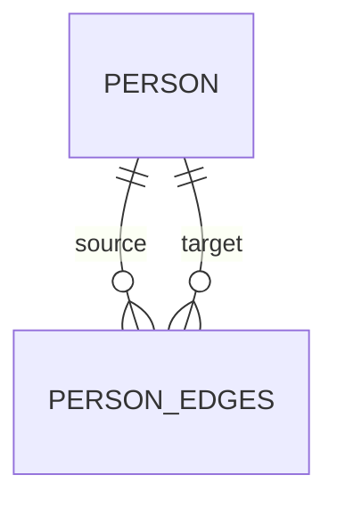

# countNeighbors

`countNeighbors` 统计图结构中邻居节点的数量。实体静态方法 `countNeighbors` 返回 `Promise<number>`，直接 `await`；要随图结构变化持续拿到数量，用返回 `Observable<number>` 的 `countNeighbors$`。

## 图关系图



## 统计语义

- 不包含起始节点本身
- 方向、层级、过滤规则与 [findNeighbors](./findNeighbors.md) 保持一致
- 适合只关心数量，不关心具体节点内容的场景

## 基础用法

```ts
const count = await Person.countNeighbors({
  entityId: alice.id,
  direction: 'both',
  level: 2
});
```

## 带过滤的统计

```ts
const count = await Person.countNeighbors({
  entityId: alice.id,
  level: 1,
  edgeWhere: {
    weight: { min: 5 }
  }
});
```

## 持续订阅

```ts
Person.countNeighbors$({ entityId: alice.id, level: 1 }).subscribe(count => {
  console.log(`好友数：${count}`);
});
```

## 什么时候优先用它

- 显示粉丝数、关注数、连接数
- 做阈值判断
- 你不需要返回整组节点对象

## 参考

- [findNeighbors](./findNeighbors.md)
- [findPaths](./findPaths.md)
