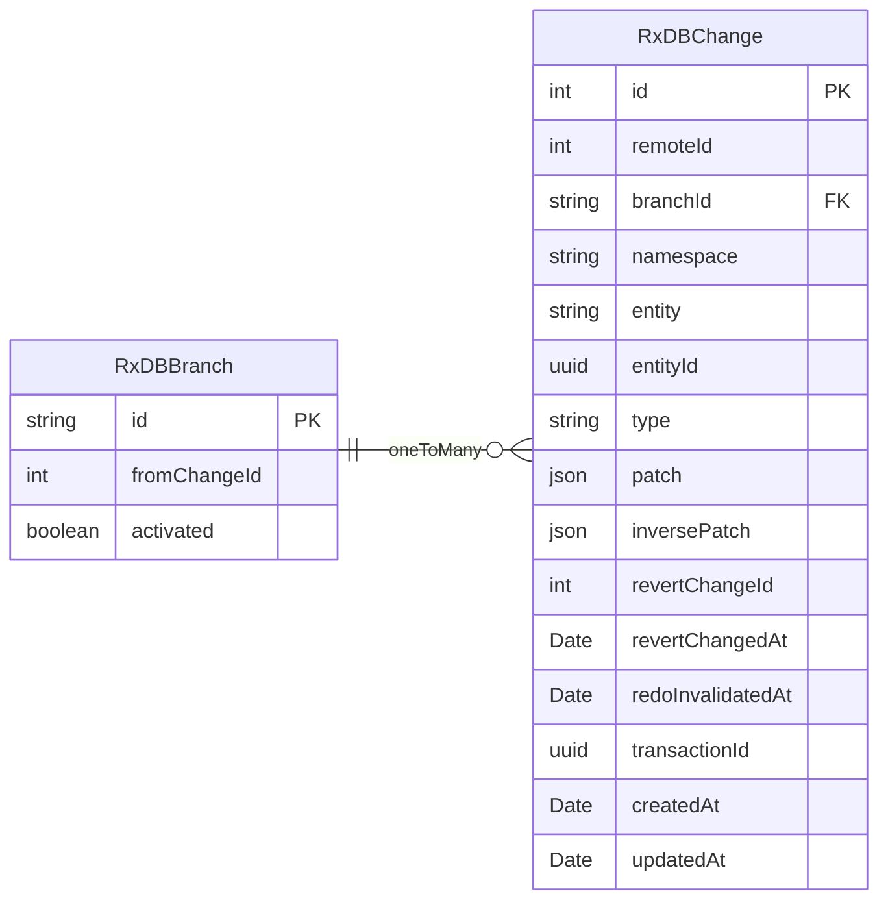

# Branch management

RxDB provides Git-like branch management: create multiple local data branches, experiment safely, then merge or switch selectively.

## Quick start

Branches and history come from `@aiao/rxdb-plugin-history`, not core:

```bash
pnpm add @aiao/rxdb-plugin-history
```

```typescript
import { RxDB, SyncType } from '@aiao/rxdb';
import { rxDBPluginHistory } from '@aiao/rxdb-plugin-history';

const rxdb = new RxDB({
  dbName: 'myApp',
  entities: [Todo],
  sync: { local: { adapter: 'wa-sqlite' }, type: SyncType.None }
});

rxdb.use(rxDBPluginHistory);
await rxdb.connect('wa-sqlite');

// Create a branch
await rxdb.versionManager.createBranch('feature-1');

// Switch to a branch
await rxdb.versionManager.switchBranch('feature-1');

// Delete a branch
await rxdb.versionManager.removeBranch('feature-1');
```

:::warning When `versionManager` is available
`rxdb.versionManager` is attached by the history plugin within the connection epoch — it only exists **after `await connect()`**. Reading it without the plugin installed gives `undefined`; core has no fallback.

The sync methods (`syncRepository` / `bulkSync` / `push` / `pull`, etc.) have moved from `versionManager` to `rxdb.syncManager` of `@aiao/rxdb-plugin-sync`; see [History and sync split](../migration/history-sync-plugins.md).
:::

## Branch management API

### Create a branch

```typescript
// Branch from the current state
await rxdb.versionManager.createBranch('feature-1');

// Branch from a specific changeId
await rxdb.versionManager.createBranch('feature-2', 12345);
```

### Switch branches

```typescript
await rxdb.versionManager.switchBranch('feature-1');
await rxdb.versionManager.switchBranch('main');
```

### Delete a branch

```typescript
await rxdb.versionManager.removeBranch('feature-1');
```

:::warning
Deleting a branch also deletes all of its change history.
:::

### Get the current branch

The current branch is the branch held by the table set this instance is mounted on. Do not query by `activated = true`: it only says which branch the primary checkout rests on. When mounted on a [writable checkout](../plugins/rxdb-plugin-working-tree/README.md#writable-checkouts), the branch held by that table set has `activated` false.

```typescript
import { getCurrentBranch, RxDBBranch } from '@aiao/rxdb';

// Read once (same value as `rxdb.versionManager.getCurrentBranch()`)
const currentBranch = await getCurrentBranch(rxdb);

// To follow changes: query with the `heldBranchWhere` of the mounted table set
RxDBBranch.findOne({ where: rxdb.worktreeTableSet.heldBranchWhere }).subscribe(branch => {
  console.log(branch?.id);
});
```

`heldBranchWhere` refers to the table set mounted at query time; query again after remounting. If you already hold a branch row, the current branch is the one where `branch.activeKey === rxdb.worktreeTableSet.holderKey` (in all three frameworks, `useWorktrees().mounted` is the mounted table set).

## Use cases

### Trying a new feature

```typescript
await rxdb.versionManager.createBranch('test-feature');
await rxdb.versionManager.switchBranch('test-feature');

const todo = new Todo();
todo.title = 'Test task';
await todo.save();

// Done testing; switch back to the main branch
await rxdb.versionManager.switchBranch('main');
await rxdb.versionManager.removeBranch('test-feature');
```

### Offline editing

```typescript
await rxdb.versionManager.createBranch('offline-work');
await rxdb.versionManager.switchBranch('offline-work');

// Edit while offline...

// Switch back to the main branch once the network is back
await rxdb.versionManager.switchBranch('main');
```

## System tables

The `RxDBChange` system table records every data change (insert, update, delete) through **database triggers**. The `RxDBBranch` table records the current branch. Together they let history compute the data at any point in time and rewrite the other tables to switch versions.



### Key fields

**RxDBBranch**

- `id`: branch identifier
- `fromChangeId`: the change where the branch starts
- `activated`: whether this is the current branch

**RxDBChange**

- `id`: change sequence number (auto-increment)
- `remoteId`: remote change id
- `branchId`: the branch the change belongs to
- `type`: `insert` | `update` | `delete`
- `patch`: forward change (JSON Patch)
- `inversePatch`: inverse change (for rollback)
- `revertChangeId`: change id set when undone
- `redoInvalidatedAt`: when redo becomes invalid

## Merging branches

Merges the **source branch**'s changes into the **currently active branch** (the target is determined by the active branch; it is not a parameter):

```typescript
// Squash merge (default): all source changes collapse into one set of transaction records on the target
const result = await rxdb.versionManager.mergeBranch('feature-1');
console.log(`Merged ${result.merged} changes, strategy ${result.strategy}`);

// Normal merge: copy each change, preserving history detail
await rxdb.versionManager.mergeBranch('feature-1', { strategy: 'normal' });

// Delete the source branch after merging
const merged = await rxdb.versionManager.mergeBranch('feature-1', { deleteSource: true });
if (!merged.sourceDeleted)
  console.warn('Merge committed, but deleting the source branch failed', merged.sourceDeleteError);
```

A merge that carries changes **clears the undo/redo history** — a merge itself is irreversible. The `deleteSource` deletion is a finishing step after the merge commits; failure neither rolls back the merge nor throws — it is reported truthfully in `sourceDeleted` / `sourceDeleteError`.

## Compare and merge preview

Without switching the current branch, you can still see how another branch differs and what a merge would land. Both methods are read-only: no write transaction is opened, business tables are untouched, and the current branch does not move.

```typescript
// Entity differences between the current state of two branches: patch holds the value on feature-1, inversePatch the value on main
const comparison = await rxdb.versionManager.compareBranches('main', 'feature-1');
for (const entry of comparison.entries) {
  console.log(entry.operation, entry.entity, entry.entityId, entry.inversePatch, '→', entry.patch);
}

// What merging feature-1 into the current branch would land
const preview = await rxdb.versionManager.previewMerge('feature-1', { strategy: 'squash' });
console.log(`Merge would land ${preview.merged} changes`); // Matches the merged value returned by mergeBranch() afterwards
for (const entry of preview.entries) {
  if (entry.conflict) console.warn(entry.entityId, entry.conflict.kind);
}
```

- `compareBranches(from, to)`: entities that exist only on `to` are `INSERT` (`patch` is the whole row); entities that exist only on `from` are `DELETE` (`inversePatch` is the whole row); entities on both sides whose business fields differ are `UPDATE` (each side carries its own values). Comparing a branch with itself returns no entries; a branch that does not exist raises the same error as `mergeBranch()`. When mounted on a writable checkout, only that table set's members are listed — the same scope as `previewMerge()`.
- `previewMerge(source, options?)`: entries summarize the operations a merge would land under the chosen strategy; `patch` is the value the merge would write, `inversePatch` the current value on the current branch. The squash strategy filters out source rows created and then deleted; the normal strategy lists a delete when the target already has a record with the same primary key — the two strategies can end in different final states. Ghost entities that do not currently exist on the target produce no entries. `merged` is the net operation count under squash and the source-branch change count under normal, still including ghost operations that were not listed as entries.

A merge overwrites in one direction. The preview flags entries that collide with changes made on the current branch since the fork (`conflict`):

| `conflict.kind`  | Situation                                                                                          | After the merge                                             |
| ---------------- | -------------------------------------------------------------------------------------------------- | ----------------------------------------------------------- |
| `overwrite`      | The source writes a field that the current branch changed to another value since the fork          | The fields in `fields` are overwritten by the source values |
| `delete_edited`  | The source deleted it; the current branch edited it since the fork                                 | The edits in `fields` are deleted along with the entity     |
| `update_deleted` | The source edited it; the current branch has no such row (deleted since the fork, or never had it) | The update lands nowhere; the source changes do not appear  |
| `revive_deleted` | The source deleted and recreated it; the current branch deleted it since the fork                  | It is recreated                                             |

Only business fields count: bookkeeping fields such as `remoteId`, `createdAt`, and `updatedAt` (`ENTITY_BOOKKEEPING_FIELDS`) count neither as differences nor as overwrites. Patches are not decoded — values come verbatim from the change log, so encrypted fields stay ciphertext.

## Open another branch or commit read-only

Differences only include changed entities; sorting, paging, aggregation, and tree expansion need whole tables. With the working-tree plugin installed and a snapshot store configured, `rxdb.workingTree.checkouts.open()` builds the target's **complete data** into a read-only snapshot — without switching branches or touching the working tree — to browse through a second read-only instance:

```typescript
const view = await rxdb.workingTree.checkouts.open({ branchId: 'feature-1' }); // or { commitId }
const FeatureTodo = view.entityOf(Todo);
const todos = await firstValueFrom(
  view.rxdb.entityManager.getRepository(FeatureTodo).findAll({ where: { combinator: 'and', rules: [] } })
);
await view.close();
```

A branch view matches row for row what you would read after switching to that branch; a commit view is the data exactly as of that `commit()`, and the commit must be on the reachable parent chain of the current branch's HEAD. A snapshot holds the data as of its build time; `view.refresh()` rebuilds it. For the snapshot store configuration, lifecycle, and supported backends, see [the working-tree plugin's read-only checkout](../plugins/rxdb-plugin-working-tree/README.md#read-only-checkouts).

## Related pages

- [Sync strategies](./sync.md) — data sync configuration
- [Undo/Redo](./undo-redo.md) — undo and redo
- [Working tree and commit history](../plugins/rxdb-plugin-working-tree/README.md) — capture uncommitted changes and commit history (`@aiao/rxdb-plugin-working-tree`); with the plugin installed, `switchBranch()` additionally accepts a precondition parameter (`requireClean` / `expectedActivationRevision`); when omitted, behavior stays byte-for-byte what it is today
