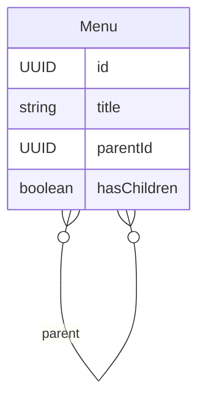

# Tree structure

Tree structure is provided by the `@aiao/rxdb-plugin-tree` plugin package and follows the adjacency list model: each node has a single nullable `parentId`, and the parent-child relation is maintained through self-references.

```bash npm2yarn
npm install @aiao/rxdb-plugin-tree
```

Register `rxdb.use(rxDBPluginTree)` before `init()` / `connect()`. Otherwise, entities declared with `@TreeEntity` fail during initialization because `TreeRepository` cannot be found. For migration from the core package, see [Tree split](/migration/tree-split.md) (in Chinese).

## Two roles

- `@TreeEntity()`: only sets the default repository type to `TreeRepository` and adds tree feature metadata
- `TreeAdjacencyListEntityBase`: actually provides `parentId`, `parent$`, `children$`, `hasChildren`, and the static tree query methods

The most common and safest form:

```ts
import { PropertyType } from '@aiao/rxdb';
import { TreeAdjacencyListEntityBase, TreeEntity } from '@aiao/rxdb-plugin-tree';

@TreeEntity({
  name: 'Menu',
  tableName: 'menu',
  properties: [{ name: 'title', type: PropertyType.string }]
})
export class Menu extends TreeAdjacencyListEntityBase {}
```

## What the base class provides

`TreeAdjacencyListEntityBase` already includes:

- a computed `hasChildren` property
- `children`: `ONE_TO_MANY`
- `parent`: `MANY_TO_ONE`
- `parentId`
- static tree query methods

The `parent` relation is nullable, and it explicitly sets:

```ts
onDelete: OnDeleteAction.CASCADE;
```

This means deleting a parent deletes its children by default.



## Accessing relations

```ts
import { firstValueFrom } from 'rxjs';

const root = new Menu({ title: 'Root node' });
const child = new Menu({ title: 'Child node' });

child.parent$.set(root);
await child.save();

const parent = await firstValueFrom(child.parent$);
const children = await firstValueFrom(root.children$);
const count = await firstValueFrom(root.children$.count$);
```

You can also set the foreign key directly:

```ts
child.parentId = root.id;
await child.save();
```

## Tree query API

Static methods on a tree entity return an `Observable`:

```ts
import { firstValueFrom } from 'rxjs';

const descendants = await firstValueFrom(
  Menu.findDescendants({
    entityId: root.id,
    level: 2
  })
);

const ancestors = await firstValueFrom(
  Menu.findAncestors({
    entityId: child.id,
    level: 3
  })
);

const descendantCount = await firstValueFrom(
  Menu.countDescendants({
    entityId: root.id,
    level: 2
  })
);
```

### What `FindTreeOptions` really means

- `entityId?: string | null`
- `where?`: ordinary query conditions
- `level?: number`

The current `level` rules:

- **Omit it to leave the depth unlimited**: the entire subtree / the entire ancestor chain
- Counted from the current node: the current node is `0`, a direct child (or parent) is `1`
- Must be a non-negative safe integer **with no upper bound**; out-of-range values throw `RxDBError` synchronously instead of being clamped

### Return semantics

- `findDescendants`: with an `entityId`, returns "current node + descendants"
- `countDescendants`: with an `entityId`, excludes the current node and counts descendants only
- `findAncestors`: with an `entityId`, returns "current node + ancestors"
- `countAncestors`: with an `entityId`, excludes the current node and counts ancestors only

### Root node queries

Without an `entityId`, tree queries start from the set of root nodes; internally the framework normalizes `entityId` to `null`.

## Build a simple tree

```ts
const root = new Menu({ title: 'Root' });
await root.save();

const a = new Menu({ title: 'A' });
a.parent$.set(root);
await a.save();

const b = new Menu({ title: 'B' });
b.parentId = root.id;
await b.save();
```

## Sortable tree entities

The sibling domain of a tree is structurally a sorting domain grouped by `parentId`, with the root node in the NULL group. Declare `manualOrder: { groupBy: ['parentId'] }` on a tree entity together with a non-null `sortOrder` field, and you get manual ordering:

```ts
import { ISortableEntity, PropertyType, SortOrderKey } from '@aiao/rxdb';
import { TreeAdjacencyListEntityBase, TreeEntity } from '@aiao/rxdb-plugin-tree';

@TreeEntity({
  name: 'SortableMenu',
  tableName: 'sortable_menu',
  manualOrder: { groupBy: ['parentId'] },
  properties: [
    { name: 'title', type: PropertyType.string },
    { name: 'sortOrder', type: PropertyType.string }
  ]
})
export class SortableMenu extends TreeAdjacencyListEntityBase implements ISortableEntity {
  title!: string;
  sortOrder!: SortOrderKey;
}
```

Key points:

- `parentId` is the foreign key column of the many-to-one relation `parent`, so it can serve as the grouping field; root nodes (with `parentId` NULL) form a separate NULL group
- Default query order: queries without `orderBy` return `[parentId asc, sortOrder asc, id asc]` (the NULL group first). When building the tree, render in the returned order, and the sibling order is the manual order
- Creating a node without a `sortOrder` appends it to the end of its siblings under the same parent; a write that only changes `parentId` appends the node to the end of the new parent within the same transaction (deleting a node and promoting its children is exactly such a write)
- `TreeRepository` extends `Repository`, so it naturally inherits `reorder()`; a cross-parent drag-and-drop is `reorder(id, { group: { parentId: target.id } })`

For the full manual ordering reference, see [Manual ordering](/model-mutation/reorder.md) (in Chinese).

## Recommendations

- For full tree capabilities, extend `TreeAdjacencyListEntityBase` first
- `@TreeEntity()` does not generate parent-child relations by itself; using it alone does not automatically add `parentId`
- Use the static methods for ancestor/descendant queries; ordinary list filtering still goes through the regular `find`
