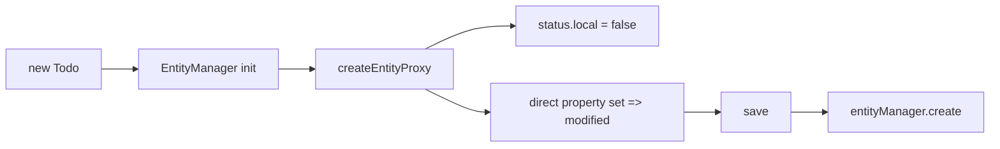

# Creating records

The reliable way to create a record is `new` followed by `save()`.

## The common path

```ts
const todo = new Todo({
  title: 'Review the English guide',
  completed: false
});

await todo.save();
```

`save()` eventually reaches `entityManager.save()`, which decides between create and update based on entity status.

## How create is decided

```ts
const status = getEntityStatus(todo);

if (status.local) {
  await rxdb.entityManager.update(todo);
} else {
  await rxdb.entityManager.create(todo);
}
```

For a new entity the question is not a static `create()` call but two things:

- Whether the entity already has a row in the local database
- Whether `status.local` is currently `false`

## Proxy instrumentation

Entities are wrapped by `createEntityProxy()` during initialization. Direct property assignment triggers state tracking.



## Creating directly

In a service layer, when you already know this is a new record, you can create it directly:

```ts
const todo = new Todo({ title: 'Task 1' });

await rxdb.entityManager.create(todo);
```

Everyday business code should still prefer `save()`, because it is less error-prone about which branch gets taken.

## Batch creation

```ts
const todos = [new Todo({ title: 'Task one' }), new Todo({ title: 'Task two' }), new Todo({ title: 'Task three' })];

await rxdb.entityManager.saveMany(todos);
```

`saveMany()` combines the pending entities into one set of mutations instead of calling `save()` on each.

## Status before and after

```ts
import { getEntityStatus } from '@aiao/rxdb';

const todo = new Todo({ title: 'Task' });

console.log(getEntityStatus(todo).local); // false

await todo.save();

const status = getEntityStatus(todo);
console.log(status.local); // true
console.log(status.modified); // false
```

## Recommendations

- Prefer `new Entity()` + `save()` for a single record
- Prefer `saveMany()` for batch creation
- Do not treat legacy entry points like `Todo.create()` as the documented path
