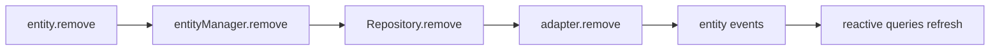

# Deleting records

Deletion follows the same path as creation and updates: prefer instance methods on the entity.

## Deleting one record

```ts
import { firstValueFrom } from 'rxjs';

const todo = await firstValueFrom(
  Todo.findOneOrFail({
    where: {
      combinator: 'and',
      rules: [{ field: 'id', operator: '=', value: todoId }]
    }
  })
);

await todo.remove();
```

`remove()` eventually reaches `entityManager.remove(this)`, then `Repository.remove()` and the adapter.

## Batch deletion

```ts
const completedTodos = await firstValueFrom(
  Todo.findAll({
    where: {
      combinator: 'and',
      rules: [{ field: 'completed', operator: '=', value: true }]
    }
  })
);

await rxdb.entityManager.removeMany(completedTodos);
```

## Delete flow



## Status after deletion

After deletion the entity no longer represents a valid row in the local database. In the current implementation the important changes are:

- `status.local = false`
- `status.removed = true`

## Recommendations

- Use `entity.remove()` for a single record
- Use `removeMany()` for batch deletion
- Avoid legacy static entry points like `Todo.remove(todo)`
