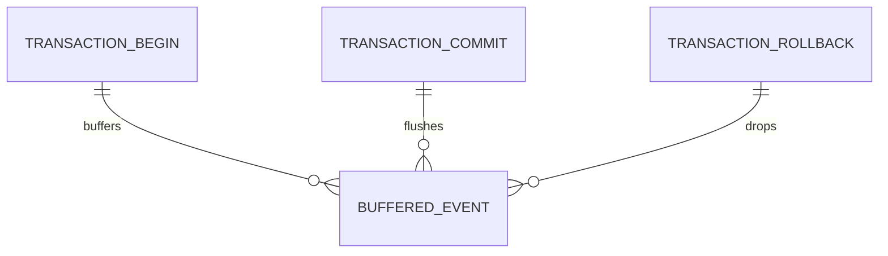
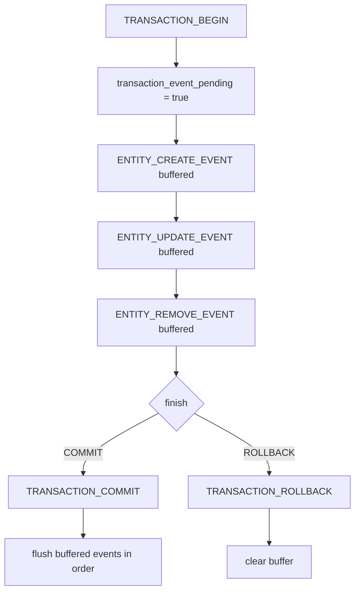

# Transaction events

This page describes the transaction event mechanism in the current implementation. It is not an invitation to depend on a public `rxdb.transaction(...)` API from business code.

## Summary

- Transactions are primarily the adapter's responsibility
- The RxDB core adds a layer of event buffering on top
- During a transaction, non-transaction events go into a buffer queue
- After `COMMIT` they are dispatched in their original order
- After `ROLLBACK` the buffered events are dropped

## Transaction event diagram



## Event sequence



## Current core logic

The decision inside `RxDB.dispatchEvent()` is:

```ts
if (this.#transaction_event_pending && isTransactionEvent(event) === false) {
  this.#need_dispatch_events.push(event);
} else {
  listeners.forEach(listener => listener.call(this, event));
}
```

Together with the listener in `#init_event()`, this means:

1. `TRANSACTION_BEGIN` is dispatched immediately and sets `transaction_event_pending` to `true`
2. Ordinary entity events during the transaction go into `#need_dispatch_events`
3. `TRANSACTION_COMMIT` is dispatched immediately, then the buffered events are replayed in order
4. `TRANSACTION_ROLLBACK` is dispatched immediately, then the buffer is cleared without replay

## Why this exists

If CREATE / UPDATE / REMOVE events from a transaction notified the UI immediately, the interface would show intermediate states.

The buffering has a direct purpose:

- Half-finished state is not exposed before commit
- A rollback needs no compensating "undo notifications"
- Query subscriptions mostly see only the final result

## What business code should do

Everyday business code should still prefer:

- `save()`
- `remove()`
- `saveMany()`
- `removeMany()`

Adapter-level transaction control is a lower-level capability and should not be presented as the regular entry point in basic business documentation.

## Transaction executor (C2 contract)

Adapter `transaction()` / `runInTransaction()` callbacks now receive a `TransactionExecutor`, not a bare client:

```typescript
import type { TransactionExecutor } from '@aiao/rxdb';

await adapter.transaction(async (executor: TransactionExecutor) => {
  const repo = executor.getRepository(Todo);
  // Repositories accept entity instances, not plain objects
  await repo.create(rxdb.entityManager.instantiate(Todo, { title: 'inside tx' }));

  // Nested inner work reuses the current executor
  await executor.run(async inner => inner.getRepository(Todo).count());

  // Merge remote changes into this transaction
  await executor.mergeChanges(actions, localChanges, /* disableTriggers */ false);
});
```

**Why the executor is required**: calling `entity.save()` directly goes through the adapter queue, but the queue's single concurrency slot is occupied by this transaction, so it hangs forever (see decision ④ in `code-reviews/transaction-executor-design.md` for the C2 design).

Zero-argument callbacks (`async () => {}`) remain compatible — TypeScript allows fewer parameters.
