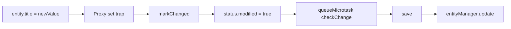

# Updating records

The main path for updates is assigning properties and then calling `save()`.

## The common path

```ts
import { firstValueFrom } from 'rxjs';

const todo = await firstValueFrom(
  Todo.findOneOrFail({
    where: {
      combinator: 'and',
      rules: [{ field: 'id', operator: '=', value: todoId }]
    }
  })
);

todo.title = 'Updated title';
todo.completed = true;

await todo.save();
```

## Why it knows this is an update

Once an entity is wrapped by a Proxy, direct property assignment:

- calls `markChanged()` to record the changed field
- sets `status.modified` to `true` immediately
- defers the patch check through `queueMicrotask()`



## Edge cases

The Proxy currently tracks direct field assignment only; it does not track mutations inside nested objects.

The following is therefore unreliable:

```ts
todo.meta.priority = 'high';
```

Reassign the whole object instead:

```ts
todo.meta = {
  ...todo.meta,
  priority: 'high'
};
```

## Behavior when nothing changed

`entityManager.update()` checks `status.modified` first. With no changes it returns the original entity without performing a meaningless write.

```ts
const status = getEntityStatus(todo);

if (status.modified) {
  await rxdb.entityManager.update(todo);
}
```

## Discarding unsaved edits

```ts
todo.title = 'Temporary edit';

await todo.reset();
```

`reset()` restores the entity to the `origin` state of its most recent snapshot, clearing the `modified` flag, the patch cache, and change history.

## Batch updates

```ts
const todos = await firstValueFrom(
  Todo.findAll({
    where: {
      combinator: 'and',
      rules: [{ field: 'completed', operator: '=', value: false }]
    }
  })
);

todos.forEach(todo => {
  todo.completed = true;
});

await rxdb.entityManager.saveMany(todos);
```

## Recommendations

- When you already hold an entity instance, prefer "assign properties + `save()`"
- Reassign whole objects for changes to nested fields
- Use `saveMany()` for batch updates
- Avoid legacy entry points like `Todo.update(...)`
