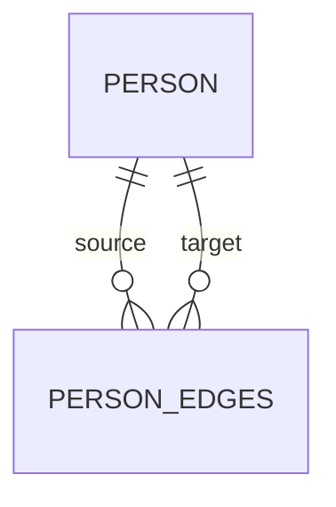

# countNeighbors

`countNeighbors` counts the neighbor nodes of a graph structure. The entity static method `countNeighbors` returns `Promise<number>` — `await` it directly; to keep getting the count as the graph changes, use `countNeighbors$`, which returns `Observable<number>`.

## Graph diagram



## Count semantics

- The starting node itself is not included
- Direction, level, and filtering follow [findNeighbors](./findNeighbors.md)
- Fits cases where only the number matters, not the node contents

## Basic usage

```ts
const count = await Person.countNeighbors({
  entityId: alice.id,
  direction: 'both',
  level: 2
});
```

## Filtered count

```ts
const count = await Person.countNeighbors({
  entityId: alice.id,
  level: 1,
  edgeWhere: {
    weight: { min: 5 }
  }
});
```

## Ongoing subscription

```ts
Person.countNeighbors$({ entityId: alice.id, level: 1 }).subscribe(count => {
  console.log(`Friends: ${count}`);
});
```

## When to prefer it

- Showing follower, following, or connection counts
- Threshold checks
- When you do not need the whole set of node objects

## See also

- [findNeighbors](./findNeighbors.md)
- [findPaths](./findPaths.md)
