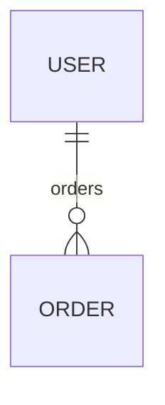

# EXISTS / NOT EXISTS

`exists` and `notExists` check whether a relation field contains related entities that match a condition.

## Relationship diagram



## Basic usage

```ts
const usersWithOrders = await firstValueFrom(
  User.find({
    where: {
      combinator: 'and',
      rules: [{ field: 'orders', operator: 'exists' }]
    }
  })
);
```

```ts
const usersWithoutOrders = await firstValueFrom(
  User.find({
    where: {
      combinator: 'and',
      rules: [{ field: 'orders', operator: 'notExists' }]
    }
  })
);
```

## With a sub-query condition

The sub-query condition goes in the `where` field, not in `value`.

```ts
const usersWithCompletedOrders = await firstValueFrom(
  User.find({
    where: {
      combinator: 'and',
      rules: [
        {
          field: 'orders',
          operator: 'exists',
          where: {
            combinator: 'and',
            rules: [{ field: 'status', operator: '=', value: 'completed' }]
          }
        }
      ]
    }
  })
);
```

## Supported relations

- `ONE_TO_ONE`
- `ONE_TO_MANY`
- `MANY_TO_ONE`
- `MANY_TO_MANY`

## When to prefer it

- You only need to know whether the relation exists
- You do not want to load the relation first and filter in memory
- You want the filtering pushed down to the query layer

## See also

- [Query operators](./operators.md)
- [find](./find.md)
