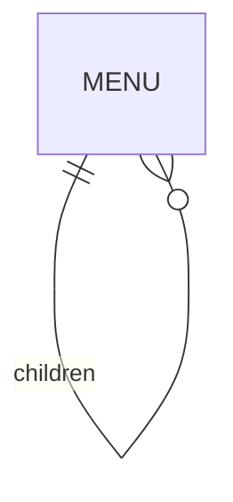

# findAncestors

`findAncestors` queries the ancestors of a tree entity. It returns a reactive `Observable`.

> The four tree queries come from the plugin package `@aiao/rxdb-plugin-tree`; the library must call `rxdb.use(rxDBPluginTree)` first. See [Tree plugin split](../migration/tree-split.md).

## Tree diagram



## Signature

```ts
findAncestors(options: FindTreeOptions<T>): Observable<InstanceType<T>[]>
```

## `level` semantics

- **No `level`: no depth limit**, returns the whole ancestor chain
- Levels count from the current node: the current node is `0`, its parent is `1`
- `level` must be a non-negative safe integer, **with no upper bound**
- Negative / fractional / non-numeric values throw an `RxDBError` synchronously — nothing is clipped, nothing falls back

## Return semantics

With `entityId`, returns "current node + ancestors".

This API should normally be called with an explicit `entityId`.

## Basic usage

```ts
import { firstValueFrom } from 'rxjs';

const ancestors = await firstValueFrom(
  Menu.findAncestors({
    entityId: leaf.id,
    level: 3
  })
);
```

## Breadcrumb scenario

```ts
const ancestors = await firstValueFrom(Menu.findAncestors({ entityId: leaf.id }));

const breadcrumb = ancestors.slice().reverse();
```

## About ordering

Do not assume the database naturally returns a "root to leaf" order. If the UI depends on an order, handle it explicitly in business code, for example with `reverse()`.

Tree queries do not accept `orderBy`. The display order of siblings in a tree (the tree-building order) comes from the default ordering of regular queries: for a sortable tree entity declaring `manualOrder: { groupBy: ['parentId'] }`, a query without `orderBy` returns `[parentId, sortOrder, id]`. See [Manual ordering (manualOrder and reorder)](../model-mutation/reorder.md).

## See also

- [countAncestors](./countAncestors.md)
- [findDescendants](./findDescendants.md)
