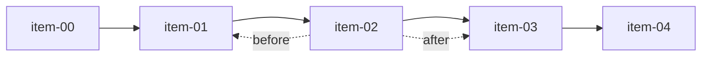

# findByCursor

`findByCursor` fits infinite scrolling and stable paging. It is not based on `offset`; it positions the cursor on an entity itself.

## Signature

```ts
findByCursor(options: FindByCursorOptions<T>): Observable<InstanceType<T>[]>
```

```ts
interface FindByCursorOptions<T> {
  where: RuleGroup<InstanceType<T>>;
  orderBy: OrderBy[];
  before?: InstanceType<T>;
  after?: InstanceType<T>;
  limit?: number;
}
```

Current defaults:

- `limit` defaults to `100`

## Cursor positioning



- `after: cursor`: returns the records after the cursor, not including the cursor itself
- `before: cursor`: returns the records before the cursor, not including the cursor itself

## Basic usage

```ts
import { firstValueFrom } from 'rxjs';

const firstPage = await firstValueFrom(
  Todo.findByCursor({
    where: { combinator: 'and', rules: [] },
    orderBy: [
      { field: 'createdAt', sort: 'desc' },
      { field: 'id', sort: 'asc' }
    ],
    limit: 20
  })
);

const nextPage = await firstValueFrom(
  Todo.findByCursor({
    where: { combinator: 'and', rules: [] },
    orderBy: [
      { field: 'createdAt', sort: 'desc' },
      { field: 'id', sort: 'asc' }
    ],
    after: firstPage[firstPage.length - 1],
    limit: 20
  })
);
```

## Three hard constraints

These are not suggestions; the repository layer throws on them:

1. `orderBy` must not be empty
2. The last `orderBy` field must be `id`
3. `before` and `after` must not be passed together

The correct ordering usually looks like:

```ts
orderBy: [
  { field: 'createdAt', sort: 'desc' },
  { field: 'id', sort: 'asc' }
];
```

## Why the last field must be `id`

Cursor paging needs a stable, unique sort tail key. Otherwise the page boundary drifts when several records share the earlier fields, and results repeat or skip.

## Difference from `find`

| Method         | Fits better                        |
| -------------- | ---------------------------------- |
| `find`         | Traditional page-number pagination |
| `findByCursor` | Infinite scrolling, stable paging  |

## Notes

The reactive result of `findByCursor` keeps following query updates. With `limit: 20` on the first query, later incremental merges do not mechanically keep the result set at exactly 20 items.

## See also

- [find](./find.md)
- [findAll](./findAll.md)
