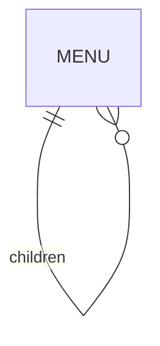

# findDescendants

`findDescendants` queries the descendants of a tree entity. It returns a reactive `Observable`.

> The four tree queries come from the plugin package `@aiao/rxdb-plugin-tree`; the library must call `rxdb.use(rxDBPluginTree)` first. See [Tree plugin split](../migration/tree-split.md).

## What it works on

- Entities extending `TreeAdjacencyListEntityBase`
- Usually paired with `@TreeEntity()`

## Tree diagram



## Signature

```ts
findDescendants(options: FindTreeOptions<T>): Observable<InstanceType<T>[]>
```

```ts
interface FindTreeOptions<T> {
  entityId?: EntityStaticType<T, 'idType'> | null;
  where?: RuleGroup<InstanceType<T>>;
  level?: number;
}
```

## `level` semantics

- **No `level`: no depth limit**, returns the whole subtree
- Levels count from the current node: the current node is `0`, its direct children are `1`
- `level` must be a non-negative safe integer, **with no upper bound**
- Negative / fractional / non-numeric values throw an `RxDBError` synchronously — nothing is clipped, nothing falls back

This means:

- With `entityId` and no `level`, returns the current node and all of its descendants
- With `entityId` and `level: 0`, returns only the current node
- With `entityId` and `level: 1`, returns the current node and its direct children
- Without `entityId` and with `level: 0`, returns the set of root nodes

## Return semantics

- With `entityId`: returns "current node + descendants"
- Without `entityId`: runs the query starting from all root nodes

## Basic usage

```ts
import { firstValueFrom } from 'rxjs';

const descendants = await firstValueFrom(
  Menu.findDescendants({
    entityId: root.id,
    level: 2
  })
);
```

## Filtering descendants

```ts
const visibleDescendants = await firstValueFrom(
  Menu.findDescendants({
    entityId: root.id,
    level: 3,
    where: {
      combinator: 'and',
      rules: [{ field: 'enabled', operator: '=', value: true }]
    }
  })
);
```

## When to use it

- Rendering a tree menu
- Loading all child nodes under a directory
- Batch-filtering a subtree

## Result order and manual ordering

Tree queries do not accept `orderBy`; results come back as "level + primary key" (siblings within a level are ordered by primary key, not by manual order). The display order of siblings in a tree (the tree-building order) comes from the default ordering of regular queries: for a sortable tree entity declaring `manualOrder: { groupBy: ['parentId'] }`, a query without `orderBy` returns `[parentId, sortOrder, id]` — render in query order while building the tree, and that is the manual order. See [Manual ordering (manualOrder and reorder)](../model-mutation/reorder.md).

## See also

- [countDescendants](./countDescendants.md)
- [findAncestors](./findAncestors.md)
