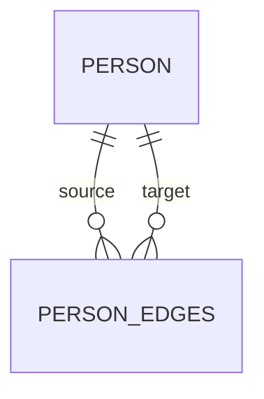

# findNeighbors

`findNeighbors` queries the neighbors of a graph structure. The entity static methods come in two forms: `findNeighbors` returns a `Promise` — `await` it for one result; `findNeighbors$` returns an `Observable` that pushes new results when the graph changes.

## Graph diagram



## Signature

```ts
findNeighbors(options: FindNeighborsOptions<T>): Promise<GraphQueryResult<NeighborResult<T>>>
findNeighbors$(options: FindNeighborsOptions<T>): Observable<GraphQueryResult<NeighborResult<T>>>
```

## Query options

| Option      | Meaning                                         |
| ----------- | ----------------------------------------------- |
| `entityId`  | Starting node id, required                      |
| `direction` | `'in' \| 'out' \| 'both'`, defaults to `'both'` |
| `level`     | Maximum hops, defaults to `1`                   |
| `where`     | Node filter                                     |
| `edgeWhere` | Edge filter                                     |

## `level` normalization

- Defaults to `1`
- `level: 0` is kept as-is: no neighbors are queried (`findNeighbors` returns an empty array, `countNeighbors` returns `0`)
- Values below `0` are normalized to `1`
- Values above `100` are clamped to `100`

## Return semantics

- The result does not include the starting node itself
- Each result item contains `node`, `edge`, and `level`
- When the same node is reachable through several paths, the result converges on the shorter path

## Basic usage

```ts
const neighbors = await Person.findNeighbors({
  entityId: alice.id,
  direction: 'out',
  level: 2
});
```

## Ongoing subscription

```ts
const subscription = Person.findNeighbors$({ entityId: alice.id, level: 1 }).subscribe(neighbors => {
  console.log(neighbors.length);
});
```

## Weight and property filters

```ts
const importantNeighbors = await Person.findNeighbors({
  entityId: alice.id,
  level: 1,
  edgeWhere: {
    weight: { min: 5 },
    properties: { category: 'friend' }
  }
});
```

## See also

- [countNeighbors](./countNeighbors.md)
- [findPaths](./findPaths.md)
- [Graph entity definition](../plugins/rxdb-plugin-graph/graph-entity.md)
