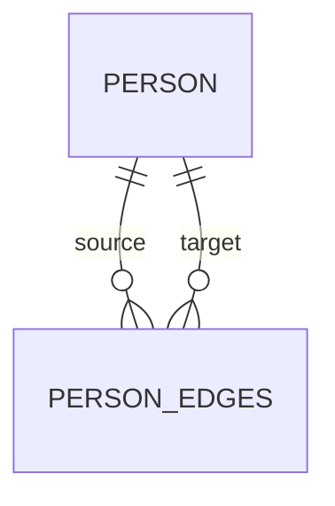

# findPaths

`findPaths` searches for paths in a graph structure. The entity static method `findPaths` returns a `Promise` — `await` it directly; `findPaths$` returns an `Observable` that pushes new results when the graph changes.

## Graph diagram



## Signature

```ts
findPaths(options: FindPathsOptions<T>): Promise<GraphQueryResult<GraphPath<T>>>
findPaths$(options: FindPathsOptions<T>): Observable<GraphQueryResult<GraphPath<T>>>
```

## Query options

| Option      | Meaning                                         |
| ----------- | ----------------------------------------------- |
| `fromId`    | Source node id, required                        |
| `toId`      | Target node id, required                        |
| `direction` | `'in' \| 'out' \| 'both'`, defaults to `'both'` |
| `maxDepth`  | Maximum search depth, defaults to `10`          |
| `where`     | Node filter along the path                      |
| `edgeWhere` | Edge filter along the path                      |

## `maxDepth` normalization

- Defaults to `10`
- Values below `1` are normalized to `1`
- Values above `100` are clamped to `100`

## Return semantics

- Returns all acyclic paths
- Each path contains `nodes`, `edges`, `length`, and `totalWeight?`
- Results are ordered by path length first; equal lengths are ordered by total weight

## Basic usage

```ts
const paths = await Person.findPaths({
  fromId: alice.id,
  toId: bob.id,
  direction: 'out',
  maxDepth: 5
});
```

## Edge filtering

```ts
const paths = await Person.findPaths({
  fromId: alice.id,
  toId: bob.id,
  edgeWhere: {
    weight: { max: 10 },
    properties: { category: 'road' }
  }
});
```

## See also

- [findNeighbors](./findNeighbors.md)
- [countNeighbors](./countNeighbors.md)
